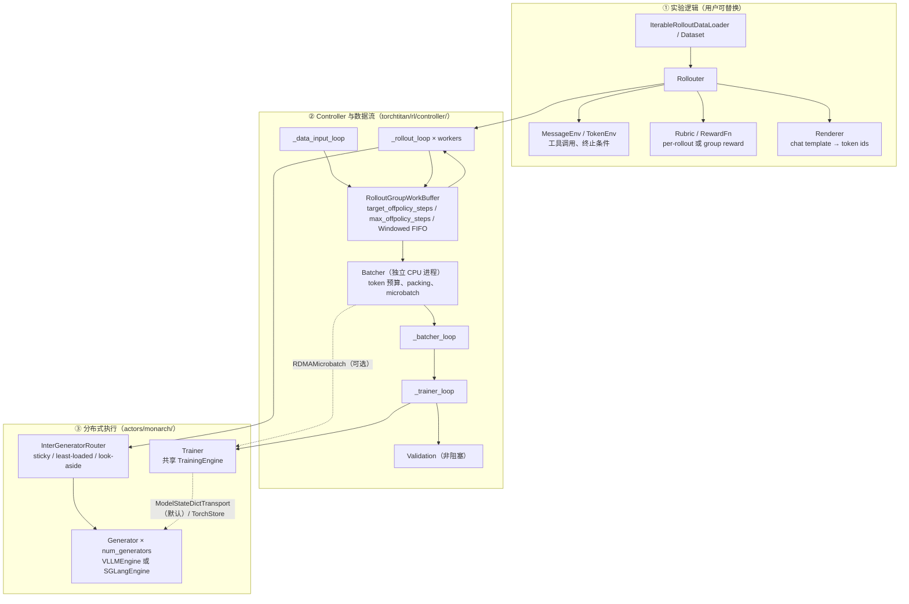
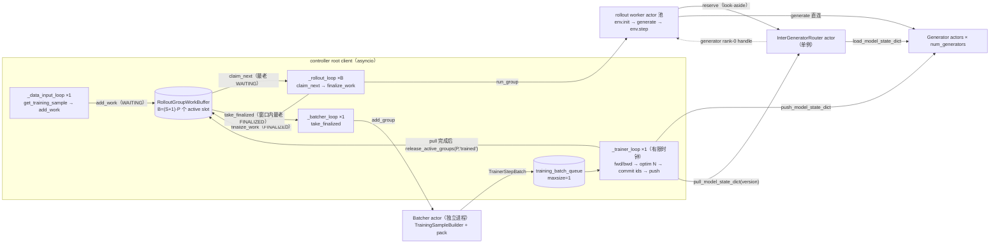
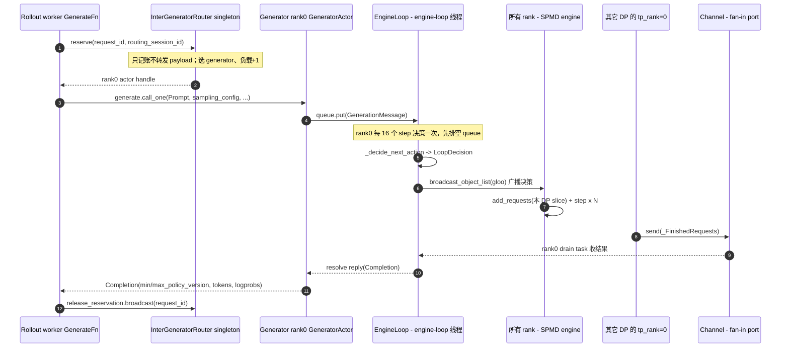
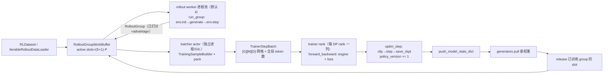
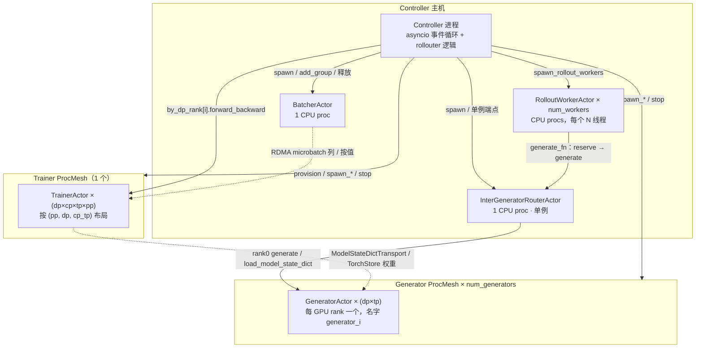

# TitanRL 调查报告：PyTorch 原生 RL 栈的动机、特色、演进与逐模块剖析

> 调查对象：`pytorch/torchtitan` 仓库的 `torchtitan/rl/`（项目名 **TitanRL**），快照 commit `bbc948206`（2026-11-20）。
> 方法：静态代码阅读（142 个文件、约 2.65 万行 Python）+ `git` 历史考据（457 个提交、455 个 PR，2025-11-07 至 2026-11-20）+ 官方文档/博客/PR 描述的外部核对。报告中的代码引用以 `path:line` 标注（未写全路径的沿用所在章节开头的约定），提交以 `#PR（日期，hash）` 标注。

> **代码引用约定**：各章 `path:line` 的解析基准不同——第 6、7、9 章默认相对 `torchtitan/rl/`（省略包名时按角色包补全，如 `controller.py` → `torchtitan/rl/controller/controller.py`、`vllm/engine.py` → `torchtitan/rl/generator/vllm/engine.py`）；第 8 章相对 `torchtitan/rl/generator/`（两份 md 除外，均在 `torchtitan/rl/`）；第 11 章的 `data.py`/`env.py`/`rubric.py` 相对各自 example 目录，配方文件指 `torchtitan_recipes/rl/` 下的同名文件；第 12 章与第 6 章中 `tests/` 开头的引用相对仓库根；CI 文件均在 `.github/workflows/` 下。全书 665 处引用已按上述约定用脚本校验：可解析的路径均存在、行号均在文件范围内。

**目录**

- 第 1 章 速览
- 第 2 章 动机：外部语境与公开证据（TitanRL 的公开表述、两条背景线、算法/框架背景、关键 PR 动机）
- 第 3 章 特色：六个设计承诺与它们的代价
- 第 4 章 架构总览：三层结构与一条训练步的生命周期
- 第 5 章 历史演进：从"确定性 RL 实验"到 PyTorch 官方 RL 栈（9 个阶段）
- 第 6 章 模块剖析：Controller、Routing 与 Observability
- 第 7 章 模块剖析：Generator 核心（服务/引擎循环/调度/权重传输）
- 第 8 章 模块剖析：推理后端 vLLM 与 SGLang
- 第 9 章 模块剖析：Trainer 与 Rollout（从样本到梯度）
- 第 10 章 模块剖析：Actor 系统、进程拓扑与运行入口
- 第 11 章 案例（一）：AlphabetSort、DAPO Math 与 Search-R1
- 第 12 章 案例（二）：Geometry3K、SLAKE、Verifiers 与 Terminal-Bench
- 第 13 章 工程文化、局限与未来 + 附录 A（提交速查）/ B（调查方法与数据）/ C（术语表）

## 第 1 章 速览

**一句话**：TitanRL 是 torchtitan 仓库内、用 PyTorch 原生方式实现的 RL（后训练）栈——它把训练用的同一份 TorchTitan 模型搬进 vLLM/SGLang 做 rollout，用异步流水线把"生成"与"训练"解耦，并把"训练/推理数值逐位一致"当成一等功能，而不是碰运气。

**它想解决的三个问题**

1. **两份模型、两套 kernel 的裂缝**。绝大多数 RL 栈（VERL、OpenRLHF 等）训练用一份模型实现、rollout 用另一份（通常是 HF/vLLM 自带实现）。两边 attention、RoPE、MoE 路由、归约顺序各自演化，导致同一条 token 的 logprob 在生成端与训练端不一致；异步 RL 又用重要性比值同时承担"staleness 修正"，于是"奖励不涨"到底该怪算法还是怪数值，无法归因。TitanRL 的答案是**统一模型 + 可选的 batch-invariant 模式**，让这条裂缝在支持的配置下消失。
2. **RL 基础设施与研究迭代的耦合**。新模型/新 kernel 若要在训练与推理各实现一遍，架构研究就被工程成本拖住；TitanRL 让推理引擎只接管 KV cache 与调度，模型与 kernel 复用训练侧代码。
3. **同步 RL 的 GPU 空泡**。rollout 与训练严格串行时，两侧 GPU 轮流空闲；TitanRL 用 work buffer + 有界 off-policy（`target_offpolicy_steps` / `max_offpolicy_steps` / Windowed FIFO）把利用率与"策略新鲜度"变成可调参数，`target_offpolicy_steps=0` 退化为同步执行。

**六个设计支柱**（详见第 3 章）：统一模型定义；batch invariance / 逐位可复现；异步 rollout 与有界 off-policy；处处可替换的扩展点（Env/Rubric、推理引擎、actor 框架、loss、batcher）；与预训练共享同一个 `TrainingEngine`；trainer/generator 可独立扩缩容（含多 generator、TMDS/RDMA 权重同步）。

**三个"可感知"的数字**（均来自 commit body，可追溯）：

| 指标 | 变化 | 出处 |
|---|---|---|
| TorchStore GPU-direct 权重同步 | 21.25 s → 0.067 s（约 317×） | #2525（2026-03-18） |
| `ModelStateDictTransport` 拉取 14B 权重（8×B200） | 10–13 s → 0.6–0.9 s（单边 RDMA ~60 GB/s/rank） | #5996（2026-11-13） |
| LoRA RL 每次权重同步（Qwen3.5-27B，rank 32） | 约 54 GB → 38 MB | #5844（2026-11-12） |

**正确性的数字**：batch-invariant 模式下，Search-R1（Qwen3-8B，8×H100，TP2/TP2）的 `kl_div` 与 `logprob_diff` 从最大 0.0084 / 1.56 变为 **0 / 0**；代价是原始计算慢 2.4–2.9×，但该工作负载的端到端 wall-clock 仅约 1.0×（因为瓶颈在 rollout 编排而非算力）——详见 `torchtitan/rl/BITWISE_PARITY.md` 的实测表。

**覆盖范围**（当前 HEAD）：模型支持 Llama 3、Qwen 3/3.5/3.6/3.8、GPT-OSS、Muse Glimmer、Muse Spark（文本+图像）、DeepSeek V3、Kimi K3（SM90+）；推理引擎 vLLM（主力）与 SGLang（官方替代后端）；图像提示全链路与 LoRA RL；示例包括 AlphabetSort、DAPO Math、Search-R1、Geometry3K、SLAKE、Verifiers（DAPO + Terminal-Bench）。

**边界与风险**（详见第 13 章）：逐位一致要求 trainer 与 generator 的 TP 度相同、且不支持序列并行；vLLM/SGLang 均以"钉死版本 + 私有 API + 显式失败"的方式集成；SGLang 仍是实验性后端；公开材料没有 TitanRL 与 VERL/OpenRLHF 的同口径横向 benchmark。

**怎么读这份报告**

- 关心"为什么值得做"→ 第 2 章（外部动机）、第 3 章（设计承诺与代价）；
- 关心"系统长什么样"→ 第 4 章（架构总览），再按需读第 6–10 章（模块剖析）；
- 关心"怎么长成今天这样"→ 第 5 章（历史演进，含 9 个阶段与 40+ 关键 PR）；
- 关心"能拿它做什么实验"→ 第 11–12 章（7 个案例的引入动机、机制与有趣点）；
- 关心"能不能上生产"→ 第 13 章（工程文化、局限与未来方向）。


---

## 第 2 章 动机：外部语境与公开证据

本节只整理可核实的外部材料：PyTorch 官方博客、DevLog、会议回顾、vLLM 团队联合博客、两篇方法学博客、关键 PR 动机描述与 RL 算法/框架论文。凡是公开资料没有明说的，文中直接写明"公开资料未明确说明"，不做推断性归因。

### 1. TitanRL 的公开表述

公开时间线可以串成一条清晰的演进链，每一步都有原始材料：

- **2025 年 11 月 10 日**，vLLM 与 TorchTitan 团队联合发布博客《No More Train-Inference Mismatch: Bitwise Consistent On-Policy Reinforcement Learning with vLLM and TorchTitan》，展示以 TorchTitan 为训练引擎、vLLM 为推理引擎、Qwen3 1.7B 的按位一致 on-policy RL（[链接](https://vllm-project.github.io/2025/11/10/bitwise-consistent-train-inference.html)）。这篇博客的结论部分已经直接点出了"统一模型"的必要性：即便数值已经对齐，"训练和推理各有一份模型代码"仍然"fragile for long-term maintenance"，任何一侧的改动都会破坏按位等价，因此"having a shared model code for both training and inference frameworks"才能消除人为引入不一致的可能。这可视作 TitanRL"一份模型定义"设计目标的公开起点。
- **2026 年 5 月 6 日**，PyTorch DevLog 发布《torch.compile for TorchTitan RL: 6x Faster Unified RL Training》，报告 Qwen3 0.6B 上端到端 6 倍加速（446s→70s），并明确写出它与第三方框架的差别："Most RL frameworks (Verl, OpenRLHF, etc.) maintain separate model definitions for training vs. inference"，而 TorchTitan RL 在 Trainer 与 Generator（vLLM）之间共用一份模型定义，因而可以共享编译产物（[链接](https://docs.pytorch.org/devlogs/distributed/2026-05-06-torchcompile-torchtitan-rl/)）。
- **2026 年 8 月**，torchtitan 仓库 README 的新闻条目正式给出 TitanRL 的一句话定位："TitanRL is a hackable RL stack for scaling and debugging. It reuses TorchTitan model definitions and kernels across training and vLLM generation and supports batch-invariant mode."（[README@bbc94820](https://github.com/pytorch/torchtitan/blob/bbc94820612e2d4a062646c2e3bc6d816f7224f4/README.md)）。
- **2026 年 10 月 21 日**，PyTorch 官方博客《TorchTitan Update: New SOTA Models, Performance at Scale, TitanRL》给出最完整的一段动机表述："Many RL stacks keep separate training and inference implementations of the model. Architecture changes have to stay aligned across both, and when a run goes sideways it is hard to tell whether the culprit is your reward, your algorithm, or the two copies quietly disagreeing. TitanRL keeps the same model from pretraining, post-training to inside vLLM, so you can do your work in one codebase."（[链接](https://pytorch.org/blog/torchtitan-update-new-sota-models-performance-at-scale-titanrl/)）。同一篇博客还把 batch-invariant 模式定位为"排除一类噪声源"的调试工具，并提到"a recent study with the TorchTitan team uses it to examine numerical mismatch in math and terminal-agent RL"——这篇 study 很可能即下文的 GDN 博客（作者为 Yichuan Wang 与 TorchTitan 团队，覆盖 math 与 terminal-agent 负载）。
- **2026 年 10 月 20–21 日**，PyTorch Conference North America 2026 在圣何塞举行，官方回顾博客把 TitanRL 列为主发布项之一："TorchTitan expanded model support across its 5D parallelism stack and introduced reinforcement learning through TitanRL. TitanRL keeps the same model implementation across pretraining, post-training, and execution inside vLLM, with asynchronous rollouts and multiple forms of parallelism for training and generation."（[链接](https://pytorch.org/blog/pytorch-conference-north-america-2026-accelerating-open-intelligence-together/)）。
- 仓库内的 TitanRL README 把上述主张收束为三条："Unified model definition"、"Batch invariance"、"One stack from pretraining to post-training"，并主动写明代价：统一模型在纯推理负载上可能落后原生 vLLM，batch invariance 是以吞吐换精确数值（[TitanRL README@bbc94820](https://github.com/pytorch/torchtitan/blob/bbc94820612e2d4a062646c2e3bc6d816f7224f4/torchtitan/rl/README.md)）。

补充说明：未检索到 TitanRL 的独立发布页或演讲录像；上文那篇（主题为 torch.compile）是唯一相关的官方 DevLog。

### 2. 核心动机的两条背景线

#### 2.1 训练/推理数值不一致：线性注意力与异步 RL

Yichuan Wang 与 TorchTitan 团队合作的博客《Defending Against the Training–Inference Numeric Mismatch in RL (Especially Linear Attention) — and Whether It Helps Async RL》（2026 年 8 月，[链接](https://yichuan-w.github.io/blog/GDN-train-inference-mismatch-asyncRL/)）给出了问题设定：LLM RL 天生跨两个引擎，训练在一个栈里（Megatron/TorchTitan/FSDP），rollout 在另一个栈里（SGLang/vLLM），两者的 kernel、matmul 分块、attention 实现与规约顺序都不同；于是同一条 token 在生成端记录的 logprob μ 与训练端重算的 π 不一致，这种"纯基础设施"的差异被当成 RL 信号里的噪声，使"到底是算法问题还是精度问题"无法判断。作者进一步指出两个加剧因素：一是前沿模型不再使用普通二次注意力，线性注意力（如 GDN）把上下文压进固定大小的递归状态，训练/预填常用 chunked kernel 而解码用 recurrent kernel——两者是**两种不同算法**，天然不按位相等，且作者称此前没有开源栈对线性注意力做到 train/inference KL=0；二是异步 RL 用重要性比值 exp(π−μ) 同时承担"staleness 修正"与"数值误差"，两类 mismatch 被混为一谈。结论是：改用 recurrent kernel 统一前向、只在反向保留 chunked kernel，再配合 num_splits=1 与 batch-invariant GEMM，可以让 step 0 的 logprob gap 恰为 0，并把宽 off-policy 窗口下不受控增长的 gap 压住；但代价是 2–3 倍 trainer 吞吐损失（终端 agent 工作负载约 5 倍），且三个工作负载中有两个看不出精度收益，因此作者把它定位为"a debugging tool, not a production default"。

#### 2.2 LLM 推理不确定性：batch invariance

Thinking Machines 的 Horace He 等《Defeating Nondeterminism in LLM Inference》（2025 年 9 月，[链接](https://thinkingmachines.ai/blog/defeating-nondeterminism-in-llm-inference/)）回答的是更底层的问题：为什么连 temperature=0 的贪婪解码在 API 上也不可复现。文章先否定流行的"并发+浮点"解释（同一 matmul 重复执行仍逐位相同），指出真正的元凶是 kernel 缺乏 **batch invariance**：cuBLAS/归约 kernel 会按输入形状选择 tile 与 split-K 策略，归约顺序成为"形状的属性"而非"数学的属性"；推理服务的并发负载天然波动，batch 组合随之变化，单个请求的数值就随之漂移。证据很直接：Qwen3-235B 上对同一 prompt 采 1000 条 temperature=0 的补全，得到 80 种不同结果（首个分歧出现在第 103 个 token）；`mm(a[:1])` 与 `mm(a)[:1]` 的最大差异达 1669.25。给出的解法是让 RMSNorm、GEMM、attention 都批量不变（固定规约顺序、attention 采用固定 split size 而非固定 split 数），并通过 `torch.Library` 在 vLLM 上替换算子。结论落到 RL 上：训练与推理的数值差异会把"on-policy RL"事实上变成 off-policy RL，因此确定性推理是"true on-policy RL"的前提；他们实现了 sampler 与 trainer 之间 KL 恒为 0。原文的 1000 条序列对比中，vLLM 默认耗时 26 秒，未优化的确定性版本 55 秒，改进 attention kernel 后 42 秒，即"性能可用但不免费"。

#### 2.3 TitanRL 的 batch-invariant 模式如何回应

仓库中的 [BITWISE_PARITY.md](https://github.com/pytorch/torchtitan/blob/bbc94820612e2d4a062646c2e3bc6d816f7224f4/torchtitan/rl/BITWISE_PARITY.md) 把问题写得很具体：生成端按一种 batch 组成（如 8 条补全）算 logprob，训练端在切分 DP 后按另一种组成（如 2 条）重算，GEMM、softmax、归约与集合通信的累加顺序不同就会产生差异；对 MoE 模型，"even tiny drift can flip top-k expert routing"，所以两条路径必须逐算子对齐。TitanRL 的做法是：`DebugConfig(batch_invariant=True, deterministic=True)` 同时作用于 trainer 与 generator，统一替换 `mm`/`addmm`/`_log_softmax`/`mean.dim` 为上游 [batch_invariant_ops](https://github.com/thinking-machines-lab/batch_invariant_ops) 的 Triton kernel；把 FA3 的 `num_splits` 强制为 1；把 NCCL 归约固定为单通道 tree；关闭 TF32 与 BF16/FP16 低精度归约；在 vLLM 侧把 attention 路由回 trainer 使用的同一 kernel（varlen/Flex/GPT-OSS 各有对应补丁），FlexAttention 固定 `BLOCK_M=BLOCK_N=16`。结果是在支持的配置下，不同数据并行布局得到**逐位相同**的 logprob，从而让 on-policy 训练中的"奖励变了"可以直接归因于算法或数据。公开材料也给了这条路线一个诚实边界：GDN 研究测到它带来 2–3 倍（终端 agent 约 5 倍）trainer 吞吐代价，且精度收益依配置而异，因此其公开定位是调试与受控研究工具，而不是默认生产配置。

### 3. 算法与框架背景（简短）

- **GRPO**（DeepSeekMath，[arXiv:2402.03300](https://arxiv.org/abs/2402.03300)）：提出 Group Relative Policy Optimization，用同一 prompt 下组内采样的相对奖励估计基线，去掉与策略等大的 critic/value 网络，降低 RL 训练的内存与计算开销。
- **DAPO**（[arXiv:2503.14476](https://arxiv.org/abs/2503.14476)）：面向大规模 LLM RL 的开源算法与系统，提出 Decoupled Clip（Clip-Higher）、动态采样、token 级策略梯度损失与超长奖励塑形四项技术，在 Qwen2.5-32B 上把 AIME 2024 做到 50 分，且训练代码构建在 verl 之上。
- **Search-R1**（[arXiv:2503.09516](https://arxiv.org/abs/2503.09516)）：让 LLM 在多步推理中自主发起（多轮）检索查询，用带 retrieved-token masking 的 RL 与简单结果奖励训练，在七个问答数据集上报告 41% 的性能提升，是"搜索 agent"类 RL 的代表性工作。
- **VERL**（HybridFlow，[arXiv:2409.19256](https://arxiv.org/abs/2409.19256)）与 **OpenRLHF**（[arXiv:2405.11143](https://arxiv.org/abs/2405.11143)）：前者以 single-controller 与 multi-controller 混合编程模型把训练框架与推理引擎编排成 RLHF 数据流，后者基于 Ray、vLLM、DeepSpeed 与 HF Transformers 提供易上手、可扩展的 RLHF/RLVR 框架。这类第三方栈的共同点是"训练框架 + 独立推理引擎"的组合式架构，模型定义在两侧各有一份——这也正是上文 TitanRL 官方材料对比的参照系。

TitanRL 与这些论文的关系是承载而非提出：仓库列出 GRPO 与 DAPO 两种 loss，并提供 DAPO Math、Search-R1 与 Verifiers 三个示例（[README@bbc94820](https://github.com/pytorch/torchtitan/blob/bbc94820612e2d4a062646c2e3bc6d816f7224f4/README.md)），说明它把自己定位为承载这些公开算法的"底座"。

### 4. 关键 PR 的动机摘录

抓取情况：18 个指定 PR（#1975、#2119、#2158、#2174、#2443、#2472、#2525、#3642、#3927、#4356、#4773、#5317、#5812、#5996、#5824、#6025、#5844、#6261）的标题、正文与合并时间经 GitHub REST API 获取（[pytorch/torchtitan pulls](https://github.com/pytorch/torchtitan/pulls)），其中 #1975、#2119 另用网页抓取核对了正文，**没有抓取失败项**。pytorch.org 与 yichuan-w.github.io 经 web 工具网关曾返回 404，改用直接 HTTP 请求取得全文。以下为最有价值的 7 条动机原句：

1. **#1975（确定性 RL 实验，2025-11-07）**："This experiment provides a complete framework for bitwise-deterministic reinforcement learning training that combines vLLM for fast rollouts and TorchTitan for training with gradients." —— 该实验提供了一个完整框架，把 vLLM 的快速 rollout 与 TorchTitan 的带梯度训练结合成按位确定的 RL 训练。（[PR #1975](https://github.com/pytorch/torchtitan/pull/1975)）
2. **#2472（非共置 trainer/generator，2026-03-05）**："While it's true that colocated trainer/generator is the fastest because you can drop and reload weights in the same memory, it requires smaller models and usually necessitates that the sharding strategy between trainer and generator is the same. These are significant limitations for training RL at scale, so we should pursue the harder and more realistic option: non-colocated." —— 共置虽快，但要求模型更小、且两侧分片策略一致，这是大规模 RL 训练的实质限制，所以应走更难但更现实的非共置路线。（[PR #2472](https://github.com/pytorch/torchtitan/pull/2472)）
3. **#3927（window FIFO 调度，2026-07-25）**："Strict FIFO gives the strongest freshness guarantee, but it also creates head-of-line blocking: one slow rollout group at the front of the buffer can prevent newer finalized groups from being trained, even when those groups are still within the allowed offpolicy budget." —— 严格 FIFO 的新鲜度保证最强，却会造成队头阻塞：一个慢 rollout 组会挡住后面已完成的组，即使它们仍在允许的离策略预算内。（[PR #3927](https://github.com/pytorch/torchtitan/pull/3927)）
4. **#4773（共享训练引擎、RL 转正，2026-09-17）**："The idea is that trainer and generator could be adopted by others independently without monarch." —— 设计意图是让 trainer 与 generator 可以脱离 Monarch 被他人独立复用。（[PR #4773](https://github.com/pytorch/torchtitan/pull/4773)）
5. **#5317（generator 分层、引入 GenerationEngine 接口，2026-10-17）**："That makes each part hard to read in isolation and ties the generator to vLLM. This PR splits the file along those lines and puts the inference engine behind an interface, so a second engine (e.g. SGLang) can be added as another GenerationEngine without touching the generator, the engine loop or the dispatcher." —— 原实现把三种职责混在一个 1860 行的类里并绑定 vLLM；本 PR 按职责拆分，把推理引擎放到接口之后，使新增第二个引擎（如 SGLang）无需改动 generator、engine loop 或 dispatcher。（[PR #5317](https://github.com/pytorch/torchtitan/pull/5317)）
6. **#5812（SGLang 引擎，2026-11-10）**："SGLang's scheduler (radix prefix cache, overlap scheduling, breakable prefill CUDA graphs, session-referenced KV, host KV offload) is a strong fit for RL rollouts, especially multi-turn agentic ones. ... As with VLLMEngine, SGLang runs the trainer's TorchTitan model and attention kernel; it owns only KV cache management and scheduling." —— SGLang 的调度器特性很适合 RL rollout，尤其多轮 agent；与 vLLM 引擎一样，SGLang 运行 trainer 的 TorchTitan 模型与 attention kernel，只负责 KV 缓存管理与调度。（[PR #5812](https://github.com/pytorch/torchtitan/pull/5812)）
7. **#5996（ModelStateDictTransport，2026-11-13）**："RL syncs the trainer's model state dict to the generators through TorchStore, which adds a store, controller and extra copies around the transfer. With 14B on one 8xB200 host (trainer FSDP 4, generator TP 2, NIXL) a TorchStore pull takes 10-13 s (2.3-3.0 GB/s); with this transport the same pull takes 0.6-0.9 s (RDMA read at ~60 GB/s per generator rank)." —— 权重同步是 RL 循环的关键路径；把权重同步改为基于 `torch.distributed._transport` 的单边 RDMA 读后，同一 14B 拉取从 10–13 秒降到 0.6–0.9 秒。（[PR #5996](https://github.com/pytorch/torchtitan/pull/5996)）

### 5. 小结：相对第三方 RL 栈的公开定位差异

**有公开证据支持的三点差异：**

1. **模型定义统一**：TitanRL 让 trainer 与 vLLM/SGLang 共用 TorchTitan 的模型定义与 kernel，推理引擎只保留 KV 缓存管理与调度（[TitanRL README](https://github.com/pytorch/torchtitan/blob/bbc94820612e2d4a062646c2e3bc6d816f7224f4/torchtitan/rl/README.md)、[PR #5812](https://github.com/pytorch/torchtitan/pull/5812)）；官方 DevLog 明确把 Verl/OpenRLHF 描述为"训练与推理各持一份模型定义"的框架（[DevLog 2026-05-06](https://docs.pytorch.org/devlogs/distributed/2026-05-06-torchcompile-torchtitan-rl/)）。这是公开材料中最直接的定位区分。
2. **数值可复现是一等功能**：batch-invariant 模式、逐位 trainer/generator logprob 对齐及配套测试与文档，是 TitanRL 的公开卖点（[PyTorch 博客](https://pytorch.org/blog/torchtitan-update-new-sota-models-performance-at-scale-titanrl/)、[BITWISE_PARITY.md](https://github.com/pytorch/torchtitan/blob/bbc94820612e2d4a062646c2e3bc6d816f7224f4/torchtitan/rl/BITWISE_PARITY.md)）；官方措辞始终把它定位为"调试与受控实验"工具，并承认以吞吐换数值。
3. **一个栈覆盖预训练到后训练**：TitanRL 复用同一套模型定义、kernel 与训练组件（[README](https://github.com/pytorch/torchtitan/blob/bbc94820612e2d4a062646c2e3bc6d816f7224f4/README.md)），这与第三方栈"外挂推理引擎"的组合方式不同；#4773 把 `torchtitan/experiments/rl/` 提升为 `torchtitan/rl/`，也说明其在官方路线中已从实验转为正式组件。

**公开资料未明确说明的部分：** 没有找到 TitanRL 与 VERL/OpenRLHF 在同一硬件、同一算法、同一模型上的吞吐或收敛对比数据；官方材料也没有声称 TitanRL 在功能或性能上全面优于第三方栈。相反，TitanRL README 自承统一模型在纯推理负载上可能落后原生 vLLM、batch invariance 会牺牲吞吐，GDN 研究进一步显示其精度收益依配置而异（[GDN 博客](https://yichuan-w.github.io/blog/GDN-train-inference-mismatch-asyncRL/)）。因此，把 TitanRL 读作"面向 PyTorch 原生、可 hack、数值可复现的 RL 研究底座"是有证据的；把它读作"第三方 RL 框架的性能替代品"则超出了目前公开材料的支持范围。


---

## 第 3 章 特色：六个设计承诺与它们的代价

> README 把卖点写成三条（统一模型、batch invariance、一个栈贯穿预训练到后训练）。但读完约 2.6 万行代码与 457 个提交后，更准确的说法是**六个承诺**——每个承诺都对应明确的机制、可验证的证据，以及被写进文档/commit 的代价。

### 3.1 承诺一：统一模型定义——模型与 kernel 只实现一次

**机制**。trainer 与 generator 使用同一个 TorchTitan `Decoder` 定义；generator 侧只把 attention 的"数据面"换掉：`build_inference_model` 构建并冻结模型，`ModelStateDictLoader` 把 HF 权重按 TorchTitan 布局加载一次，随后逐 FSDP group 原地写回（已捕获的 CUDA graph 因此保持有效）；attention 计算仍调用训练侧同一 kernel（varlen FlashAttention、GDN/KDA 的 paged kernel）。vLLM 侧通过 `CUSTOM` attention backend 把 TorchTitan 的 `VarlenInnerAttention` 接进 vLLM 的 paged KV/metadata；SGLang 侧注册 `torchtitan_varlen` backend，只覆写 kernel 入口。推理引擎真正拥有的只有 KV cache 管理与调度。

**证据**。#2174 首次让同一 `Qwen3TorchTitanForCausalLM` 同时用于训练（换 `VLLMCompatibleFlashAttention`）与推理（换 `VLLMAttention`）；#5317 的 commit body 写明"as with `VLLMEngine`, SGLang runs the trainer's TorchTitan model and attention kernel; it owns only KV cache management and scheduling"；#5811 把模型构建、权重加载、paged attention 抽到引擎无关层，使 SGLang 可以在一天内补齐整组功能（#5812–#5819）。

**代价**。统一模型在纯推理负载上可能落后原生 vLLM（README 自述）；"统一"并非字面意义的 100%——注意力模块与少量 wrapper 仍按引擎适配，`HF weights → TorchTitan layout` 的转换必须正确，且 MoE/MLA/GDN 等复杂结构需要额外的布局校验与 parity 测试。

### 3.2 承诺二：batch invariance——把"数值噪声"变成可排除项

**机制**（详见 `torchtitan/rl/BITWISE_PARITY.md`）。同一输入在生成端（8 条补全一批）与训练端（DP 切分后 2 条一批）的批组成不同，GEMM/softmax/归约/集合通信的累加顺序随之不同；MoE 模型里"even tiny drift can flip top-k expert routing"。TitanRL 用 `DebugConfig(batch_invariant=True, deterministic=True)` 同时约束两侧：

- 共享算子替换：`mm`/`addmm`/`_log_softmax`/`mean.dim` 换成固定 tile 迭代顺序的 Triton kernel；FA3 强制 `num_splits=1`；NCCL all-reduce 固定为单通道 tree（`NCCL_ALGO=allreduce:tree`、`NCCL_MAX_NCHANNELS=1`）；关闭 TF32 与 BF16/FP16 低精度归约；
- generator 专属补丁：把 vLLM 的融合 attention / sampler 路由回 trainer 的算子（varlen/Flex/GPT-OSS 各有路径），v2 sampler 的融合 logprob 换成 trainer 的 `compute_logprobs`；
- RoPE 的 `freqs_cis` 保持 fp32（FSDP `cast_forward_inputs=False`），否则每个 FSDP 边界都会把它 cast 成 bf16；
- 精度前提：两侧都必须是 bf16 计算；trainer 用 FSDP mixed precision（fp32 master + bf16 forward）与 generator 的 bf16 对齐。

**证据**。`#2683`（2026-04-06，相同并行度下的 batch invariance）→ `#2932`（FSDP 混合精度）→ `#2364` 起的 varlen 对齐 → 2026-08 的 Qwen3.5 统一路径（#3957）→ GPU 测试 `test_bitwise_parity.py` / `test_sglang_bitwise_parity.py`。

**代价**。原始计算慢 2.4–2.9×（Search-R1 实测），外部 GDN 研究甚至测到 trainer 2–3×、终端 agent 约 5× 的吞吐损失；且只在"TP 度相同、无序列并行"时成立。因此官方把它定位为**调试与受控研究工具**，而不是默认生产配置——但正是它让"奖励不涨"可以被二分：先排除数值，再谈算法。

### 3.3 承诺三：异步 rollout + 有界 off-policy

**机制**。Controller 内部是一组独立循环：数据加载 → rollout（可多个 worker/generator）→ 打包成 batch → 训练更新 → 推送权重。`RolloutGroupWorkBuffer` 以 rollout group 为单位连接生产者与消费者，容量由 `target_offpolicy_steps` 决定；`max_offpolicy_steps` 给出硬性新鲜度上界；Windowed FIFO 在不违反上界的前提下允许"有限超车"，避免一个慢组造成队头阻塞。每个样本记录产生它时的 `policy_version`，训练侧据此计算策略年龄（多轮样本取所有 turn 的最小 policy version）。路由层再叠加 sticky session（同一会话固定到同一 generator，复用 KV）与 look-aside（router 只负责 reserve，调用方直连 generator，避免 16K prompt 在 router 进程反复 pickle，约 320 µs/次）。

**证据**。#3642（2026-06-25，异步 RL 循环）的 commit body 有完整的数据流图与"buffer 容量 = `max_offpolicy_steps × groups_per_step`"的公式；#3927（Windowed FIFO）给出 `B=(S+1)P`、`W=P(M−S)+1` 的推导并引用 MiniMax 论文的调度章节；#4826 把窗口单位改成 batch；#5990 look-aside；#5217–#5220 会话生命周期与 KV 保持。

**代价**。off-policy 越深吞吐越高、但样本越旧；SLAKE 案例里把 `target_offpolicy_steps` 从 3 提到 7，trainer 等待从 14.6 s 降到 0.002 s、step 从 36.0 s 降到 24.0 s，代价是平均 policy age 从 1.4 升到 4.0——这是一个需要按任务调的旋钮，而不是免费午餐。

### 3.4 承诺四：处处可替换的扩展点

README 明确了一条设计原则："Examples should configure reusable components directly; they should define subclasses only when behavior is actually customized." 把代码翻一遍，这句话有很具体的落点：

| 扩展点 | 接口/配置 | 谁在用它 |
|---|---|---|
| 数据 | `IterableRolloutDataLoader.Config(dataset=...)` | 所有 example 的 `data.py` |
| 环境/工具 | `MessageEnv`（reset/step/tool 调用）、`TokenEnv` | Search-R1（search 工具）、Verifiers（外部环境） |
| 奖励 | `Rubric.Config(reward_fns=[...], weight=...)` | DAPO Math（Math-Verify）、SLAKE（同义词 EM） |
| rollout 执行 | `Rollouter` / `BaseRolloutWorker` / `MessageEnvRolloutWorker` | Search-R1、Verifiers 自定义 worker |
| 推理引擎 | `GenerationEngine`（`add_requests`/`step`/`has_unfinished_requests`/权重加载） | `VLLMEngine`、`SGLangEngine` |
| actor 框架 | `ActorSystem`（provision/spawn/stop） | `MonarchActorSystem`（默认） |
| 损失 | `losses/` 下的 GRPO/DAPO 与 `PolicyLoss.Config` | reference recipes |
| batch 打包 | `Batcher` 的 token/序列预算与 packing 策略 | DAPO 8K/32K、Terminal-Bench 长轨迹 |
| 权重同步 | `ModelStateDictTransport` / TorchStore / `model_state_dict_load_mode` | 大规模集群 vs 单机调试 |

**证据**。#5316 的 commit body 解释重组动机："旧结构按技术层分组，generator 的代码散落在 4 个目录里，没有明显的位置放第二个推理引擎（SGLang）或第二个 actor 框架（Ray）"；#5391 把 actor 放置抽象成 `ActorSystem`，"换框架 = 写一个新的 `ActorSystem` 子类 + 一组 adapter"。

**代价**。抽象层数多：一个 RL 配置要同时理解 `Controller.Config`、`Trainer.Config`、`Generator.Config`、`Rollouter.Config` 与 `ActorSystem.Config`；新读者容易在"哪一层负责什么"上迷路——这也是本报告第 4 章要解决的问题。

### 3.5 承诺五：一个栈贯穿预训练 → 后训练

**机制**。`torchtitan/training_engine.py` 的 `TrainingEngine` 被 core eager trainer 与 RL trainer 共享，拥有分布式模型执行、优化、checkpoint、profiling、GC、SDC replay、CUDA graph；RL 侧只保留自己的 weight push、整批数据接收与 controller 状态。#4773（2026-09-17，"Share the core training engine"）完成这次抽取，同时把 `experiments/rl` 升格为 `torchtitan/rl`。

**意义**。对用户：fork 一次 torchtitan，预训练/SFT/RL 共用模型定义、并行化、checkpoint 与 kernel，"one stack"不是口号而是同一批类；对上游：RL 的模型/kernel 改进（FA4、GDN、MLA、CUDA graph）会同时惠及预训练，反之亦然。

**代价**。RL 不再是"独立实验目录"，其改动会触碰 core（如 `TrainingEngine`、`apply_fsdp`、attention 元数据），对 review 与 CI 的要求更高；core 也不得反向依赖 RL-only 的可选依赖（README 把这写成硬规则）。

### 3.6 承诺六：系统层面的独立扩缩容

**机制**。trainer 与 generator 分别在独立的 GPU mesh 上：trainer 用 FSDP/TP/PP/CP/EP 的组合，generator 用 TP/DP/EP（vLLM 的 DP 与 SGLang 的 attention DP 两种表达）；两者不必同位、不必同并行度；generator 可以有多个（`num_generators`），router 在它们之间做 sticky/least-loaded 路由；权重通过 `ModelStateDictTransport`（单边 RDMA，默认）或 TorchStore 推送；rollout worker、batcher、router 都是 controller 主机上的独立 CPU 进程/actor。

**证据**。#2472（非共置）的 PR 描述直言"colocated 虽快但要求模型更小、两侧分片一致，是规模化 RL 的实质限制"；#3696 多 generator；#3980/#5424 trainer 的 PP/CP；#4838 generator 上的 FSDP；#5317/#5391 服务化。

**代价**。跨 mesh 通信与权重同步成为关键路径（正因如此才有 #2525、#4549、#5996 一连串优化）；拓扑组合爆炸，配置与排障复杂度上升；Monarch 成为默认的分布式胶水（可换，但目前只有一种实现）。


---

## 第 4 章 架构总览：三层结构与一条训练步的生命周期

TitanRL 的 README 把架构写成三层：**实验逻辑**、**Controller 与数据流**、**分布式执行**。这三层正好对应三种读者：做 RL 研究的人只碰第一层；做系统/数据流的人碰第二层；做分布式/推理的人碰第三层。本章先给全景，再给一次训练步的时序，最后给"要改某个东西该看哪里"的索引。

### 4.1 三层架构



三层的边界是"可替换性"：第一层用配置组合、几乎不用改框架代码；第二层是 Controller，负责调度与数据流；第三层把 standalone service（`Trainer`、`Generator`、`Batcher`、`RolloutWorker`、`InterGeneratorRouter`）放到进程上。README 把依赖方向写成硬规则："rollout domain components 不得依赖 Monarch 或 TorchStore，standalone services 不得依赖 Monarch，core TorchTitan 不得引入 RL-only 的可选依赖。"

### 4.2 包结构与职责

| 包 | 职责 | 关键类/文件 |
|---|---|---|
| `controller/` | 异步 rollout/training 主循环、有界 work buffer、controller 指标 | `Controller`、`RolloutGroupWorkBuffer`、`MetricsProcessor`、`WINDOWED_FIFO.md` |
| `trainer/` | 独立 trainer 服务、batch 打包、训练样本构造、损失、controller 状态 checkpoint | `Trainer`、`Batcher`、`TrainingSampleBuilder`、`losses/{grpo,dapo}.py`、`rdma_microbatch.py` |
| `generator/` | 独立 generator 服务、SPMD engine loop、请求分发、引擎接口、模型构建与权重加载、推理并行 | `Generator`、`EngineLoop`、`RequestDispatcher`、`GenerationEngine`、`ModelStateDictLoader` |
| `generator/vllm/`、`generator/sglang/` | 两个推理后端及其模型适配、attention 适配、CUDA graph、KV/session 管理 | `VLLMEngine`、`SGLangEngine`、`VLLMModelWrapper`、registry、`batch_invariance.py` |
| `rollout/` | rollout 执行、用户扩展 API、advantage、数据加载、rollout 记录、RL 数据类型 | `Rollouter`、`BaseRolloutWorker`/`MessageEnvRolloutWorker`、`MessageEnv`、`TokenEnv`、`Rubric`、`RolloutSampleRecorder` |
| `routing/` | 跨 generator 与 generator 内的请求路由 | `InterGeneratorRouter`、`IntraGeneratorRouter`、sticky/least-loaded 策略 |
| `actors/` | 与框架无关的 `ActorSystem` 接口 + Monarch 实现（薄适配层） | `ActorSystem`、`MonarchActorSystem`、`TrainerActor`/`GeneratorActor`/`BatcherActor`/`RolloutWorkerActor`、launcher |
| `observability/` | 类型化指标库与 console/后端日志 | `Metric`/`MetricValue`、`MetricsProcessor` |
| `examples/` | 数据集、环境、奖励、集成与完整 recipe | `alphabet_sort/`、`dapo_math/`、`search_r1/`、`geometry3k/`、`slake/`、`verifiers/` |
| 顶层 | 入口、环境默认值、权重传输、数值文档 | `train.py`、`generate.py`、`_env.py`、`model_state_dict_transport.py`、`BITWISE_PARITY.md`、`MODEL_STATE_DICT_TRANSPORT.md` |

训练侧与预训练/SFT 共享 `torchtitan/training_engine.py` 的 `TrainingEngine`（分布式模型执行、优化、checkpoint、profiling、CUDA graph），RL 只保留自己的权重推送、整批数据接收与 controller 状态。

### 4.3 一次训练步的时序

以"异步、一个 trainer、多个 generator"的典型配置为例（简化，省略错误处理与 validate）：

1. **取数据**。`Controller._data_input_loop` 等待 `RolloutGroupWorkBuffer` 有空位，用 `Rollouter` 从 `IterableRolloutDataLoader` 取一个训练样本，包装成 `RolloutGroupWork(group_id, sample)` 入 buffer；buffer 容量由 `target_offpolicy_steps` 与每步 group 数决定。
2. **产生 rollout**。`_rollout_loop`（或其 actor 化形态 `RolloutWorkerActor`）claim 一个 group，经 `InterGeneratorRouter` 选一个 generator（sticky/least-loaded，可 look-aside 直连），把 prompt 发给 `Generator`；`EngineLoop` 在 SPMD 引擎线程里把请求并入 vLLM/SGLang 的连续批处理；多轮场景下 `MessageEnv` 反复驱动 tool call 与下一轮生成，期间按 session 保持 KV。
3. **打分与回填**。`Rubric` 对每条 rollout 打分（可验证奖励/奖励模型/规则），`advantage.py` 做 group 归一化等处理；结果连同每 turn 的 token、logprob、`policy_version` 写回 buffer 中同一个 work 项。
4. **打包**。当 buffer 中已完成的 group 满足窗口条件，controller 的 `_batcher_loop` 让 `Batcher`（独立 CPU 进程）按 token 预算把多个 group 的样本 first-fit 打包成等 token 预算的 DP 列，切成可变数量的 microbatch，结果放入 `training_batch_queue`；可选的 RDMA microbatch 把 batch 从 batcher 进程直传 trainer。
5. **训练**。`_trainer_loop` 按 DP rank 调 `TrainerActor.by_dp_rank[i].forward_backward`：重算 logprob、计算 GRPO/DAPO loss、反向、optimizer step（`TrainingEngine` 执行）；完成后 `policy_version += 1`。
6. **权重同步**。trainer 把新的 model state dict push 到 transport（默认 `ModelStateDictTransport` 单边 RDMA；或 TorchStore），generator 在 engine loop 的安全点拉取并原地加载（drain 在途请求/重置 prefix cache 的语义由配置决定）。
7. **旁路**。验证（`ValidationConfig`）在训练旁异步跑；指标经 `MetricsProcessor` 每步 reduce 一次发往 console/W&B/TensorBoard；`RolloutSampleRecorder` 抽样写 `rollout_samples.jsonl`；结构化日志生成跨 actor 的 Gantt 时间线。

### 4.4 配置与依赖注入

TitanRL 没有用 Hydra/TOML：每个组件是 `Configurable`，自己的 `Config` 类型负责 build 自己（#2386 的配置系统重构）。配置以 Python 函数形式写在 recipe 模块里：

```python
# torchtitan_recipes/rl/dapo_math.py
def rl_dapo_qwen3_4b_math_8k() -> Controller.Config: ...
```

入口按模块名 + 函数名加载：

```bash
python -m torchtitan.rl.train \
  --module torchtitan_recipes.rl.dapo_math \
  --config rl_dapo_qwen3_4b_math_8k \
  --output-dir outputs/rl/qwen3_4b_dapo_math_8k_150
```

一个 `Controller.Config` 组合了：`rollouter`（数据、env、rubric、worker）、`renderer`、`trainer`（模型、并行度、loss、optimizer）、`generator`（模型、并行度、`engine` 类型、权重加载方式）、`actor_system`（默认 Monarch）、`model_state_dict_transport`（默认 TMDS）、`metrics` 等。trainer 与 generator 各自拥有一份模型配置（并行度不同），`build_rl_model_configs()` 用一次调用从同一个模型工厂构造两份，并按 role 应用 transform（例如给 generator 换 CUDA-graph 兼容的 MoE dispatcher）。

两个"按类型选择实现"的扩展点值得记住：`Generator.Config.engine` 的类型决定用 `VLLMEngine` 还是 `SGLangEngine`；`Controller.Config.actor_system` 的类型决定进程如何放置（默认 `MonarchActorSystem.Config()`，lazy import）。

### 4.5 部署拓扑

| 规模 | 典型配置 | 说明 |
|---|---|---|
| 单机调试 | 1–8 GPU，`target_offpolicy_steps=0`，debug 模型 | `torchtitan_recipes/tests/rl/alphabet_sort.py` 等；CPU 单测不需要 GPU |
| 单机 8 GPU 参考实验 | trainer TP=2（2 GPU）+ 6× TP=1 generator（6 GPU），DAPO Math 8K | trainer 与 generator 非同位，异步流水线 |
| 多机大规模 | trainer 8 GPU + 3×8 GPU generators（Muse Spark 816B-A42B SLAKE） | 32×GB300；LoRA + Dist-MoE + TMDS |
| 集群调度 | SLURM launcher（#5572）：launcher 申请 host、构造 `MonarchActorSystem(host_meshes=...)` | `actors/monarch/launcher/{base,slurm,submit}.py` |

进程/GPU 放置可以概括为：controller 主机上跑 controller 进程、`InterGeneratorRouterActor`、`BatcherActor`、若干 `RolloutWorkerActor`（都是 CPU 进程）；trainer 与每个 generator 各自是一个 GPU ProcMesh，**每个 GPU rank 一个 actor**；`TrainerActor.by_dp_rank[i]` 是一个覆盖 pp×cp×tp 的句柄集合，而不是"每个 DP rank 一个 actor"。

### 4.6 想改某处代码时看哪里

| 想做的事 | 起点 |
|---|---|
| 加一个新任务/环境 | `torchtitan/rl/examples/<name>/{data,env,rubric}.py` + `torchtitan_recipes/rl/<name>.py` |
| 改奖励或采样策略 | `rollout/rubric.py`、`rollout/advantage.py`、recipe 的 `SamplingConfig` |
| 改异步调度/off-policy 程度 | `controller/work_buffer.py`、`controller/controller.py`、`controller/WINDOWED_FIFO.md` |
| 改 batch packing/序列预算 | `trainer/batcher.py`、`trainer/training_sample_builder.py` |
| 换推理引擎或加第三个后端 | `generator/engine.py`（接口）、`generator/vllm/`、`generator/sglang/`、`Generator.Config.engine` |
| 改权重同步 | `model_state_dict_transport.py`、`MODEL_STATE_DICT_TRANSPORT.md`、`Generator.Config.checkpointer` |
| 换 actor 框架/加集群调度 | `actors/system.py`、`actors/monarch/`、`launcher/` |
| 调试数值不一致 | `BITWISE_PARITY.md`、`torchtitan/distributed/batch_invariant.py`、`generator/*/batch_invariance.py` |


---

## 第 5 章 历史演进：从"确定性 RL 实验"到 PyTorch 官方 RL 栈

> 本章结论先行：TitanRL 不是一次性设计出来的系统，而是 2025-11 至 2026-11 一年内、围绕四个反复出现的压力点（**数值正确性、解耦可扩展、端到端性能、能力覆盖**）持续重构的产物。它经历了三次"身份跃迁"：`experiments/deterministic_vllm_rl`（2025-11）→ `experiments/rl`（2025-12）→ `torchtitan/rl`（2026-09 正式命名为 TitanRL 并升格为一级目录），最后在 2026-10/11 完成"服务化 + 双推理引擎"的架构收敛。

### 1. 时间线总览

统计口径：`git log -- torchtitan/experiments/deterministic_vllm_rl torchtitan/experiments/rl torchtitan/rl`，截至 2026-11-20 共 **457 个提交、455 个 PR（#1975 → #6266）**，首末提交为 2025-11-07 与 2026-11-20。当前目录 **142 个文件、约 2.65 万行 Python**，另有 `tests/rl/` 下 58 个测试文件。

| 阶段 | 时间 | 提交数 | 主题 | 代表 PR |
|---|---|---|---|---|
| 0 起源 | 2025-11 ~ 2025-12 | 5 | 确定性 RL demo：vLLM 前向 + 手写反向、单卡 | #1975, #2119 |
| 1 多进程与统一模型 | 2025-12 ~ 2026-02 | 19 | Monarch 多进程、trainer/generator 共用 TorchTitan 模型、TP | #2158, #2174, #2165 |
| 2 组件化 | 2026-02 ~ 2026-03 | 49 | 配置系统重构、复用 TorchTitan 组件、非同位部署、TorchStore 权重同步 | #2386, #2443, #2472, #2525, #2618 |
| 3 系统骨架 | 2026-04 ~ 2026-05 | 50 | trainer/generator/controller 三大件重构、varlen packing、Batcher、指标与 TITO | #2985, #3001, #3073, #2906, #3347, #3391 |
| 4 异步与规模化 | 2026-06 | 68 | MessageEnv/Rubric/Renderer、多轮工具调用、异步 RL 循环、多 generator 路由 | #3453, #3602, #3593, #3642, #3583, #3735 |
| 5 性能与正确性 | 2026-07 ~ 2026-08 | 53 | Window FIFO、varlen CUDA graph、FA4、Qwen3.5 统一路径与 bitwise parity、spmd_types、RolloutWorker | #3927, #3893, #4012, #3957, #4085, #4310, #4145 |
| 6 升格与共享引擎 | 2026-09 | 61 | 升格 `torchtitan/rl`、抽出共享 `TrainingEngine`、NIXL、first-fit packing、RL 单测进 CI | #4773, #4549, #3938, #4889, #4908 |
| 7 服务化架构 | 2026-10 | 74 | 按角色重组包、generator 拆 service/loop/dispatcher/engine、ActorSystem 抽象、PP/CP、RDMA microbatch、loss 重设计 | #5277, #5316, #5317, #5391, #3980, #5424, #5285, #4582 |
| 8 双引擎与多模态 | 2026-11 | 94 | SGLang 后端、ModelStateDictTransport、图像提示与 LoRA RL、非阻塞验证、MoE/GDN/KDA/MLA kernel | #5812, #5996, #6125, #5824, #5825, #5844, #6025, #5228, #6261 |

按月提交数（可直观看出 6 月和 9–11 月三个爆发点）：

```
2025-11 ▏1
2025-12 ▏4
2026-01 ▏3
2026-02 ▏12
2026-03 ▏37
2026-04 ▏33
2026-05 ▏17
2026-06 ▏68   ← 异步 RL 循环 / 多轮 / MessageEnv
2026-07 ▏19
2026-08 ▏34
2026-09 ▏61   ← 升格为一级目录 + 共享 TrainingEngine
2026-10 ▏74   ← 服务化架构
2026-11 ▏94   ← SGLang / 多模态 / TMDS（仅 21 天）
```

### 2. 起源（2025-11 ~ 2025-12）：先解决"前向与后向对不上"

第一个提交 #1975（2025-11-07，Bram Wasti + Teja + Chien-Chin Huang）是一个名为 `deterministic_vllm_rl` 的实验，目标非常聚焦：**让 vLLM 生成的路由与 TorchTitan 训练的前向在 bit 级别一致，并且能对 vLLM 的 batch-invariant 算子求梯度**。

它的 README 写得很直白：vLLM 有确定性的 batch-invariant 前向，但没有反向；RL 需要"快推理 + 可训练"，所以实验做了三件事：

1. 用 vLLM 的 batch-invariant kernel 做前向；
2. 为 matmul/linear/RMSNorm/FlashAttention 手写反向（`batch_invariant_backward.py`）；
3. 提供 TorchTitan 与 vLLM 权重格式的双向转换（合并 gate/up 投影、`num_splits=1` 的确定性 FA）。

原始实现是**单卡**的，训练循环内直接把 vLLM 的 logprob 与 TorchTitan 重算的 logprob 做 `torch.equal` 断言。这个"用断言守护数值一致性"的基因一直保留到今天——只是从单卡断言演化为 CI 里的 `test_bitwise_parity.py`、`test_sglang_bitwise_parity.py` 以及 `BITWISE_PARITY.md`。

2025-12 起方向从"复刻 vLLM"转向"让 vLLM 直接跑 TorchTitan 模型"：

- #2119（2025-12-15）"Run vLLM inference using torchtitan model definition"——把 TorchTitan 的模型定义塞进 vLLM，目录迁到 `torchtitan/experiments/rl`；
- #2158（2025-12-22）"Multiprocess simple RL loop"——用 Monarch 把 trainer（DDP）与 generator（vLLM TP）拆成 actor，跑在多进程上；
- #2174（2025-12-23）"Support Trainer and Generator Unified Model"——同一份 `Qwen3TorchTitanForCausalLM` 同时用于训练与推理，训练时换 `VLLMCompatibleFlashAttention`，推理时换 `VLLMAttention`；TP=1 时训练与推理 bitwise 一致；
- #2165（2025-12-25）把统一模型扩展到 TP。

这一阶段确立了一个后来再未动摇的决定：**不为推理单独维护一份模型实现**。"trainer 与 generator 用同一份模型、同一套 kernel"从此成为 TitanRL 的核心卖点（README 第一条优势）。

### 3. 组件化（2026-02 ~ 2026-03）：从"实验脚本"到"TorchTitan 的一等公民"

2026-02 的配置系统重构 #2386（TOML → Python dataclass registry）扫清了复用 TorchTitan 组件的障碍。紧接着 #2443（2026-02-28）"Refactor simple RL loop with torchtitan components"把 RL 循环改为复用 TorchTitan 的并行化、checkpoint、metrics 等组件；但该版本有一个明确的强假设，commit body 写得很清楚：

> "the trainer and generator must have the same parallelism, and are collocated... We should be able to remove this constraint once we have more powerful weight sync."

这个 TODO 在两周内被解决：

- #2472（2026-03-05）支持非同位（non-colocated）trainer/generator；
- #2525（2026-03-18）把 TorchStore 的 GPU-direct RDMA 权重同步接进来。commit body 给出了一个极有说服力的数字：权重同步从 **21.25s → 0.067s（317×）**；
- #2618（2026-03-18）"Flatten rl directory"：删掉 `vllm_compat`、把 `unified` 目录拉平到 `rl/` 根下——正式放弃"兼容版模型"路线，只保留统一模型这一条路。

同期还完成了推理侧的关键基础设施：原生 PyTorch varlen attention（#2364）、trainer 侧 compile（#2568）、RL CI（#2300），以及 batch-invariant 模式在"相同并行度"下的验证（#2683，2026-04-06）。

这一阶段的本质是：**RL 代码开始"寄生"在 TorchTitan 的抽象上**（config、parallelism、checkpoint、metrics），而不是自带一套平行实现。这为 2026-09 的"共享 TrainingEngine"埋下伏笔。

### 4. 系统骨架（2026-04 ~ 2026-05）：三件套与"会生成的 batch"

4-5 月的关键词是"把 demo 拆成可复用的骨架"：

- #2985 / #3001 / #3073 连续重构 Trainer、Generator、Controller，并把 rollout 抽象成"以 Env 为中心"的循环；
- #2906（2026-04-15）varlen sequence packing：一次训练步把多条变长序列打成一条；
- #3347（2026-05-28）引入独立 Batcher：从"每步固定 global batch"改为"按 token 预算动态打包"，这是后续所有 packing 工作的起点；
- #3391（2026-05-18）TITO（token-in / token-out）generator：绕开 tokenizer/detokenizer 往返，让 generator 直接吃 token、吐 token；
- #3234 / #3237 建立跨 trainer/generator/controller 的 trace span 与指标；
- #3330 切到 vLLM v2 engine。

至此，一个 RL step 的链路已经和今天很像：数据 → rollout → 打分 → 打包 → 训练 → 权重同步。

### 5. 异步化与规模化（2026-06）：一个月 68 个提交，架构定型

6 月是第一个爆发点，也是"TitanRL 之所以是 TitanRL"的一个月：

- **用户扩展 API**：#3453 引入 `MessageEnv`、rollout types、`Rubric`、Renderer——把"环境/奖励/对话"从框架内部逻辑变成用户可组合的配置；
- **多轮工具调用**：#3593 连续批处理 generator + 多轮 rollout；#3602 带来 Search-R1 案例；#3582 用 AlphabetSort 取代 SumDigits 作为调试任务（并顺手清掉了旧任务）；#3581 加入 rollout logger；
- **异步 RL 循环**：#3642 把 Controller 改成多个独立 loop（数据、rollout、打包、训练）由 work buffer 连接，buffer 容量 = `max_offpolicy_steps × groups_per_step`，并明确"每步的 microbatch 数量是可变的"；
- **多 generator**：#3583 加入 `InterGeneratorRouter`，#3625 引入 sticky session 路由，#3696 支持多主机多 generator；
- **模型/并行覆盖**：#3687 GPT-OSS、#3236 vLLM wrapper 的 DP+EP、#3142 TP2EP；
- **可恢复性**：#3735 checkpoint + resume RL 训练循环；
- **大文件拆分**：#3451 把 `gypo.py` 拆成 `trainer.py` 与 `train.py`（`gypo` 是早期 GRPO 循环的内部代号/拼写遗留，此后不再出现）。

同月还完成了 Monarch 从 main 切到 stable（#3460）。到 6 月底，Controller、WorkBuffer、Rollouter、MessageEnv、Rubric、Router、Batcher 这些今天 README 里的名词已经全部就位——之后的工作主要是**让它们更快、更正确、覆盖更多模型与场景**。

### 6. 性能与正确性（2026-07 ~ 2026-08）：两个"硬指标"同时推进

7-8 月的工作可以概括为两条并行主线。

**性能**：

- #3927（2026-07-24）Window FIFO 调度：严格 FIFO 会 head-of-line blocking，一个慢 rollout group 挡住后面已完成的组；Windowed FIFO 在 `max_offpolicy_steps` 约束内允许有限"超车"。commit body 明确给出了公式：`B=(S+1)·P`、`W=P·(M−S)+1`，并引用了 MiniMax 论文的调度章节；
- varlen full CUDA graph（#3893）、FA4 varlen（#4012/#4012 前序）、Qwen3.5 统一路径（#3957，同时覆盖 bitwise parity、CUDA graph、TP+DP/EP）；
- #4310 把 rollout 执行从 controller 进程搬到独立 Monarch actor（rollout worker），动机是 controller 进程的 CPU 利用率/GIL 竞争；
- #4085 把 spmd_types 变为默认的 DTensor 布局后端。

**正确性**：

- batch-invariant 从"同并行度"扩展到 FSDP 混合精度（#2932）、NCCL tree all-reduce（#2994）等；
- 8 月 #4085/#4236 之后，generator 的 HF 权重转换改为 DTensor state dict adapter，避免布局转换带来的 silent 数值差异；
- #4356（2026-09）Verifiers 桥接、#4145 Muse Glimmer + Search-R1，标志"外部环境/第三方渲染器"进入官方支持范围。

8 月 8 日 #4086 是一个象征性节点：README 从"RL Training with TorchTitan and vLLM"改名为 **TitanRL**，并把卖点正式写成"unified model definition / batch invariance / one stack from pretraining to post-training"。

### 7. 升格与共享引擎（2026-09）：`experiments/rl` → `torchtitan/rl`

#4773（2026-09-17）是项目史上最大的一次结构变更，commit body 里的 "Human's note" 明确列出两件事：

1. 把 `TrainingEngine` 抽到 `torchtitan/training_engine.py`，**core eager trainer 与 RL trainer 共享**同一套分布式模型执行/优化/checkpoint/profiling/CUDA graph 逻辑；RL 侧只保留自己特有的 weight sync、整批数据接收、controller 状态；
2. `torchtitan/experiments/rl/` **毕业**为 `torchtitan/rl/`，并新增 code owners。设计原则也第一次被写清楚："trainer 与 generator 的 non-Monarch 实现放在 `torchtitan/rl/` 下，Monarch actor 薄封装放在 `distributed/actors/`，这样别人可以不用 Monarch 独立采用 trainer/generator。"

此后 9 月还完成了 NIXL 权重同步（#4549）、first-fit flat-token packing（#3938）、FIFO 窗口按 batch 计（#4826）、RL 单测进 CI（#4889）、用 Python 配置加载替换 Tyro CLI（#4908）。

### 8. 服务化架构（2026-10）：为"第二个引擎/第二个 actor 框架"预留位置

10 月是第二个爆发点（74 个提交），核心是三次"按可替换边界"的重组：

- #5277 仓库级重组（RL 依赖、文档、测试目录）；
- #5316 按角色重组 `torchtitan/rl/`：`controller/`、`trainer/`、`generator/`、`rollout/`、`routing/`、`actors/`。commit body 给出了直接动机：旧结构按技术层分组，generator 的代码散落在 4 个目录里，"没有明显的位置放第二个推理引擎（SGLang）或第二个 actor 框架（Ray）"；
- #5317 把 1860 行的 `VLLMGenerator` 拆成 `Generator`（服务）+ `EngineLoop`（线程/事件循环）+ `RequestDispatcher`（DP 分发）+ `GenerationEngine`（引擎接口），并引入 `VLLMEngine`；
- #5391 把 actor 放置抽象成 `ActorSystem`，Monarch 只是实现之一（`Controller.Config.actor_system`），动机与 #5317 完全对称。

同期还有：trainer 支持 PP（#3980）与 CP（#5424）、Dist-MoE 推理（#5046）、generator 上 FSDP（#4838）、RDMA microbatch（#5285）、batcher 独立进程（#5291）、loss 抽象重设计（#4582）、多轮 session 的 KV 保持与路由生命周期（#5217–#5220）、MLA（#5556）。

### 9. 双引擎与多模态（2026-11）：能力面的最后几块拼图

11 月（截至 11-21 已 94 个提交）同时推进四个方向：

- **SGLang 后端**：11-10 一天内落地 #5812–#5819 一整组（engine、MoE EP、sliding window、GDN、MLA、KDA），随后 #5853 full prefill CUDA graph、#5918 复用 rollout group 的 prompt KV、#5959 DeepEP/HybridEP、#6027 Mooncake KV 共享、#6143 attention DP+EP、#6261 unified memory。commit body 里 maintainer 明确表态：SGLang 是"official alternative engine"，不是一次性实验；
- **权重同步换挡**：#5996 引入 `ModelStateDictTransport`（one-sided RDMA），#5997 接入，**#6125 改为默认**。commit body 的实测数字：14B/8×B200 上 generator pull 从 10–13s 降到 0.6–0.9s；GB300 18 主机上 full-step 吞吐 630 → 743 tok/s；
- **图像提示与 LoRA RL**：#5824 让图像提示穿过 rollout 与 vLLM generator，#5825 让 trainer 真正在图像上训练并给出 Geometry3K recipe，#5844 让权重同步只传 LoRA adapter（Qwen3.5-27B 从 ~54GB/次降到 38MB/次），#6025 给出 Muse Spark 816B-A42B + SLAKE 的 LoRA GRPO recipe；
- **可用性**：#5228 非阻塞/周期性验证（Terminal-Bench 单次验证 >1h 曾让训练迟迟无法开始）、#6266 验证温度与 best-of-n、#5990 look-aside 路由（避免 router 进程对 16K token prompt 反复 pickle，约 320µs/次 CPU 开销）、#6033 拆 `BaseRolloutWorker`/`MessageEnvRolloutWorker`、#5511 把 Verifiers 组放进 rollout worker。

### 10. 演进规律与工程文化观察

从 457 个提交里可以提炼出几条稳定的"项目性格"：

1. **先有数值断言，再有系统**。项目起点是 `torch.equal(logprob_vllm, logprob_titan)`；每次引入新引擎/新 kernel（vLLM→SGLang、FA4、GDN/KDA、MLA），都会配套 batch-invariant 测试与 parity 文档，而不是事后补。
2. **重构由"下一个扩展点"驱动**。三次大拆分（#2618 拉平目录、#4773 升格+共享引擎、#5316/#5317/#5391 服务化）的 commit body 都写了同一句话式的动机："现在的位置放不下下一个 X（第二个后端/第二个 actor 框架/独立采用者）"。
3. **性能决策带实测数字**。权重同步 317×、TMDS 10–13s→0.6–0.9s、router 320µs、验证 1h45m 等数字直接写在 commit body 里，可追溯。
4. **PR 文化**：大量 stacked PR（ghstack，"review bottom up"）、模板里要求 "Summary (human-written)"、部分 PR 带 "## Agent details" 段落——2026 年的 torchtitan 明确在"用 AI 辅助开发，但要求人对摘要负责"。这也是理解该项目文档质量与迭代速度的一个背景。
5. **两条腿走路**：一边把"可 hack"作为卖点（每层都有清晰的扩展点：Env/Rubric/Renderer、GenerationEngine、ActorSystem、loss、batcher），一边把"生产可用"作为硬约束（CI 5 个 workflow、checkpoint/resume、graceful shutdown、周期性验证、OTLP 指标）。

下一章开始按当前包结构逐模块剖析。需要提醒的是：**今天的目录结构只反映最后一次重组的结果**；阅读代码时若发现命名与历史提交不一致（如 `weight_sync` → `model_state_dict`、`distributed/actors` → `actors/monarch`、`components/` → 各 role 包），那正是第 8 节所述服务化重组留下的痕迹。


---

## 第 6 章 模块剖析：Controller、Routing 与 Observability

> 引用路径若无特别说明均相对 `torchtitan/rl/`（例如 `controller.py` = `torchtitan/rl/controller/controller.py`，`inter_generator.py` = `torchtitan/rl/routing/inter_generator.py`）；`tests/` 开头的是仓库根路径；`WINDOWED_FIFO.md` 在 `controller/` 下。commit 证据格式 `#PR (YYYY-MM-DD, hash)`。记号：`P`=`num_prompts_per_train_step`（每步的可训练 group 数），`S`=`target_offpolicy_steps`，`B`=`max_active_rollout_groups`，`W`=`window_size`。

### 1 动机与定位

同步 RL 的 GPU 空泡有两个方向：训练步结束到下一批样本就绪之间，生成侧闲着；一整批 rollout 挂满之前，训练侧闲着。TitanRL 把 trainer 与 generator 放进不同的 GPU mesh（`controller/controller.py:358-388` 的 `trainer`/`generator`/`num_generators` 分离配置），controller 本身是纯 CPU 编排者：它只跑 asyncio 协程和 RPC，不建模型。`run()` 同时起数据输入、rollout、打包、训练等几组循环（`controller/controller.py:8-12` 的 TLDR 图），让 `_trainer_loop` 的 forward/backward 与下一轮 `_rollout_loop` 的生成重叠；代价是训练样本来自若干个旧 policy 版本，即 off-policy。因此 Controller 的设计空间就是三件事：**流水线深度**（buffer 容量与背压）、**off-policy 可控性**（`target_offpolicy_steps`、`windowed_fifo_batches`、`policy_version`）、**多 generator 的分配与可观测性**（routing + typed metrics）。入口在 `train.py:60-63`：`config.build()` → `setup_async()`（起 actor、首轮 push/pull，`controller.py:751-879`）→ `run()`；`run()` 里 trainer 是唯一有限循环，它跑完 `num_training_steps` 就驱动整体关闭（`controller.py:1010-1021,1117-1127`）。Controller 的边界很清晰：它不解析 prompt（唯一生成入口是 `GenerateFn`）、不打包（batcher actor）、不做前反向（trainer RPC）。它只维护三类共享状态：buffer 的 slot 账本、`_trainer_policy_version`、metrics/recorder 的簿记；路由状态在 router actor 里，打包/训练/生成状态在各自 actor 里。

### 2 架构与数据流

`run()` 创建六类任务（`controller.py:1007-1100`）：

- `_data_input_loop` ×1：等空闲 slot → 线程池里取 `rollouter.get_training_sample()` → `add_work` 成 WAITING（`controller.py:1210-1235`）。与 rollout loop 分离，是为了让慢的数据准备（例如在线生成题目）与生成重叠（注释 `controller.py:1216-1217`）。
- `_rollout_loop` ×`B`：`claim_next` 取最老 WAITING（组粒度 FIFO）→ 交给 rollout worker actor 执行 `run_group_rollouts`（`rollouter.py:226-268`；`generate_fn` 是持有 router/generator handle 的闭包，会随调用被送进 worker 进程，`controller.py:699-701` 注释解释了为什么闭包只捕获 handle 而不是 controller）→ 写 recorder、`release_groups` 释放该组的 prefix cache salt → `finalize_work`（`controller.py:1237-1292`）。worker 数 = `B`，注释说明这样冷启动时能填满全部 active slot（`controller.py:1062-1075`）。
- `_batcher_loop` ×1：`take_finalized` 取窗口内最老已完成组 → `batcher.add_group`（跨进程 RPC）→ 够了 `P` 个可训练 group 就返回 `TrainerStepBatch` 放进 `training_batch_queue`（maxsize=1，`controller.py:1054-1056,1294-1330`）。
- `_trainer_loop` ×1：出队 → 算 age → forward/backward → optimizer → commit 数据游标 → push 权重 → 后台 pull 权重并在完成后释放 slot（`controller.py:1332-1536`）。
- `_generator_loop` ×1：等所有 generator 的 engine loop 退出，任一崩溃即让整次 run 失败（`controller.py:1096-1100,1149-1151`）。
- validation：每个到期的验证是一个独立 task，训练侧从不 await；generator 用 vLLM priority -1 优先服务验证请求，验证 group id 从 -1 递减以避免与训练 request id 冲突（`controller.py:145-163,632-636,1173-1200`）。



一次稳态步 `N` 的时序（`controller.py:1360-1536`）：

1. `training_batch_queue.get()` 等 batch；队列容量 1 使 batcher 最多预排一个 batch。取出后**先**用当前 `_trainer_policy_version` 算这批样本的 age（`controller.py:1387-1396`），再按 DP rank 切列发 `forward_backward`（`controller.py:1409-1423`）。
2. `optim_step` 前 `commit_training_sample_ids(packed.group_ids)`（`controller.py:1444-1449`），把 dataloader 游标推进放到 checkpoint 事务边界；返回的 `optimizer_result.policy_version` 更新 controller 的 `_trainer_policy_version`（`controller.py:1450-1456`）。trainer 的 policy version 定义为"已完成的 optimizer 步数"（`trainer/trainer.py:190-193`）。
3. 先 `await` **上一步**的后台 pull（`controller.py:1458-1465`），再 `await` 本步 push（`controller.py:1467-1481`）。push 必须先于下一步 forward/backward：后者会阻塞 trainer 事件循环，push 的 reply 会排在后面（注释 `controller.py:1467-1472`）。
4. 把本步的 pull 作为 task 放到后台，与下一步 fwd/bwd 重叠（`controller.py:1483-1488`）；pull 完成后才 `release_active_groups(P, "trained")`（`controller.py:1538-1554`）。这个顺序就是 "born-fresh" 不变式：新组只会在 generator 已装载新 policy 后被 admit，因此不会产生出生即过期的样本（注释 `controller.py:1353-1354`）。最慢的 generator 拖住全部 admission，见 `controller.py:1545-1548` 的 TODO。

关闭由 trainer 结束触发：trainer 跑完 → `buffer.close()` 唤醒卡在 buffer 上的 waiter → cancel 其余 task（卡在 `training_batch_queue` 的阻塞靠 cancel，`close()` 唤不醒）→ `gather`（`controller.py:1128-1145`）；任一后台 loop 先崩溃也会被 `asyncio.wait(FIRST_COMPLETED)` 捕获并 re-raise，因此 producer 在 `done` 里等于崩溃（`controller.py:1114-1127`）。`_batcher_loop` 在 buffer 排空后向队列放 `None` 哨兵通知 trainer 收尾（`controller.py:1329,1383-1385`）。

**policy version 与 age。** generator 在 request 被 engine loop 接纳时给 request 打 `min_policy_version`：未开启 `reset_kv_cache_on_model_state_dict_load` 时按 group `setdefault`，即**同一 group 的所有 turn 共享该 group 首次被接纳时的版本**（这也是它能复用 group 前缀 KV 的 salt，`generator/engine_loop.py:505-517`、`generator/engine.py:52-55`）；开启重置时则每 turn 取当时版本。`Completion` 同时带 `min_policy_version`（接纳版本）与 `max_policy_version`（完成时已安装版本），一个 turn 在 hot swap 下可以跨版本（`rollout/types.py:140-148`；stamping 见 `generator/dispatcher.py:273-280`）。一个 training sample 对其各 turn 取 min（`trainer/training_sample_builder.py:444-445`），最终 age = `trainer_policy_version - min_policy_version`，在 trainer 消费时计算而不是打包时计算，所以日志反映"真正拿来训练时"的差异（`controller.py:1387-1389` 注释、`controller/metrics.py:204-207`）。

### 3 关键机制

#### 3.1 RolloutGroupWorkBuffer：容量、slot 语义、背压、GC

容量是 `B=(S+1)*P`（`controller.py:267-269`），按 **rollout group** 计数（一个 prompt 的整组 sibling，每组 `num_samples_per_prompt` 条 rollout；`S`、`P`、`windowed_fifo_batches` 都在 `AsyncLoopConfig` 里，`controller.py:214-244`）。`S` 决定平均年龄，推导依据 Little's law：buffer 里 `B` 个组、每步消费 `P` 个，平均等待约 `S` 步（`WINDOWED_FIFO.md:13-19`）。

**entry 生命周期与 active slot 分离**是这块最不显然的设计（`controller/work_buffer.py:54-84`）：组在 `take_finalized()` 被取走时从 dict 删除，但 slot 不释放；只有 trainer 在 pull 后 `release_active_groups(P, "trained")`，或 batcher 发现某组产不出可训练样本时 `release_active_groups(1, "untrainable_group")`（`controller.py:1323-1326,1552-1554`）才释放。这保证 buffer+queue+training 中的 group 总数 ≤ `B`；否则新组可能在旧组还没训练时出生，产生 born-stale 样本（`work_buffer.py:64-68`、测试 `test_take_finalized_does_not_release_active_slot`，`tests/rl/unit_tests/cpu/test_async_controller.py:600-618`）。释放计数会被记成 trace scalar `rollout_buffer/released/<reason>`（`work_buffer.py:232`）。

读 slot 账本时要注意：`num_groups_{waiting,claimed,finalized}` 只统计还在 dict 里的 entry，已被 `take_finalized()` 取走但 trainer 还没 pull 完的组不再出现在这些 gauge 里，却仍占 slot。因此"占用"= 三个 num_groups 之和 + 已取走未释放组数，`available_active_slots` 才是 admission 的真实余量；稳态训练时被训练的 `P` 个组一直算占用，buffer 里实际不会同时有 `(S+1)P` 个可训练组（`work_buffer.py:246-276`）。

背压由**一个** `asyncio.Condition` 承担（`work_buffer.py:104-106`）：data input 等 slot、rollout worker 等 WAITING、batcher 等窗口内 FINALIZED，所有 mutation `notify_all()`，等待者重查谓词（`work_buffer.py:114-155,168-206`）。`close()` 置 `_closed`、清空 dict 并唤醒全部 waiter，各 loop 各自退出（`work_buffer.py:235-244`）。`target_offpolicy_steps=0` 就是同步路径：`B=P`，训练批占满所有 slot，且在 pull 后才释放，所以没有主动的 run-ahead，训练期间基本没有新 rollout 在飞，生成与训练接近串行、理想路径下 age=0（若某组不可训练需要补位，补进来的组可能进下一批、age 变成 1）；`S` 越大重叠越深、样本越旧。因此 `target_offpolicy_steps` 不只是"陈旧度"旋钮，也是流水线深度旋钮（`controller.py:1038` 注释）。

GC 相关：rollout loop 在 `finalize_work` 后立即 `del group, work`（`controller.py:1291-1292`），因为每个 rollout loop task 会在等待下一个 group 时把最后一组（含每 turn 全量 prompt 的 Python list）留在栈上（#5215 的 35B chess 场景约 1.2 小时），full GC 走这些 list 会把 controller 冻结 7-30 秒，超过 Monarch 30 秒链路超时（`#5215 (2026-10-09, 4e0bccb8c)`）；`run()` 开头 `GarbageCollector.freeze` 把 setup 期的约 100 万对象移出 GC 扫描（`controller.py:1024-1027`、`torchtitan/tools/garbage_collector.py:78-84`）。

#### 3.2 windowed FIFO

`window_size = windowed_fifo_batches * P`，`None` 表示无窗口（`controller.py:271-276`；配置校验 `windowed_fifo_batches` 只能 None 或 ≥1，`controller.py:262-265`）。窗口**锚定在 buffer 中最老那个 entry 的 group id**（包括 WAITING/CLAIMED，不只是 FINALIZED），batcher 只能在 `[head, head+W-1]` 内取最老的 FINALIZED（`work_buffer.py:168-206`）。取走窗口内的年轻组不会让锚点前移，所以最多 `W-1` 个更年轻的组能绕过卡住的 head，之后 batcher 必须等 head（`WINDOWED_FIFO.md:13-31`；测试 `test_windowed_fifo_takes_within_anchored_window`，`test_async_controller.py:728-753`）。

三个边界语义需要区分清楚：

- `windowed_fifo_batches=1` 是"**按 batch** FIFO"：最多 `P-1` 个年轻组绕过 head，不是逐组严格 FIFO。逐组严格 FIFO 对应 `window_size=1`（`work_buffer.py:177-178`），而配置只能给出 `W = n*P (n≥1)`，`P≥2` 时到不了 1。
- `None` 是贪婪：任取最老 FINALIZED，**最大 age 无界**；超过 `target_offpolicy_steps` 的样本只统计占比并 warning，从不丢弃（`WINDOWED_FIFO.md:13-19`、`controller/metrics.py:217-228`）。
- 有窗口时 `max_offpolicy_steps=(B+W-2)//P`（`controller.py:278-289`），`P≥2` 时等于 `S+windowed_fifo_batches`；batch 里只要有样本超界就抛 `RuntimeError`（"rollout backpressure admitted stale training data"），这是运行期硬不变式而不只是指标（`controller/metrics.py:209-216`）。`P=1` 时该闭式实际得 `S+windowed_fifo_batches-1`，与 `WINDOWED_FIFO.md:101` 的等式差 1（边界情形；仓库内 recipe 的 `P` 为 5/8/16/32，`P=1` 只出现在单测里）。

为什么限制慢组：可选方案只有 stall（等慢组，训练空转）、drop（浪费已完成的 rollout，且改变哪些样本进入训练、引入偏差）、加大 `S`（为少数慢组让**所有**样本变旧），window 是"有限绕过"的折中（`WINDOWED_FIFO.md:21-31`）。`#4826 (2026-09-24, 0dd5f7892)` 的动机就是一条 >50min 的 SWE-rebench rollout 让 window 一直 stall、generator 空闲超 30min 后超时。

#### 3.3 off-policy 语义与丢弃规则

`policy_version` 一身三职：样本年龄基准、组内 prefix-KV salt（`generator/engine.py:52-55`）、以及 controller 的 `_trainer_policy_version` 状态（`controller.py:1036,1456`）。age 用 `min_policy_version`（每个 turn 的接纳版本，再跨 turn 取 min）作为保守度量（最老的那部分 KV/logprob），`max_policy_version` 另记最新值；代码 TODO 承认目前只有 per-turn min/max、没有 per-token 版本归属（`rollout/types.py:143-148`）。由于默认路径下 min 版本按 group 钉死，同一 group 的所有样本 age 相同，一个 training batch 的 age 分布因而体现为"P 个 group 首次接纳版本"的分布。

丢弃/过滤与 age 完全解耦：

- rollout 组失败 → 合成空 `RolloutGroup` 并打 `rollout/group_failures`，不中断训练（`controller.py:1280-1286`）；batcher 判定不可训练后由 controller 立即释放 slot（`controller.py:1323-1326`）。
- 超 `ctx` 的样本在 batcher 里丢弃（`trainer/batcher.py:427-448`）；rollout 侧与 reward 过滤在 builder/batcher 完成；空组仍随下一批携带 `group_id`，直到 optimizer 边界统一 commit（`trainer/batcher.py:450-463`）。
- **age 超界不丢**：有窗口时超界是 bug 触发 raise；无窗口时永远训练，只上报 `train_batch/pct_samples_over_target_age`（`controller/metrics.py:217-236`）。

#### 3.4 路由：跨 generator 与 generator 内两层

`InterGeneratorRouter` 是**单例 actor**，跨 generator mesh 分配请求并负责 weight pull（`routing/inter_generator.py:45-77`）；`IntraGeneratorRouter` 在 generator rank 0 内部跨 DP rank 分配（`routing/intra_generator.py:32-47`，由 `generator/dispatcher.py:108-109` 构建）。两层共用 `RoutingStrategy` 接口与候选对象上的 `reserved_load` 字段（`routing/strategies.py:9-22`）：round-robin 忽略负载轮转（`strategies.py:66-85`）；least-loaded 选负载最小者，tie 用"最久未被选择"打破而不是固定顺序——否则空闲状态下所有新 sticky session 会钉到同一个 generator（`strategies.py:88-131`）；sticky session 默认策略把一条 multi-turn rollout 的 session 钉在首个候选上以复用 prefix KV（`strategies.py:134-229`）。

单例是设计要求而非实现巧合：`draining`、`reserved_load` 这些可变路由状态不落共享存储，多个 router 实例会各自做局部决策（`routing/inter_generator.py:58-71`）；actor 层直接用 `current_size()==1` 断言强制（`actors/monarch/router.py:29-34`）。负载单位是"一次调用"：忽略请求大小、也忽略 session 在 turn 之间 hold 的 KV（vLLM 只上报 running request 的 KV），`inter_generator.py:141-144` 留了按 token/KV 估算的 TODO。

**look-aside（#5990）**：router 不再代理 payload。`reserve(request_id, *, routing_session_id)` 做选择、`reserved_load += 1` 并返回 generator rank-0 handle（`inter_generator.py:122-149`）；caller 直接 `generator.generate(...)`，`finally` 里 `release_reservation.broadcast(request_id)`（`controller.py:716-728`）。省掉 prompt/completion 在 router 进程的两次跨网络序列化（16K token prompt 仅 pickle/unpickle 约 320us/次，commit body）；代价是每 turn 两个小 RPC，且 release 从 await 改成了不等回执的 broadcast（2026-11-10, 74127bc22）。router 保留 `request_id -> generator` 映射，`release_reservation` 只清路由簿记，和释放 KV 的 `release_session`/`release_groups` 是两件事（`inter_generator.py:151-154,235-248`）。

session 生命周期：rollout 的最后一 turn 后 worker 调用 `ReleaseSessionFn` → router 先查 `pinned_candidate`，`strategy.release_session` 清 pin，再让 pinned generator 释放该 session 的 KV（`inter_generator.py:235-244`；controller 侧构造见 `controller.py:732-741`）。sticky 的 pin 不是永久的：`repin_load_ratio=1.5` 时若 pinned 候选的在飞负载 > 1.5×候选平均负载，fallback 会重选并 re-pin（代价是重算 context，`strategies.py:196-214`、`Config.repin_load_ratio` `strategies.py:149-169`）；`max_sessions=262144`（约 35 MiB）是没人 release 时的 LRU 兜底（`strategies.py:139-147,215-218`）。drain 模式下（`hot_swap=False`）router 在 load 期间把 `draining=True`，pinned 的 turn 仍然去它并在 generator 队列里等，其他新请求只去非 draining 的 generator，全体 drain 时按负载分散（`inter_generator.py:129-140,198-224`；drain 的执行已下沉到 generator，`#5905 (2026-11-07, a9953e7b3)`）。更早的层内路由叫 `DPRequestRouter`（`#3768 (2026-06-26, 574502c80)`），当前对应 `IntraGeneratorRouter`（改名 commit 未逐一定位，待确认）。

#### 3.5 metrics：类型化、懒聚合、每步一次 reduce

`Metric(key, MetricValue)` 只是一个"待聚合记录"：`MetricValue` 保存 partial（`Mean` 存 sum+count，`Std` 存 sum/sum_squares/count，`SummaryStats` 一次展开 `_mean/_max/_min/_std/_sum`，`NoReduce` 原样透传且同 key 至多一条），同名 key 用不同 Value 类型即可共存（`observability/metrics/types.py:32-107,110-281,284-388`）。`MetricsProcessor.log` 每步调用一次（controller 在 `controller.py:1493-1526`），`_aggregate_metrics` 按 `(key, type(value))` 分组、每组调用一次 `reduce`，NaN 结果被丢弃、重复输出 key 直接 raise（`observability/metrics/processor.py:113-156`）；console 只按正则 allow list 渲染，backend 始终收到全部 reduced key（`processor.py:158-210`、`console.py:42-62`）。

Controller 侧的指标分四类：**(a) buffer 水位（队列深度）**——`rollout_buffer/num_groups_{waiting,claimed,finalized}`、`active_slots_in_use_peak`、`available_active_slots`（`work_buffer.py:246-276`，peak 每步重置为当前值而不是 0）；**(b) age panel**——`train_batch/policy_age/mean`、`policy_age_max`、`pct_samples_over_target_age`（`controller/metrics.py:229-236`）；**(c) timing/perf**——`timing/step/*`、`timing/weight_sync/{trainer_push,generator_pull}_model_state_dict`、`perf/trainer/tokens_per_second_full_step`、`tokens_per_second_fwd_bwd`、`perf/trainer/step_time_ratio/{batch,fwd_bwd,unaccounted}`（`controller.py:1492-1525`、`controller/metrics.py:85-168`）。trainer 的 `wait_for_training_batch` 占比就是"rollout 供给不足"的直接信号；controller 本身不测生成吞吐，生成侧以每 turn 的 `generator/*` 指标（queue/ttft/ITL 等）随 `Completion.metrics` 回传，**(d)** 与 rollout/batcher 指标一起挂在 `packed.metrics` 上进入同一步日志。`MetricsTimer` 按 step 收集多个 span，`flush()` 把同 key 的多次观测合成一条 `Mean`（`controller/metrics.py:23-56`），所以 PP/多 microbatch 下的 `timing/step/forward_backward` 是均值。

`fold()` 是 observability 的 GC 配套：每次 generate 返回 8 个指标 × Mean/Max 两条记录，multi-turn 会一直攒到该步才 reduce；`fold` 把同 key 的 Mean/Max/Min/Sum 合成为一条（`types.py:391-426`），`_aggregate_metrics` 得到相同结果（测试 `test_metrics.py:366-386`）。`#5290 (2026-10-11, 155e2d119)` 用它把最长 GC pause 从 0.98 s 降到 0.06 s。engine 级 vLLM 指标不走这套 typed Metric，而走独立 OTel 管线（`observability/metrics/README.md:160-184`）。

### 4 设计取舍与演进（commit 证据）

| PR (日期, hash) | 变更与动机 |
| --- | --- |
| #3642 (2026-06-25, 966983a73) | 首个 async RL loop：数据→rollout→打包→训练流水线；当时只有一个 `max_offpolicy_steps`，容量 `(M+1)*P`，消费严格 FIFO；`num_prompts_per_train_step` 取代固定 `global_batch_size`；PR 自述 "still slop"。 |
| #3927 (2026-07-24, fd2776584) | 严格 FIFO 的 head-of-line blocking → windowed FIFO：`target_offpolicy_steps` 定容量 `(S+1)*P`，`window_fraction`（B 的比例）定窗口，`max_offpolicy_steps` 由两者推导。DAPO math 实测等 batch 平均 ~37s→~22s，首步 ~100s→~27s。 |
| #4826 (2026-09-24, 0dd5f7892) | window 从"buffer 比例"改为"按 batch 表达"并允许 `None`（贪婪、无 age 上界）；动机是一条 >50min rollout 卡住 FIFO、generator 空闲 30min 超时；PR 明确不做 oversample/扩 buffer。 |
| #3583 (2026-06-10, 7f0749e64) | 多 generator 的 `GeneratorRouter`：round robin / least loaded，以及 hot-swap 与 drain 两种 weight sync。 |
| #3625 (2026-06-16, 609c8c973) | 增加 `StickySessionRoutingStrategy`。 |
| #4986 (2026-10-01, 7d00e9740) | inter-generator 默认策略从 least-loaded 改为 sticky：12 generator 的 35B agentic run 中 prefix hit 仅 ~35%（KV 用量 12-17%），turn 被分到不同 generator。 |
| #5217 (2026-10-12, 695a7d265) | rollout 结束即释放 routing session（此前只靠 262144 LRU，会淘汰 live session）；9216 in-flight 下 later-turn 迁移率 20.7%→0%，prefix hit 0.732→0.805。 |
| #5218 (2026-10-12, 4b0d99dad) | drain 期间 pinned turn 等自己的 generator 而不是 re-pin（否则所有 turn 挤到第一个恢复的 generator）；32 generator 墙钟 831s→400s。 |
| #5219 (2026-10-13, 50474ad60) | `repin_load_ratio=1.5`：pin 负载超均值 1.5× 时才搬家；1 个 2× 慢 generator 时墙钟 -8%，代价 prefix hit 最多 -4.1 points；仅 CPU 模拟。 |
| #5220 (2026-10-14, 13ab79360) | opt-in session KV holder：turn 之间无 in-flight request 也 hold 住 KV block（含 hybrid 模型的 GDN state），直到下一 turn 或 rollout 结束。 |
| #5905 (2026-11-07, a9953e7b3) | drain 逻辑下沉到 generator engine loop；router 不再等 serving event，只维护 `draining` 布尔：pinned turn 跟它走，其他请求避开，全体 drain 时按负载分散。 |
| #5990 (2026-11-12, febafbd21) | look-aside routing：router 只 reserve/release，caller 直连 generator（前身是 `#3768 (2026-06-26, 574502c80)` 起、由 router 代理 generate 的实现）。 |
| 74127bc22 (2026-11-10) | `release_reservation` 由 await 改为 broadcast，rollout worker 每个 generate 后不再等一次 router 往返。 |
| #5290 (2026-10-11, 155e2d119) | controller GC：freeze setup heap + `fold` 每 rollout/per-turn 指标；最长 GC pause 0.98s→0.06s，GC 时间 1.63→0.57 s/min。 |
| #5215 (2026-10-09, 4e0bccb8c) | rollout loop 每条 task 持有最后一个 finished group，full GC 7-30s，~30s 冻结触发 Monarch 链路超时杀死 GB300 run；修复就是 `del group, work`。 |

### 5 局限与观察

- **冷启动会填满整个 buffer**：`run()` 一次起 `B` 个 rollout worker，"step 0 fills every active slot"（`controller.py:1062-1064`），即 `B` 个组都在 version 0 出生；无窗口时最早几批的 age 可以任意大，只有 `pct_samples_over_target_age` 会暴露它。`work_buffer.py:108-109` 的 warm-start TODO 仍未实现。
- **age 是保守上界而非精确 off-policy 度**：默认路径按 group 取 min，hot swap 下一个 turn 内部也可能跨多个版本；per-token 版本归属是 TODO（`rollout/types.py:143-148`）。另外窗口判定假设 `group_id` 随 admission 单调递增（窗口是 id 区间 `[head, head+W-1]`），数据源若重排 id 需重新推导（待确认是否有校验）。
- **单生产者与批量释放**：data input 只有一个协程按 slot 串行 admit，而 slot 是每步批量释放 `P` 个，admission 呈 burst；`controller.py:1219-1222` 自己留了 TODO。
- **权重同步的两个串行点**：push 不能与下一步 fwd/bwd 重叠（0.12s vs 45s fwd/bwd，注释 `controller.py:1469-1472`）；pull 要等**所有** generator 完成才释放任何 slot，最慢 generator 拖住全局 admission（`controller.py:1545-1548`）。pull 的异常处理也不完整：trainer loop 抛异常时后台 pull 的错误无人读取（`controller.py:1530-1532`）。
- **shutdown/验证边界**：被 cancel 的 validation 的 groups 会一直 pinned 在 generator 里（generator 没有 abort 路径，`controller.py:1131-1136`）；buffer `close()` 只唤醒卡在 buffer 上的 waiter，卡在 `training_batch_queue` 的仍需 cancel（`controller.py:1016-1019`）。
- **metrics 的硬约束**：`NoReduce` 同 key 多条会直接 raise（`types.py:383-388`），validation 与 train 的 key 必须靠 prefix 区分（`controller.py:938-947`）；`fold` 只合并 Mean/Max/Min/Sum，其他类型会原样透传。
- **work buffer 的唤醒粒度**：一个 `asyncio.Condition` + `notify_all` 会唤醒所有 rollout worker（`work_buffer.py:101-102` TODO），`B=32` 时问题不大，scale 上去是 O(B) 唤醒。
- **`P=1` 的公式边界**：`max_offpolicy_steps` 的闭式在 `P=1` 时比文档等式少 1（§3.2），`P=1` 目前只出现在单测配置里。


---

## 第 7 章 模块剖析：Generator 核心：服务、引擎循环、调度与权重传输

> 代码基线：torchtitan `bbc948206`（2026-11-20）。本章只剖析与引擎无关的核心层和 vLLM/SGLang 的公共契约；两家引擎的 kernel 细节留给后端章节。

### 1. 动机与定位

TitanRL 把生成侧做成独立 service，而不是 trainer 进程内的一个函数：ActorSystem 单独 provision 出 `num_generators` 个 proc mesh，总 GPU 占用为 `num_generators * generator_world_size`（`controller.py:370-376`），每个 mesh 内是一份完整推理引擎。三个动机：

**（1）推理引擎是自带生命周期的 SPMD 世界。** vLLM/SGLang 各自持有 process group、KV cache、CUDA graph 和调度器；vLLM 用 `distributed_executor_backend="external_launcher"` 直接复用 Monarch 已 spawn 的 TP worker（`vllm/engine.py:311-313`）。塞进 trainer 进程会与训练的 process group、显存分配器、event loop 相互干扰。因此 generator 内部再切成四层（`generator.py:56-74`）：`Generator`（endpoint、setup、prefetch）、`EngineLoop`（每 rank 的 SPMD 循环与 load 决策）、`RequestDispatcher`（DP 内分发与结果 fan-in）、`GenerationEngine`（引擎接口）。

**（2）异步 RL 要求生成与训练重叠。** trainer 在 optimizer step 后把权重 stage 到 pinned CPU（`trainer.py:446-489`，`stage` 无集合通信），generator 同时用 one-sided RDMA 读走，trainer 不保留 GPU 副本（`MODEL_STATE_DICT_TRANSPORT.md:13-18`）。两者共享进程和 event loop 时，这种 overlap 很难实现。

**（3）故障与阻塞隔离。** `engine.step()` 是几十毫秒级的阻塞调用，所以引擎与循环被放到独立线程上（`engine_loop.py:35-41`，#5029）；controller 用 `wait_engine_loop` 观察循环崩溃（`generator.py:379-385`），崩溃时未决 reply 一律失败而不是挂死（`engine_loop.py:390-398`）。

**为什么需要 engine 抽象。** `GenerationEngine`（`engine.py:25-64`）把引擎收敛为 `add_requests` / `has_unfinished_requests` / `step` / `load_model_state_dict` / `shutdown` 五个方法加 DP size/rank、prefetch buffer 三个属性；generator、循环、dispatcher 只依赖该接口。#5317 的 commit body 写明动机："ties the generator to vLLM ... so a second engine (e.g. SGLang) can be added as another GenerationEngine without touching the generator, the engine loop or the dispatcher."（3c7c14791, 2026-10-17）。vLLM 的 import 只出现在 `generator/vllm/`，SGLang 只在 `generator/sglang/`，默认 engine config 懒加载（`generator.py:49-53`）。

**为什么模型/并行/tokenizer 解耦。** generator 复用 trainer 的同一份 `Decoder.Config`，但独立 build：`build_inference_model` 在 meta device 上建模再切分（`model.py:64-161`）。并行度由 `InferenceParallelismConfig` 独立配置，由 `to_training()` 翻译成 torchtitan 的 `ParallelismConfig`（`parallelism.py:36-48`），DP 被映射到 FSDP shard 轴。prompt 以 token id 进入（`Prompt`，`rollout/types.py:66`），vLLM 侧 `skip_tokenizer_init=True`（`vllm/engine.py:324`），tokenizer 只留在 rollout 的 renderer；`SamplingConfig.stop_token_ids` 由 renderer 填、generate 时断言必填（`generator.py:430-432`）。精度镜像 trainer：引擎在 `precision.param_dtype` 计算（`engine.py:42-44`）。

### 2. 架构与数据流

一次生成请求的完整生命周期（look-aside 路由后调用方直连，结果经 Channel fan-in 回 rank 0）：



**Look-aside 路由。** Rollout worker 持有的 `GenerateFn`（`rollout/types.py:160-191`）先调 `InterGeneratorRouter.reserve` 拿 generator 的 rank-0 handle（`inter_generator.py:122-145`），然后由调用方直连该 handle 的 `generate`，router 从不转发 payload（`controller.py:704-729`）。router 是 singleton，只用负载计数与 session 粘性做决策（`inter_generator.py:52-60`），投递完在 `finally` 里 `release_reservation.broadcast`（`controller.py:727-728`）。

**Generator 服务与 SPMD 循环。** `GeneratorActor` 的 `@concurrent_endpoint` 把调用转给框架无关的 `Generator.generate`（`actors/monarch/generator.py:84-100`），后者构造带 `arrival_time` 的 `EngineRequest` 入 `EngineLoop` 的线程安全队列（`engine_loop.py:198-205`）。每 rank 一条 engine loop，跑在 `EngineLoopThread` 上；只有 rank 0 有队列和 reply，其它 rank 调用 generate 会直接 assert 失败（`engine_loop.py:265-274`）。rank 0 在 `_decide_next_action`（`engine_loop.py:423-529`）中排空队列、选 `STEP|LOAD_MODEL_STATE_DICT|CLOSE`，再用 gloo 的 `broadcast_object_list` 把 `LoopDecision` 广播给所有 rank（`engine_loop.py:304-331`）。

**每 rank 职责。** rank 布局固定为 `global_rank = dp_rank * tp_degree + tp_rank`（`dispatcher.py:45-49`）：rank 0 是 coordinator 兼 DP0/tp0，持有队列、未决请求表和 fan-in 接收端；其它 DP 的 tp_rank=0 只负责把本 replica 的完成结果推回 rank 0；tp_rank!=0 不持有任何 output（`dispatcher.py:34-68`）。每个 rank 只 admit `decision.requests_per_dp_rank[dp_rank]` 这一片，因此同一 replica 的 TP rank 以相同 FCFS 顺序看到同一批请求（`engine_loop.py:367-375`）；`step()` 本身是 TP 集合操作，所有 rank 同序执行是接口的隐含前提（`engine.py:29-31`）。

**Fan-in 与 reply。** DP>1 时 rank 0 打开 result channel，把 sending port 用 cloudpickle 序列化后经同一个 gloo 组广播（Monarch 的 Port 不能用 stdlib pickle），只有 peer 的 tp_rank=0 保留 port（`dispatcher.py:176-212`）。rank 0 的后台 drain task 在 engine-loop 的 event loop 上收 `_FinishedRequests` 并 resolve 对应的 Future（`dispatcher.py:302-320`）；rank 0 自己的 DP0 结果在 `process_finished_requests` 里就地 resolve（`dispatcher.py:214-291`）。完成是按单个请求而非按 batch 返回的，因此同一决策批次里后发的请求可以先返回（`engine_loop.py:96-99`）。

**同步与异步。** `model_state_dict_load_mode` 是另一条正交选择：`cpu_prefetch`（默认）在 load 时把 pinned CPU buffer 拷进 GPU，网络传输已由 prefetch 提前完成；`gpu_fetch` 让 load 直接读 StorageVolume 到 GPU，省一份 host 拷贝，但传输发生在引擎暂停期间（`generator.py:174-187`，`engine.py:55-56`）。`hot_swap=True`（默认）时 load 插在 step burst 之间，in-flight 请求继续用旧权重跑完，controller 只在 pull 完成后才 release 并 admit 下一批 group（born-fresh，`controller.py:1550-1555`），因此一个 rollout 可能跨越两个 policy version，由 `Completion.min/max_policy_version` 如实标出。

### 3. 关键机制剖析

#### 3.1 Generator 服务接口

`Generator` 本身是框架无关的普通类，Monarch adapter 用 12 个 `@concurrent_endpoint` 暴露：`initialize_torchstore_client`、`model_state_dict_layout`、`connect_model_state_dict_transport`、`sync_log_step`、`start_engine_loop`、`wait_engine_loop`、`generate`、`release_groups`、`release_sessions`、`load_model_state_dict`、`prefetch_model_state_dict`、`close`（`actors/monarch/generator.py:52-120`）。

`generate` 只能在 rank 0 上接受（`generator.py:387-442`），契约是：`prompt` 携带 token ids 和图片文件 bytes（引擎自己预处理，不 tokenize）；`request_id` 是请求唯一键（重复会被判为 fatal）；`group_id` 决定 group 级缓存 salt pin（同组共享 pinned version），也直接当 vLLM 优先级；`routing_session_id` 供多层路由做粘性；`sampling_config` 缺省用 `Generator.Config.sampling`。返回的 `Completion` 带 `token_ids`、`token_logprobs`、`finish_reason`、逐请求 metrics，以及生成期间的最小/最大 policy version（`rollout/types.py:130-155`）。对上层 rollouter 来说，唯一可见的协议是 `GenerateFn`：`__call__(prompt, *, request_id, group_id, routing_session_id=None, sampling_config=None) -> Completion | None`，实现可以是 router、actor 或 HTTP endpoint（`rollout/types.py:160-191`）。`prefetch_model_state_dict` 在调用方 event loop 上把权重读进 pinned CPU，必须早于 `load_model_state_dict`：router 先 await 前者，controller 再 await 后者，然后 trainer 才能发下一次 push（`generator.py:75-80`）。

#### 3.2 engine_loop.py：线程、inbox、批次合并与 drain

- **引擎线程化（#5029, 2026-10-06, e06ff0485）。** `EngineLoopThread` 是带自己 event loop 的 daemon 线程，引擎的构建（`generator.py:255-287`）、`step` 和所有引擎调用都只在这里发生，actor 的 event loop 因此可以持续接调用（`engine_loop.py:35-67`）（`EngineLoop` 的 docstring 明确"implementations need not be thread-safe"，`engine.py:29-31`）。
- **inbox。** 现在的 `EngineLoopQueue` 即 #5029 的 "thread-safe inbox"：`put/close` 可从任意线程调，内部用 `call_soon_threadsafe` 把消息交给拥有队列的 event loop，并用一把锁保证 close 一定排在已提交的 put 之后（`engine_loop.py:636-685`）。
- **批次合并。** 决策不是每 step 一次，而是每 `max_engine_steps_between_decisions`（默认 16）个 step 一次（`engine_loop.py:377-388`）；每次决策先把队列中所有消息一次性取走（`engine_loop.py:450-452`），于是新请求在 burst 期间 buffer 起来一起 prefill，避免每个 decode step 之间插一次 prefill（`generator.py:156-159`）。
- **drain 模式（#5905, 2026-11-07, a9953e7b3）。** load 优先级高于 admit；`drain=True` 时 rank 0 先反复返回 `STEP`（admit 空请求）把已 admit 的请求跑完，期间新请求被 held，等 load 应用后再 admit（`engine_loop.py:489-497`，docstring `engine_loop.py:110-121`）。防死锁的计数是 `已admit = outstanding - pending`（`engine_loop.py:481-488`）：不能把刚出队、还没 admit 的请求算进 drain 等待。load 还会合并：一次决策里多个 load 只应用最高 version（`engine_loop.py:498-506`）。
- **load 的集合语义。** `_load_model_state_dict` 在所有 rank 上经 `fetch_model_state_dict` 填权重，然后 all_reduce 失败标记；任一 rank 失败全体 raise，成功才把 `policy_version` 推进到该 version（`engine_loop.py:531-555`）。`release_groups` 是例外：它在队列外直接 pop 缓存 salt pin，所以一次 stamp 循环中途被 pop 的 group 其请求可能拿到不同 version（`engine_loop.py:219-227` 自述）。

#### 3.3 dispatcher.py：DP 选择、优先级与 fan-in

- **选 DP rank 的度量是"在飞请求数"，不是时延。** rank 0 对每个请求调 `IntraGeneratorRouter.reserve`，`reserved_load += 1`，完成 resolve 时 `release`（`dispatcher.py:135-159`，`intra_generator.py:68-93`）。默认策略 `StickySessionRoutingStrategy`：同一 session 粘在同一 DP rank 以复用前缀 KV，只有负载超过均值 `repin_load_ratio=1.5` 才迁移（`strategies.py:134-229`）。请求的 `arrival_time` 不参与路由，它被传给引擎做优先级 tie-break 和 TTFT 测量（`types.py:71-72`，`vllm/engine.py:429-435`）。代码里没有 prefill/decode 分流的路由分支。
- **引擎内优先级。** `EngineRequest.group_id` 直接作为 vLLM 的 `priority`（越小越先、越后抢占），validation 统一取 -1（`vllm/engine.py:334-339`，`types.py:60-67`）；`has_unfinished_requests` 与 `step` 都以 rank 内引擎为真源。
- **DP fan-in 与历史。** `#3765`（2026-06-25, fcde6db8e）先加入 fan-in 并把 DP 路由硬编码到最高 DP rank 以便验证；`#3768`（2026-06-26, 574502c80）抽出 `DPRequestRouter` 并让两层路由共享同一套 strategy 类。当前实现见 `dispatcher.py:176-320`。
- **Completion 的版本记账。** rank 0 是唯一知道请求 admitted 时版本的地方：`min_policy_version` 在 admission 时 stamp 到 `OutstandingGeneration`，`max_policy_version` 取 finish 时循环的 `policy_version`（`dispatcher.py:161-174`，`dispatcher.py:255-291`）；metrics（TTFT、prefill/decode 时间、preemption、cache token 数）也在这里从 `RequestMetricsInputs` 组装（`dispatcher.py:367-421`）。

#### 3.4 model.py：构建、state dict 转换与 paged attention

- **从 TorchTitan model config 构建推理模型。** `build_inference_model` 先 `to_training()` 得到训练侧 `ParallelismConfig`，据此建 `ParallelismContext`（DP 被表述为 FSDP shard），在 meta device + SPMD context 下 build，再 `parallelize`（FSDP2/TP/EP）、`to_empty`、`init_weights`（`model.py:64-161`）。模型参数全部 `requires_grad_(False)`、标记 `_skip_lm_head`（logits 由引擎单独算，`model.py:126-130`、`model.py:164-183`）；`set_keep_unsharded_storage(True)` 让 CUDA graph 在跨多次 load 时读固定地址（`model.py:141-143`）。
- **HF state dict → generator 并行布局。** 初始权重由只含 model 的 CheckpointManager 加载，并复用模型自己的 `state_dict_adapter_cls` 做 HF→TorchTitan 布局转换（`model.py:391-423`）。运行期权重由 trainer 以 FSDP/TP DTensor 分片经 transport 抵达 prefetch buffer，`ModelStateDictLoader.load` 按 FSDP group 做 reshard → 重新分配 sharded storage → `fetch` 原地填 → unshard → 释放 sharded storage（`model.py:515-579`），这样 FSDP degree 1 时只多一份分片而非整份权重（`model.py:527-532` 的 64.6 GiB vs 1.6 GiB 例子）。frozen 参数（如 LoRA base）从不走 weight sync，必须由 checkpointer 提供，否则构造 loader 时直接报错（`model.py:460-471`）；`gpu_fetch` 不支持量化参数（`model.py:480-489`）。
- **paged attention。** 引擎无关实现在 `generator/attention/`：`paged_varlen_attention_out` 接收 paged KV（`block_table`/`seqused_k`）并调用 PyTorch 的 FA varlen kernel，两个引擎的 attention backend 都走它（`attention/attention.py:9-11`）；GDN/KDA 的线性注意力状态同样放在 paged state pool 上（`attention/gdn.py:7-10`）。batch-invariant 模式下强制 `num_splits=1`，FA2 上另有规避 NaN 的强制单 split（`attention/attention.py:73-81`）。
- **并行布局的边界。** generator 的 `data_parallel_degree>1` 不是用来开独立 replica 的，它只为 EP 提供 rank：`expert_parallel_degree` 必须等于 `data_parallel_degree * tensor_parallel_degree` 或 1，独立 replica 要改 `Controller.num_generators`（`generator.py:189-207`）。`to_training()` 里 `fsdp_reshard_after_forward="never"`，让 unsharded 表示一直保留到下一次 load（`parallelism.py:47-48`）。
- **token-in-token-out。** vLLM 路径 `skip_tokenizer_init=True`，输出 `logprobs_mode="processed_logprobs"`（即采样分布而非原始 logits 的 logprob），引擎只搬运 token id 与 logprob（`vllm/engine.py:324-329`）。

#### 3.5 TMDS：模型状态字典的 RDMA 传输

RL 每走完一个 optimizer step，generator 的权重就过期一次，必须在下一个 rollout 前同步成 trainer 的新权重；异步 RL 还要求同步尽量不打断正在进行的生成，所以拆成"prefetch 网络传输 + load 原地拷贝"两段。`ModelStateDictTransport` 用 `torch.distributed._transport` 的 one-sided read，把 trainer 的 state dict 从 trainer 的 pinned 暂存 buffer 直接读进每个 generator rank 的 prefetch buffer（`model_state_dict_transport.py:7-11`，`MODEL_STATE_DICT_TRANSPORT.md:1-18`）。

**为什么不用 TorchStore。** TorchStore 路径要经 StorageVolume、key 查找和每 step 元数据交换：14B / 8xB200 上一次 pull 10-13 s（2.3-3.0 GB/s），TMDS 只要 0.6-0.9 s（约 60 GB/s per generator rank）（#5996, 2026-11-13, b7a90b31a 的 body）。**为什么是 RDMA 而不是集合通信。** trainer 的 FSDP 分片与 generator 的 TP/DP 布局不同，集合通信要求两侧同构；one-sided read 让 trainer 不必参与、可继续 optimizer step，也不必保留常驻 GPU 副本（`MODEL_STATE_DICT_TRANSPORT.md:13-18`），NIXL/Mooncake 后端还能跨节点读 host 内存。

**协议要点。** `register_trainer_source` 按每个 generator rank 的 `shard_layout` 求 trainer 分片与 generator 分片的交集（piece），cast 到 generator dtype、16 B 对齐放进一个 registered pinned buffer（`model_state_dict_transport.py:350-410`、`model_state_dict_transport.py:36`）。`shared_rank_layouts` 要求所有 generator 的 sharding 完全一致，否则 init 报错（`model_state_dict_transport.py:141-162`）。`_plan_reads` 每个 piece 一次 read：若 piece 是 generator shard 的连续段就原位落盘，否则 packed 读、load 时再 unpack（`model_state_dict_transport.py:221-307`；#6097, 2026-11-17, 9ea1ef0ca 改成不再让 trainer restage）；HSDP 多副本时 generator rank 轮流从不同副本读（`model_state_dict_transport.py:237-262`）。生命周期是 init（layout→register→connect）→ push（`stage`，无集合通信）→ pull（`read`，600 s 超时）→ load（`copy_prefetched_`）；controller 保证 pull N 完成后才 push N+1，所以单个 staging buffer 就够（`MODEL_STATE_DICT_TRANSPORT.md:80-97`）。

**版本与失败语义。** trainer 的 `policy_version` 就是已完成 optimizer step 数（`trainer.py:190-193`）；controller 每步先 push 再以该 version 调 pull（`controller.py:1456-1488`），generator 只有 load 成功（全 rank all-reduce 通过）才推进自己的 `policy_version`（`engine_loop.py:531-555`）。默认后端是 NIXL（#6125, 2026-11-17, 49dbf7a92），Mooncake 可选；`gpu_fetch` 仍只能走 TorchStore（`MODEL_STATE_DICT_TRANSPORT.md:20-22`，`controller.py:390-397`）。更早的 #4549（2026-09-22, 7349a2282）就用 NIXL + CuMem allocator 做过一版权重同步（RDMA 更新要求权重地址固定），当时改的 `torchtitan/rl/generator.py` 与 `torchtitan/rl/model/vllm_worker.py` 已被后续重构取代。

#### 3.6 batch invariance 的引擎无关机制

**为什么需要。** generator 在一个 batch 组成下算出的 logprob，trainer 会在另一个 batch 组成下重算；GEMM、softmax、reduction、collective 的累加顺序随 batch 大小变化会产生末位差异，MoE 中还可能翻转 top-k 路由，于是重要性采样比和梯度都有偏（`BITWISE_PARITY.md:11-17`）。

**如何做到。** 共同开关 `set_batch_invariance()`（`distributed/batch_invariant.py`）用 `batch_invariant_ops` 的固定 tile 顺序 kernel 覆盖 `mm/addmm/bmm/sum.dim_IntList/_log_softmax/mean.dim`，FA3 强制 `num_splits=1`，NCCL 固定单 channel tree（必须在 `init_process_group` 之前设），关闭 TF32 与低精度 reduce。generator 侧还要消除引擎自带融合 kernel 的差异：vLLM 把 v2 sampler 的融合 Triton logprob kernel 换成 trainer 的 `compute_logprobs`（`vllm/batch_invariance.py:16-69`）；SGLang 则给每个 built-in sampling backend 注册 `TrainerLogprobsSampler`，在同样的 full-vocab logits 上用同一函数重算 logprob，采样本身不变（`sglang/batch_invariance.py:17-68`）。attention 两端跑同一 kernel（`BITWISE_PARITY.md:58-84`）。

**支持范围与限制。** 只支持两端 TP degree 相同、不支持 sequence parallelism、要求 bf16 计算（`BITWISE_PARITY.md:98-126`）；`Generator.Config.__post_init__` 强制 batch-invariant 必须同时开 `reset_kv_cache_on_model_state_dict_load=True`，否则旧 policy 的 KV 被复用会直接破坏 parity（`generator.py:209-216`）。GPU 测试按"trainer prefill 与 batch 无关 → trainer prefill == vLLM prefill → vLLM decode == 二次 prefill"三步传递验证 trainer == generator decode（`tests/rl/unit_tests/gpu/test_bitwise_parity.py:8-33`），SGLang 侧还额外覆盖 cached turn、load 后重算、CUDA graph replay 等 7 类场景（`tests/rl/unit_tests/gpu/test_sglang_bitwise_parity.py:8-31`）。

### 4. 设计取舍与演进

按时间线（`#PR (date, hash)`）：

- **2025-12**：#2119（2025-12-15, e36d02752）单 GPU 上用 torchtitan 的模型定义跑 vLLM；#2158（2025-12-22, 4b3d25a0c）多进程 RL，trainer 与 generator 成为各自 actor；#2174（2025-12-23, 30ab580cd）统一 trainer/generator 模型，TP=1 下 bitwise 一致。
- **2026-04**：#2683（2026-04-06, 52e34d386）在相同并行度下启用 batch-invariant，只支持 bf16；#3001（2026-04-22, d52d2475b）generator refactor（早期整理，#5317 是后来的正式拆分）。
- **2026-06**：#2932（2026-06-29, 3e819667f）用 FSDP mixed precision 把 trainer 前向对齐到 bf16；#3765（2026-06-25, fcde6db8e）DP fan-in；#3768（2026-06-26, 574502c80）DPRequestRouter。
- **2026-10**：#5029（2026-10-06, e06ff0485）引擎独立线程 + 线程安全 inbox；#5317（2026-10-17, 3c7c14791）把 1860 行的 `VLLMGenerator` 拆成 service/engine loop/dispatcher/engine 并引入 `GenerationEngine`，让第二个引擎不改这三层。
- **2026-11**：#5905（2026-11-07, a9953e7b3）把 drain 从 router 下沉进 generator（router 只保留 draining 标记用于路由）；#5811（2026-11-08, c62c6a755）把模型构建、state dict load、paged attention 从 `vllm/` 移出，为 SGLang 省掉约 500 行复制；#5996/#5997（2026-11-13, b7a90b31a/631d544b1）引入并接线 TMDS；#6097（2026-11-17, 9ea1ef0ca）改为 packed 读；#6125（2026-11-17, 49dbf7a92）默认 TMDS。

取舍主线：**分层换可测性**（fake engine 即可测循环分支，`tests/rl/unit_tests/cpu/test_engine_loop.py:10-13`）、**独立线程换可用性**（actor 不被 step 阻塞）、**独立进程/GPU 换 overlap 与隔离**（代价是额外的 `num_generators × world_size` 卡）、**one-sided RDMA 换延迟与 trainer 零 GPU 副本**（代价是布局/拓扑强耦合）。#5317 与 #5811 的 commit body 都直接给出了"为什么现在做"的论据：前者为了避免第二个引擎复制服务/循环/调度，后者为了避免复制约 500 行 FSDP storage 处理。

几处被否决或后撤的方案同样有信息量。TorchStore 只需一个 key 加一个 StorageVolume，能天然覆盖 `gpu_fetch`，而 TMDS 要把两端布局在 init 时就静态化，`#5997` 之后还得规定 `model_state_dict_transport=None` 才能用 `gpu_fetch`（`controller.py:390-397`）；`#6097` 之前 TMDS 会在 trainer 侧对每个不连续的 DTensor 做一次 redistribute 集合通信，后来改成 generator 侧 packed buffer 才把集合通信彻底移除（9ea1ef0ca body）；`#5905` 之前 drain 由 router 显式清 serving 事件完成，会让所有新 session 在 router 处阻塞，下沉到 generator 后 router 只保留一个 `draining` bool 供路由避让（a9953e7b3 body，`inter_generator.py:99-145`）。"先让功能跑通、再收敛到 engine/generator 内部"是这套代码的主要演进模式。

### 5. 局限与观察

**（1）engine 抽象泄漏。** 接口的 SPMD 契约只写在 docstring 里：每 rank 同序调用、`step()` 是 TP collective、`add_requests` 必须确定性拒绝（`engine.py:29-31`、`engine.py:91-96`）；服务层只在 build 后用 `data_parallel_size/rank` 交叉校验布局（`generator.py:292-311`），没有类型级约束。引擎特有语义仍会外溢：`holds_session_kv` 在 SGLang 恒为 True、在 vLLM 取决于 `session_kv_holder`（`sglang/engine.py:781-784`，`vllm/engine.py:400-402`），KV 重置语义由各后端自己实现；`has_unfinished_requests` 在 vLLM 每次调用是一次 DP group 的 CPU all-reduce，而循环每个 step 前都调它（`vllm/engine.py:498-504`，`engine_loop.py:381-383`），这是接口没写明的每 step 成本。

**（2）TMDS 的拓扑与规模约束。** 所有 generator 的 sharding 必须一致（`model_state_dict_transport.py:141-162`）；每个 trainer rank 一份 pinned staging buffer（GB300 部署里 24-42 GB/rank、trainer RSS 48 GB，#6125 body）；generator 要连所有 trainer rank（40 rank 的 connect 在 NIXL 上 8.7 s、Mooncake 上 30 s）；不支持 `Partial` / uneven `_StridedShard`（`model_state_dict_transport.py:100-108`）、不支持 `gpu_fetch`；read 超时后传输仍在飞、只能重启 job（`model_state_dict_transport.py:483-498`）；Mooncake/NIXL 对 NIC、NUMA、IPv6 有额外要求（`MODEL_STATE_DICT_TRANSPORT.md:24-40`）。router 目前还把所有 generator 的 pull 一起发，全量 generator 同时读同一份 staging（`inter_generator.py:221-223` TODO）。

**（3）batch invariance 的吞吐代价。** 计算本身慢 2.4-2.9x（Qwen3-8B/Search-R1：generator ITL 9.6→22.8 ms，trainer fwd/bwd 370→127 tok/s），但该 workload 的端到端 wall-clock 几乎不变（136.4→133.6 s），因为被检索往返与多轮编排掩盖；换到 compute-bound workload 时这 ~2.5x 会暴露（`BITWISE_PARITY.md:143-179`）。此外它要求 load 时清 KV cache，等价于每次 weight sync 后重算前缀。

**（4）其他小坑。** `min_policy_version` 在 admission 时 stamp 而非 generation 开始时（`engine_loop.py:358-361` TODO），所以一个跨 load 的请求只能诚实地记"min/max 区间"；SGLang 在 load 时可能把 in-flight batch 的结果算到新 version 上（`sglang/engine.py:751-753` TODO）。这些是异步 RL 下"权重版本语义"仍未完全精确的边界。另外，`max_engine_steps_between_decisions` 是延迟/吞吐旋钮：调大能合并更多 prefill，但新请求的排队时延也变大（`generator.py:156-159`）；`hot_swap` 下 load 与 admit 严格串行而 step 继续，于是一次慢 load（尤其 `gpu_fetch` 的整轮读取）会表现为所有 generator 的可用性抖动。


---

## 第 8 章 模块剖析：推理后端 vLLM 与 SGLang

> 路径均相对 `torchtitan/rl/generator/`，其中 `README.md` 指 `torchtitan/rl/README.md`、`BITWISE_PARITY.md` 在 `torchtitan/rl/`；commit 证据格式为 `#PR (日期, hash)`。

### 1. 动机：一份模型定义，两个引擎

传统 RL 栈是"训练一份模型、推理另一份模型"：SFT 用 TorchTitan 训练、rollout 用原生 vLLM 的 HF 实现，两边实现各自演化，位级差异会让 on-policy 比率与 KL 不可解释。TitanRL 的做法相反：把**训练用的那份 TorchTitan `Decoder` 直接搬进推理引擎**，只替换 attention 的"数据面"（KV cache 的读写与寻址），计算仍调用训练侧的内核（`README.md:5-6`）。代码上这条原则落在共享层 `attention/attention.py:5-9`：每个引擎的 TorchTitan attention 后端都调用同一个 `paged_varlen_attention_out`，即 trainer `VarlenInnerAttention` 用的 torch varlen FlashAttention；GDN/KDA 同理走 Attention Gym 的同一组 paged kernel（`attention/gdn.py:1-12`）。收益是 kernel 与算子只实现一次、数值路径唯一；代价是统一模型在纯推理吞吐上可能不及原生 vLLM（`README.md:11`），且引擎侧需要为 TorchTitan 的层序"借壳"。

第二个后端 SGLang 的动机不是替代 vLLM，而是能力互补与解耦。`SGLangEngine` 明确写着"an alternative to the vLLM engine"（`sglang/README.md:3-7`），`#5812` 的动机是 SGLang 的调度器适合 RL rollout：radix prefix cache、overlap scheduling、breakable prefill CUDA graph、session-referenced KV、host KV offload，尤其多轮 agentic 场景。这依赖两步重构：先把 generator 拆成 service、engine loop、dispatcher 与 `GenerationEngine` 接口（`#5317`），再把模型构建、权重加载、paged attention 抽到引擎无关层（`#5811 (2026-11-08, c62c6a755)`）。定位上 HEAD 仍是 vLLM 为主、SGLang 为实验性对照：图像、序列并行、flex attention、attention sink 在 SGLang 侧直接 `ValueError`（`sglang/engine.py:233-239`、`sglang/model_wrapper.py:136-142`）。

"私有 API、版本漂移"是这套方案的结构性风险，管理手段有四类：**版本 pin**（RL 环境把 vLLM 钉在 `1.0.0.dev20261107`，即 vLLM `9f03b510c`，因为更新的 vLLM 删掉了 `worker.py` 所继承的 V1 model runner；SGLang 只验证过 commit `851642ade`，无 release 包含它，见 `scripts/install_rl_env.sh:64-72`、`:138-146` 与 `sglang/README.md:3-7`）；**私有调用点全部带 TODO + upstream issue**；**构建期显式失败**而非静默降级（`sglang/README.md:90`）；**CI 分层**（CPU 单测 mock 引擎内部，B200 跑真机 parity，`.github/workflows/integration_test_rl_b200.yaml:88-136`）。

### 2. 共同架构：一个 Decoder 如何变成 engine 的 model runner

共享层在 `model.py`：`build_inference_model` 构建并冻结模型，`ModelStateDictLoader` 负责初始加载与每次 policy 更新的 in-place 加载，`compute_logits`、`route_tp_all_reduce`、Dist-MoE runtime 也在这里。各引擎只做三件事：注册、包一层模型类、替换 attention 适配器。

**注册**。两个 registry 都用"动态子类 + 闭包"把 torchtitan 的 `model_config/parallelism/precision` 带进引擎的模型构造：vLLM 侧把 `VLLMModelWrapper` 的子类注册进 `ModelRegistry`，另注册 HF 形态的 config parser 与 MLA arch converter（`vllm/registry.py:213-379`）；SGLang 侧写 `ModelRegistry.models[...]`、注册 `ModelConfigParser` 与 attention backend（`sglang/registry.py:186-355`）。注意注册的是**模型类**而非权重：vLLM 的 `load_weights` 是空实现，只返回全部参数名以通过安全检查（`vllm/model_wrapper.py:494-518`）；初始 HF 权重由 torchtitan 自己的 `state_dict_adapter_cls` 按 `hf_assets_path` 加载成 TorchTitan 布局（`model.py:395-416`），因此 HF 权重/命名适配只发生一次，引擎永远只见 TorchTitan 的参数名。后续权重更新走 `ModelStateDictLoader.load`，按 FSDP group 逐组"重分配→fetch 写入→unshard 释放"，原地写回使已捕获的 CUDA graph 继续有效（`model.py:426-445`、`:515-575`）。

**模型包装**。wrapper 深拷贝 model config 后逐层替换 `inner_attention`：softmax 层换成 `VLLMInnerAttention`/`SGLangInnerAttention`，GDN/KDA 换成对应 `VLLMInnerGDN`/`SGLangInnerGDN` 等，MLA 则按"压缩 latent"或"物化 K/V"走两条路（`vllm/model_wrapper.py:59-181`、`sglang/model_wrapper.py:60-183`）。其余模块——embedding、RoPE、MLP/MoE、norm、lm_head——就是训练侧同一份代码。之后 wrapper 实现引擎要求的 forward：vLLM 是 token 级 `forward` + `compute_logits`（`vllm/model_wrapper.py:427-492`）；SGLang 是 `forward(input_ids, positions, forward_batch) -> LogitsProcessorOutput`，并额外包一个 `_DecoderBody`，让 SGLang 的 prefill graph 只捕获 decoder body，lm_head 与 logits 处理留在 eager（`sglang/model_wrapper.py:206-307`、`:406-431`）。

**attention 替换点**。vLLM 走 `AttentionBackendEnum.CUSTOM`：`TorchTitanVarlenInnerAttentionBackend` 注册为 CUSTOM，用 vLLM 的 paged KV/metadata，但 kernel 换成本仓库的 varlen 实现（`vllm/attention/attention.py:81-114`）；MLA 压缩路径注册自己的 `MLACommonBackend` 子类（`vllm/attention/mla.py:117-176`）；后端选择由 `vllm_attention_backend(cfg)` 决定（`vllm/registry.py:87-110`）。SGLang 走名字注册：`torchtitan_varlen` 后端继承 SGLang 的 `FlashAttentionBackend`，只覆写 `_init_flash_attention_functions` 里的两个 kernel 入口（`sglang/attention/attention.py:36-134`），并加入 SGLang 的 deterministic/radix 允许列表（`sglang/registry.py:307-326`）。

**并行映射**。vLLM 侧直接翻译 `EngineArgs`：`tensor_parallel_size=TP`、`data_parallel_size=DP`、`enable_expert_parallel=EP>1`，并注释说明 vLLM 不接受显式 EP degree，而是把全部 DP×TP rank 组为 EP 组（`vllm/engine.py:302-313`）。SGLang 侧用"attention DP"：一个实例覆盖 DP×TP world，`tp_size=DP*TP`、`attn_dp_size=DP`，模型里的 TP 代码要用 SGLang 的 **attn_tp** 组而非 tp 组（`sglang/engine.py:428-440`、`:348-350`、`sglang/README.md:132-158`）。`Generator.Config` 要求 EP 为 1 或恰好 `DP×TP`（`generator.py:191-207`），EP 集合跨 DP rank，因此空闲 DP rank 也要以空 batch 参与 EP 集合通信（`sglang/README.md:155-158`）。

**tokenizer 边界（TITO）**。两个引擎都 `skip_tokenizer_init=True`：prompt 与输出都是 token id，stop 由 controller 填的 `stop_token_ids` 决定，EOS 来自 checkpoint 的 generation config 需要显式屏蔽（vLLM 用 `ignore_eos=True`，`vllm/engine.py:578-587`；SGLang 把 `hf_eos_token_id` 清空，`sglang/engine.py:353-356`）。logprob 直接按采样 token 返回（`flat_logprobs`）。SGLang 仍需 tokenizer/detokenizer socket，用 `_OutputCollector` 顶替（`sglang/engine.py:803-911`）。此外所有 engine 调用都跑在专属 engine loop 线程上，`LLMEngine` 非线程安全、每个 rank 以相同顺序收到相同调用（`engine.py:28-33`、`engine_loop.py:35-66`）；`generate` 与加载权重只通过线程安全队列和 Future 进入该线程（`engine_loop.py:103-121`）。

### 3. vLLM 后端

#### 3.1 生命周期与 worker

`VLLMEngine.__init__` 先做进程级 `register_to_vllm`、强制 `VLLM_USE_V2_MODEL_RUNNER=0`，再构造 `EngineArgs` 并 `LLMEngine.from_engine_args`（`vllm/engine.py:207-235`）。`distributed_executor_backend="external_launcher"` 表示进程由 Monarch 拉起、vLLM 不再 spawn（`vllm/engine.py:310-313`）；`worker_cls` 指向 `TorchTitanGPUWorker`，其 `init_device` 在构造 runner 的瞬间把 `GPUModelRunner` 临时替换成 `TorchTitanGPUModelRunner`，并拒绝 V2 runner（`vllm/worker.py:202-228`）。`add_requests` 对非法请求"记录并返回"而非抛出，失败 rollout 不破坏引擎，且所有 TP rank 拒绝同一批请求（`vllm/engine.py:411-444`）；`step` 是一个 TP 集合操作（`:506-512`）；`has_unfinished_requests` 在 DP>1 时是每步一次的 gloo all-reduce（`:498-504`）。权重加载按 FSDP group in-place，必要时重置 prefix cache 与 encoder cache（`:527-544`）。`shutdown` 只关 renderer，进程组与 actor 生命周期交给 Monarch，避免与 actor mesh 停止互相阻塞（`:546-558`）。engine 线程与 drain 是引擎无关设施：`#5029` 把引擎 loop 搬上专属线程，避免 `LLMEngine.step()` 阻塞 actor 收请求；`#5905` 把 drain 逻辑收进 generator——带 `drain` 的加载会先停止接收、把已接收请求步进到完成，再加载，加载期间到达的请求在加载后接收（`engine_loop.py:478-512`）。

#### 3.2 模型包装与 CUDA graph

wrapper 还承担若干"补丁"职责：校验 vLLM dtype 与 trainer `param_dtype` 一致（`vllm/model_wrapper.py:290-295`）；monkeypatch `weak_ref_tensor` 以支持 TP 下的 DTensor 子图输出（`:184-200`）；用 `support_torch_compile` 标注动态维度（`:237-251`）；非 batch-invariant 时把模型 TP all-reduce 路由到 vLLM 的 custom AR，并强制其 `registered=False` 以适配 expandable segments（`:203-234`）；gpt-oss 的 attention sink 通过 `out_transform` 注入（`:397-414`）。

CUDA graph 是这个后端最复杂的部分。`VLLMCudaGraphConfig` 有三档：`NONE`、`FULL_DECODE_ONLY`、`FULL`（默认，整段 forward 连同 prefill 一起捕获，`vllm/config.py:42-50`）。捕获尺寸按 vLLM 的稠密阶梯生成，并加 1536–4096（步长 512）与 6144–cap（步长 2048）两段 prefill 尾巴，最后补 `max_num_seqs` 与 cap 两个精确尺寸（`vllm/config.py:176-202`，`#5383`）。`FULL` 的 cap 取 `min(max(max_num_seqs, max_num_batched_tokens), max_num_seqs*max_model_len)`，超过任何一步能到达的尺寸会在构建期报错（`:126-143`）。捕获时每个 dummy 请求的序列长度被限制到 `max_model_len`，否则 attention 会按整图长度读越界 KV（`vllm/worker.py:112-143`，`#5488`）。`#5704` 之后 decode 有专属 FULL graph：`TorchTitanCudagraphDispatcher` 用 vLLM 原生的 `FULL_DECODE_ONLY` 另建一套 decode key，uniform decode 且 token 数不超过 `max_decode_capture_size` 时走 decode graph，否则回落 mixed graph；batch-invariant 且允许 eager 时直接返回 `NONE`，因为 GDN/KDA 的 packed kernel 与 decode kernel 不位级一致（`vllm/worker.py:26-101`）。新增 graph 的显存估算被排除，避免按 mixed graph 计费（`:145-160`）。默认档位曾是 `FULL_DECODE_ONLY`，因为混合 prefill-decode 的 FULL graph 在大 batch 下会生成退化 token 与 NaN logprob（`#3685`）。

#### 3.3 attention 后端

共享 kernel `paged_varlen_attention_out` 负责适配三类 FlashAttention：FA3/FA4 从 `block_table + seqused_k` 自推 K 长度，FA2 需要显式构造 `cu_seqlens_k`；FA2 恒 `num_splits=1`（paged KV 下的 NaN 规避），batch-invariant 时所有 FA 版本都 `num_splits=1`；调用前用 `sdpa_kernel([FLASH_ATTENTION])` 排除 cuDNN，因为 paged decode/mixed 上 cuDNN 慢 1.5–15 倍（`attention/attention.py:20-102`）。

**页大小是正确性与性能的共同杠杆**。`_FA4PageSize` 在 SM100/SM103 上让 FA4 用 128-token 页：只有页恰好容纳一个 128-key tile 时 FA4 才能用 TMA 一次搬完 prefill 的 K/V（`vllm/attention/attention.py:44-55`，`#5489`）；batch-invariant 时改为恰好 16-token 页，因为 FA4 在"页长为 128 倍数"时会启用 SwapAB decode kernel（256-key tile），与 prefill 的 128-key tile 读取粒度不同，decode 就不可能和 prefill 位级一致（`:55-62`，`#5870`）。代价是 prefix cache 只能按 128 token 粒度复用、每序列最多浪费 127 个 KV slot，且显式 `block_size` 不再是 128 的倍数会报错。其它 GPU 保持 vLLM 默认页；非 SM90 走 FA2 时引擎把 `block_size` 设为 256（`vllm/engine.py:350-352`）。CPU 单测用 mock 覆盖了这些分支（`tests/rl/unit_tests/cpu/test_vllm_attention.py:19-69`）。另一处是 FA4 的 mixed step 拆分：单 token 的 decode 行与 prefill 行被分成两次 FA4 调用（`cu_seqlens_q` 在 device 上 clamp/max 拆分），否则 FA4 按 `max_seqlen_q` 选的一套配置会让 decode 行慢 3–8 倍（`vllm/attention/attention.py:255-316`，`#5941`）。

**MLA** 有两条路径（`#5556`）：非 batch-invariant 时缓存压缩 latent，decode 走 Attention Gym 的 paged latent kernel、prefill 走 torch varlen（`vllm/attention/mla.py:7-19`、`:117-176`，`#5712`）；batch-invariant 时退回物化 K/V 的 `VLLMInnerAttention`，以与 trainer 逐算子对齐。压缩与否统一由 `uses_compressed_mla_cache` 判定，缓存布局与层实现必须同时切换（`vllm/registry.py:73-84`）。不等 K/V head dim（Kimi K3）用 vLLM 的 DiffKV backend，并在 `customize_spec` 里把 V 的 head size 写进 spec，否则 vLLM 会按 K 给 V 算页大小而拒绝切分（`vllm/attention/attention.py:117-142`，`#5955`）。

**GDN/KDA 线性注意力**用一个 backend 服务两族：`TorchTitanLinearAttentionBackend` + 自定义 metadata builder，`configure_hybrid_state` 把 vLLM 的 hybrid recurrent-state 接口挂到模型类上（`vllm/attention/linear_attention.py:34-375`）。builder 支持 vLLM mamba cache 的 `align` 模式、拒绝 `all` 模式（会引入中间 prefix-cache checkpoint，`:110-114`）；每步在 `SINGLE_TOKEN` 与 `PACKED` 两条执行路径间选择，并把 decode 请求的 state slot 与偏移预先 stage 好，供 decode kernel 与 chunk kernel 分别读取（`:142-270`）。KDA 在 batch-invariant 下每个 slot 额外保存 Attention Gym 的 replay state（未完成 64-token chunk 的 q/k/v/gate/beta 与计数），使 decode 与 chunk 分块的 prefill 位级一致（`vllm/attention/kda.py:82-138`、`attention/kda.py:1-60`）。GDN/KDA 要求 vLLM conv state layout 为 `SD`（`vllm/registry.py:270-280`），SSM 状态恒 float32，否则 decode 每个 token 经 bf16 舍入会与一次 prefill 不同（`vllm/attention/gdn.py:7-19`）。

#### 3.4 MoE：DP+EP、TP2EP 与 Dist-MoE

MoE 推理并行沿三条提交演进：`#3236` 让 generator 的 DP 副本充当 EP（`dp_replicate` 翻译成纯 DP，绕开训练侧并行维度校验）；`#3142` 做 TP2EP（dense 层 TP、专家 EP，`ep = tp_size`）；`#5046` 接入 Dist-MoE。当前代码里这些由 `EngineArgs.enable_expert_parallel` 与 `InferenceParallelismConfig` 表达，EP 组即 DP×TP（`vllm/engine.py:288-313`）。Dist-MoE 需要处理 vLLM 的 padding：runner 在每次 forward 前把"真实 token 数"写进一个固定地址的 device 标量（`vllm/worker.py:162-189`），wrapper 用它构造 `arange >= num_valid_tokens` 的 mask 传给模型，padding 行被路由到 expert `-1`，不参与网络通信（`vllm/model_wrapper.py:336-345`、`:462-482`）；由于 MoE 把一步的 token 均分到 TP，每个 EP rank 每步必须传相同行数，DP>1 时取 `num_tokens_across_dp_cpu.max() // TP`（`:347-369`）。TP 下 runner 会把 token 数向上取整到 TP 倍数，SP/专家 SP 打开时也如此（`vllm/worker.py:191-199`）；dispatcher 的容量与合法性在构建期用共享函数校验（`vllm/engine.py:178-183`）。padding mask 链路有专门的 CPU 单测（`tests/rl/unit_tests/cpu/test_vllm_dist_moe_padding_mask.py:5-7`）。

#### 3.5 KV cache、prefix cache 与会话

policy 更新后的 KV 复用由 `cache_salt` 控制：不开 reset 模式时 salt 是本请求允许的最老 policy version（`min_policy_version`，rank 0 在接收时按 rollout 组钉住），于是新策略的请求只复用同版本 KV（`vllm/engine.py:446-465`，`#4761`）；开 reset 模式则每次加载后 `reset_prefix_cache(reset_running_requests=True)` 并清 encoder cache（`:527-544`）。`prefix_cache_retention_interval=None` 让 decode 过程中跨过的 block 边界也参与 hash，否则多轮 rollout 的下一轮无法命中上一轮的 completion（`:340-349`，`#5097`）。多轮会话之间，`VLLMSessionKVHolder` 在 prefill 完成时对"下一轮会命中的 blocks"加引用（含 hybrid 模型的 GDN state），rollout 结束时释放；内存紧张时按最久空闲优先释放，释放阈值为 watermark + 一次 prefill chunk + 每 group 一个 block（`vllm/session_kv_holder.py:20-63`、`:102-151`，`#5220`）。它与 partial-block hash hit、speculative decoding 互斥（`:69-78`）。batch-invariant 模式还强制 reset 模式，KV 因此不会跨 policy 更新复用（`generator.py:209-213`）。**注意**：vLLM 侧目前没有 CPU KV offload 与 Mooncake Store 实现——`engine.py` 只是把 master 地址 `del` 掉并留 TODO（`vllm/engine.py:168-169`）；`cpu_kv_offload.py`/`SIMPLE_CPU_OFFLOAD.md`/`mooncake.py`/`MOONCAKE_STORE.md` 只存在于未合入 main 的 `origin/codex/simple-cpu-kv-offload`、`origin/codex/mooncake-store-kv-offload` 分支，HEAD 的 `vllm/` 没有这些文件，本篇不当作现行能力。

#### 3.6 指标

`VllmOtelStatLogger` 实现 vLLM 的 `StatLoggerBase`，在 TP rank 0 上实例化，经 `OTEL_METRICS_EXPORTER` 选择 jsonl（写 `<output_dir>/vllm_metrics/`）或 OTLP（`vllm/stat_logger.py:1-13`、`:148-260`）。每步聚合 KV 使用率、running/waiting、prefix hit、token 数、preemption、TTFT/ITL 直方图（`:79-140`）；每个完成请求带 queue/decode/e2e 时延（`:58-76`）。请求级原始指标从 `RequestOutput.metrics` 抽取后由上层构造（`vllm/engine.py:624-647`）。SGLang 侧没有对应 logger，只能读 request 的 `time_stats`（需 SGLang 自己的 metrics 打开）（`sglang/engine.py:923-926`）。

### 4. SGLang 后端

#### 4.1 为什么能复用，以及引擎路径

SGLang 提供 KV 管理（paged KV pool、radix prefix cache）与调度（continuous batching、chunked prefill、priority、overlap scheduling、CUDA graph），模型和 attention kernel 仍是 TorchTitan 的（`sglang/README.md:9-36`）。每个 rank 在进程内构造一个 `Scheduler`，**不启动 tokenizer/detokenizer/scheduler 子进程**；`add_requests` 直接调 `Scheduler.process_input_requests`，`step()` 跑一次 `event_loop_overlap`（linear attention 模型跑 `event_loop_normal`），因为这两个循环没有公开的单步 API，代码逐行镜像了 pin 版本（`sglang/engine.py:509-527`、`:711-744`、`:945-1010`，TODO #48472）。结果侧用 `_OutputCollector` 顶替 socket，拼接增量 token/logprob 并从 `Req.time_stats` 生成指标（`:803-942`）。权重加载同样 in-place，但要在 `schedule_stream` 上先与 `forward_stream` 对齐、清掉 watchdog 观察的 batch（`:746-779`）。

模型侧：`SGLangModelWrapper.forward` 发布 `forward_batch` 上下文后调 `_DecoderBody`，后者按 TP 倍数补 padding 行、为 Dist-MoE 构造 mask、返回 `hidden_states[:num_tokens]`；随后 `_TorchTitanLogitsProcessor` 用完整词表 logits（`sglang/model_wrapper.py:206-307`、`:399-431`）。attention 侧 `SGLangInnerAttention` 把 rank-local q/k/v 交给 SGLang 的 `RadixAttention`，由 `TorchTitanVarlenAttnBackend` 的 `_paged_attention` 回调到共享的 `paged_varlen_attention_out`；只支持 FA3/FA4（SM90+），且只支持"已写入 paged KV 的 causal attention"，no-cache prefill、softcap、FP8 KV 均抛错（`sglang/attention/attention.py:36-141`）。页大小固定为 1：SGLang 默认的 128 页是给它自家 FA4 的，128 页会把 batch-invariant decode 推上 SwapAB kernel（`sglang/engine.py:443-447`）。GDN/KDA 侧 SGLang 的 mamba state pool 持有每个请求的 conv/recurrent slot，radix cache 连 state 一起快照，`TorchTitanGDNAttnBackend`/`TorchTitanKDAAttnBackend` 用 Attention Gym kernel 原地推进（`sglang/attention/linear_attention.py:120-159`、`attention/gdn.py`、`attention/kda.py`）。batch-invariant 下 KDA 的 replay state 被塞成每个 slot 的额外 conv state entry，于是 radix cache 与 HiCache 能一并快照（`sglang/attention/kda.py:44-96`）。

#### 4.2 CUDA graph、EP 与统一内存

`cuda_graph` 有 `none/decode/breakable/full` 四档，默认 `full`：decode 与 prefill 分别成批，`full` 为 prefill 也捕获整图（按 token 数分桶，每 running request 一个槽位），因为无 prefill 图时 prefill 受 eager CPU 开销支配（Qwen3-0.6B TP2 的 16K prefill chunk 上 CPU 约为 GPU 的 7 倍，`sglang/README.md:92-104`）。线性注意力模型必须用 `breakable`，SGLang 的混合线性注意力后端抓不了 full prefill 图（`sglang/engine.py:265-275`，TODO sglang#48593）；该模式按层切段、段间 attention 走 eager，每次 prefill 每层多约 0.27 ms CPU（`#5853`）。注意力 DP 的接线是：`data_parallel_degree>1` 时用 `tp_size=DP×TP`、`attn_dp_size=DP`，每个 DP rank 跑自己的请求，MoE 的 EP 跨所有 rank；空闲 DP rank 也要以"每 TP rank 一行"的空 batch 参与（`sglang/engine.py:428-440`、`sglang/README.md:132-158`，`#6143`）。`#6261` 打开 SGLang 的 unified memory：线性注意力模型的 KV 与 GDN/KDA state 共享一个内存池，用不到 state 的内存可放 KV、反之亦然；代价是每个 running request 仍占 3 个 state slot，因此并发上限约为 `state slots // 3`（Qwen3.5-9B TP1、`gpu_memory_limit=0.86`、GB300 上约 714），需要更多并发只能调 `max_mamba_cache_size`（`sglang/README.md:179-187`，`#6019`）。统一内存走 page-major KV layout，SGLang 只允许审计过的后端名，因此仓库临时把 `torchtitan_varlen` 当 `fa3` 过白名单，注明上游 PR 合入后删除（`sglang/registry.py:151-183`）。

#### 4.3 多轮、Mooncake 与数据面

SGLang 的 session radix cache 常开：每个请求带 `routing_session_id` 作为 session，rollout 结束后由 `release_sessions` 调 `release_radix_session`（`sglang/engine.py:452-457`、`:785-792`）。GRPO 同组样本共享 prompt 是另一套机制：SGLang 只在 prefill 结果处理后把 KV 插入 radix cache，同批 admitted 的样本会各算一遍 prompt，于是引擎把同 prompt+优先级+cache salt 的 leader 放进 waiting queue、followers 留在队列外，等 leader 出第一个 token 再 `join` 回去，followers 只算 prompt 最后一个 token（`:630-656`、`:730-741`，`#5918`，README 报告缓存命中 0%→94%）。Mooncake Store 是 HiCache 的 L3：controller 在主机上启动 `mooncake_master`（`mooncake_master.py:44-82`，`#6254`），各 generator 用 `extra_server_args` 打开 `enable_hierarchical_cache` 并配 `hicache_storage_backend="mooncake"`，Store key 由 `extra_backend_tag`、model path、cache salt、token prefix 与 TP rank 组成，因此 run 之间不会串版本；`reset_kv_cache_on_model_state_dict_load=True` 与任何 storage backend 互斥，因为 SGLang 的 flush 不清 Store（`sglang/engine.py:170-204`、`:240-264`、README:254-331，`#6027`）。KV 复用的正确性有跨 generator 的位级测试（649/650 token 命中、逐位相同）。

### 5. 两后端对比

| 维度 | vLLM 后端 | SGLang 后端 |
| --- | --- | --- |
| 定位/成熟度 | 默认、能力最全；RL CI 主力 | 实验性 alternative，仅 pin 版本验证；CI 覆盖 B200 parity |
| 版本约束 | vLLM nightly `1.0.0.dev20261107`（`9f03b510c`），更新的 vLLM 删了 V1 runner | commit `851642ade`，无 release 包含 |
| 模型覆盖 | dense/GDN/KDA/MLA（压缩+物化）/MoE/SWA/flex/sink | dense/GDN/KDA/MLA（仅物化）/MoE/SWA；flex、sink、图像、SP 报错 |
| CUDA graph | `NONE`/`FULL_DECODE_ONLY`/`FULL`（默认），decode 专属图 + prefill 尾巴 | `none`/`decode`/`breakable`/`full`（默认）；线性注意力必须 breakable |
| KV 页 | FA4 SM100 128 token、BI 16 token；其余 16、FA2 256 | 固定 1 token |
| 会话 KV | opt-in `VLLMSessionKVHolder`（与 partial hit/spec decode 互斥） | session radix cache 常开 |
| CPU offload / L3 共享 | HEAD 未实现（分支上） | HiCache + Mooncake Store（KDA 暂不支持 HiCache） |
| Batch invariance | 支持；FA 页 16、custom AR 关闭、logprob 走 trainer | 支持；custom AR 关闭、attention 页 1、logprob 换成 trainer |
| DP+EP | EngineArgs DP + `enable_expert_parallel` | attention DP（`tp_size=DP×TP`、`attn_dp_size=DP`） |
| 指标 | OTel StatLogger（jsonl/OTLP） | 读 request time_stats（需 SGLang metrics） |

### 6. 设计取舍与演进

时间线大致分四段。**统一 kernel**（2026-03）：`#2364` 用 torch 原生 varlen FA 替换 vLLM 自带 FA，明确走"共同依赖、两边打补丁"的第三条路；`#2486` 打开 `support_torch_compile`，报告端到端 1.85×、generator 15× 加速。**引擎形态反复**（2026-05~06）：`#3330` 切 vLLM v2 engine 以提前暴露不兼容；`#3685` 因混合 prefill-decode 的 FULL graph 在大 batch 下数值崩坏，默认退回 `FULL_DECODE_ONLY`；`#3749` 又因 v2 model runner 在 DP>1 下有 bug 退回 v1 runner——这段历史解释了今天 `worker.py` 为什么强制 V1（`vllm/engine.py:267`、`vllm/worker.py:216-219`）。**正确性与性能补课**（2026-10~11）：权重 staging 三连（`#4945 (2026-10-01, 33a2dc476)` CPU staging、`#5107 (2026-10-09, bd2f308a8)` trainer 侧 staging、`#5652 (2026-11-03, c5c112d82)` 改为 `gpu_fetch` 以免 GB300 主机 OOM、`#5659 (2026-11-03, 411ce5b24)` 让训练端把 GPU 权重直接写 TorchStore）；KV 生命周期（`#5097` prefix retention、`#4761` per-group salt、`#5220` session holder）；attention 数值/性能（`#5489` 128 页、`#5870` BI 16 页、`#5704` decode 专属图、`#5941` mixed step 拆 FA4 调用、`#5955` hybrid 页按 V head size、`#5556`+`#5712` MLA）。**双引擎**（2026-11-08~20）：`#5811` 把引擎无关代码抽出 `vllm/`，随后 SGLang 在一个 11 月 10 日的串行栈里补齐 `#5812` 引擎、`#5815` MoE/EP、`#5816` SWA、`#5817` GDN、`#5818` MLA、`#5819` KDA，接着 `#5853` full prefill 图、`#5918` 组内 prompt KV 复用、`#5959` DeepEP/HybridEP；再往后 `#6027` Mooncake Store、`#6143` attention DP、`#6261` unified memory（当前 HEAD）。

取舍可以归纳为三条。其一，**数值一致性优先于吞吐**：batch-invariant 让 generator 与 trainer 逐位一致，代价是 compute 慢 2.4–2.9×（端到端可能被调度掩盖），`BITWISE_PARITY.md:143-179` 有完整测量。其二，**同一数值目标在不同引擎上落成不同的数据面参数**：vLLM 用 16-token 页、SGLang 用 1-token 页，但 attention kernel 与 logprob 计算是同一份代码——"batch invariance"不是开关，而是 kernel 选择（页粒度、split-k、collective 算法、融合算子替换）逐项对齐的结果；共享的 `set_batch_invariance` 还先把 mm/addmm/log_softmax 换成固定 tile 顺序的 Triton kernel、把 NCCL 固定为单通道 tree、关掉 TF32 与低精度 reduction（`BITWISE_PARITY.md:30-56`、`sglang/batch_invariance.py:17-68`）。其三，**用构建期报错代替兼容层**：不支持的组合（SGLang 的 SP/flex/sink/图像/KDA+HiCache、vLLM 的 MLA+flex、页大小与 block_size 冲突）一律 `ValueError`，避免静默走慢路径或错路径。

### 7. 局限与观察

1. **SGLang 的并发上限来自 state pool 而非 KV pool**：GDN/KDA 每请求固定占 3 个 state slot，长上下文与多短请求需要相反的 `mamba_full_memory_ratio` 切分，`#6261` 的统一内存只能缓解不能消除上限（`sglang/README.md:179-187`）。2. **SGLang 的 MLA 只用物化 K/V**：DeepSeek V3 671B TP8 下每 token 每层每 rank 约 5120 元素 vs 压缩 latent 576，缓存约 9×，是已知 TODO（sglang#48462，`sglang/model_wrapper.py:129-135`）。3. **SGLang 的 kernel 面更窄**：varlen 后端要求 FA3/FA4（SM90+），只跑 paged causal，无 flex/sink/图像；线性注意力没有 `extra_buffer` 策略，radix cache 只在缓存前缀末尾存 state，同一 prompt 的下一个请求需要比缓存 state 早一个 token 的状态，因此无法复用，引擎对 GDN/KDA 直接放弃 hold 请求、overlap scheduling 也关掉（`sglang/README.md:160-170`、`:223-226`、`sglang/engine.py:719-729`）。4. **vLLM 的私有 API 暴露面最大**：runner 子类替换、`CudagraphDispatcher` 覆写、MLA backend 内部 hook、Mamba state 接口、custom AR 的 `registered=False`、`weak_ref_tensor` monkeypatch 都在 main 路径上；`#5941` 自认是 FA4 未按序列选 kernel 的 bandaid，`#5704` 的 dispatcher 也注明等 vLLM 原生支持后删除。5. **两个后端的"正确性"仍以 kernel 对齐为主要证据**：仓库不含 vLLM/SGLang 内部实现，采样器与调度器的数值差异只能靠 parity 测试兜底（`tests/rl/unit_tests/gpu/test_sglang_bitwise_parity.py:9-44`、`BITWISE_PARITY.md` 的机制清单）。待核实：vLLM 侧 Mooncake/CPU offload 两个 codex 分支的最终形态；`#6015` 报告的 KDA+HiCache 偶发 mismatch 尚未 root-cause；SGLang 的 unified memory 依赖上游 sglang#49681 合入后才能删掉白名单补丁。


---

## 第 9 章 模块剖析：Trainer 与 Rollout：从样本到梯度

> 路径若无特别说明均相对 `torchtitan/rl/`；commit 证据格式为 `#PR (日期, hash)`。文中 `P`=每步 prompt group 数（`num_prompts_per_train_step`），`S`=目标 off-policy 步数，`D/M`=DP 度/每步 PP micro-batch 数，`T`=每 DP rank 每 micro-batch 的 token 预算，`ctx`=模型上下文长度。

### 1. 动机与定位

**同一个 engine，两种数据循环。** RL `Trainer` 与 core SFT `Trainer` 都只是 `TrainingEngine` 的薄包装，Config 都直接继承 `TrainingEngine.Config`（`trainer/trainer.py:91-95`、core `torchtitan/trainer.py:55-60`）；共享是 `#4773 (2026-09-17, ec953b360)` 完成的，该 PR 明确"纯重构、无数值变化"。差异在于 SFT 的 `train_step` 自己从 `data_iterator` 拉固定 `gradient_accumulation_steps` 个 micro-batch 再 all-reduce token 数（core `trainer.py:351-412`），而 RL 的 batch 是**生成出来的、打包出来的**，由 controller 在 actor 之间编排：RL `Trainer` 对外核心端点只有 `forward_backward` 与 `optim_step`（另有 push/pull 与状态读取等辅助端点，见 `trainer/trainer.py:262、375、446、516`），`policy_version` 就是 `engine.num_completed_steps`（`trainer/trainer.py:190-193`）。

四项结构性差异决定了后面的所有设计：

1. **batch 是生成的**：样本来自 rollout，不是数据集，条数与总 token 数每步都在变；RL 用"凑满 `P` 个**可训练 group**"而不是固定 batch size 触发一次 optimizer step（`controller/controller.py:219-221`）。一个 group 内 `num_samples_per_prompt` 个 sibling rollout 共享 prompt，这是 GRPO 组内归一化的单位。
2. **序列长度不定**：需要把多个变长样本拼进固定 `T` 的 micro-batch，并给每段重置 `positions`（`trainer/batcher.py:906-957`），因此既有 packing 问题，也有 `cu_seqlens` 上限问题（`max_num_documents`）。
3. **需要 old logprob**：训练样本上存的是**生成时**的 per-token logprob 与 scalar advantage，loss 里再与当前策略 logprob 求比值，于是天然 off-policy（`trainer/losses/dapo.py:102-125`）。当前实现**没有 reference model / KL 项**：`torchtitan_recipes/rl/search_r1.py:155` 注释写明 "no KL / reference model"；`#2750 (2026-04-10, 55658e93f)` 曾用 `kl_coef` 把 ref model 做成可选，到 `#3602 (2026-06-15, 61c010fcb)` 的 DAPO 重写时已无该字段（具体移除 PR 待确认）。
4. **权重同步是一等公民**：每个 optimizer step 后 trainer 推送参数，generator 拉取后才允许新的 rollout group 进入 buffer（`controller/controller.py:1353-1354、1458-1488`），这直接决定了 off-policy 上界。

**为什么 batcher 单独成进程（#5291, 2026-10-15, 9a14d251c）。** 打包涉及上千个小 torch 算子，在 controller 的忙事件循环旁抢 GIL：commit 给出的数字是单 batch 0.2 s（独占）恶化到 3.7-5.4 s（忙时），10 节点 agentic 训练里 trainer 每步空转 54%（batcher 100-180 s/批 vs 前反向 80 s）。于是引入 `BatcherActor`，在 controller host 上起一个单进程 mesh（`actors/monarch/system.py:173-175`），理由是"controller 的 loop 线程会阻塞所有 rollout；放到 `asyncio.to_thread` 里每次让出 GIL 最多要等 5 ms 的 switch interval"（`actors/monarch/batcher.py:79-81`）。代价是 batch 要么按值 pickle 回 controller（2.0-4.5 s，仍要过 controller 的 GIL），要么走 RDMA。

**为什么有 RDMA micro-batch（#5285, 2026-10-15, bdb253e82）。** 默认路径 controller 把整张 `[num_microbatches][D]` 网格按值传给 `forward_backward`，而每个 trainer rank 只取 `row[dp_rank]`，等于每 rank 反序列化 `D` 倍数据；按 38 B/token 约 1.1 GB/rank，加上 precomputed routing 与 top-32 logprob 会到 614 B/token（17.8-19.9 GB/rank），step-3 调用 93-100 s 才到达最后一个 rank，撞上 Monarch 60 s proc-state timeout。`rdma_min_tensor_bytes` 让 batcher 把大 tensor 留在自己进程注册成 RDMA buffer，trainer 只读自己那一列：同一 5.2 GB step 从 9.1-11.1 s 降到 3.3-5.1 s。代价是新增一组跨进程不变量：读的顺序与归属要校验（`trainer/trainer.py:306-322`）、buffer 生命周期要显式 `drop`（`trainer/batcher.py:495-510`）、预取要与 lazy preprocessing 联动（`#5286, 2026-10-15, bed6eca29`）。

### 2. 一次 optimizer step 的完整流程



1. **取数据**：`_data_input_loop` 在拿到空 slot 后调用 `Rollouter.get_training_sample()`（即 `IterableRolloutDataLoader.__next__`，`rollout/data.py:83-97`），生成 `RolloutGroupWork` 放进 `RolloutGroupWorkBuffer`；slot 预算 `(S+1)·P`（`controller/controller.py:267-269`），且 slot 直到 trainer 训练完才释放，注释明确目的是"不产生 born-stale 样本"（`controller/work_buffer.py:64-70`）。
2. **Rollout**：controller 起 `(S+1)·P` 个 `_rollout_loop` 协程并发消费 buffer（数量等于 active slot 数，`controller/controller.py:1065-1077`），每个调用 `Rollouter.run_group_rollouts`（`rollout/rollouter.py:226-268`），后者用 `choose` 把 group 分派给 worker 进程池中的某个 worker；worker 内 `MessageEnvRolloutWorker.run_group` 并发跑 group_size 条 rollout（`rollout/rollouter.py:423-478`），打分、算 advantage，返回 `RolloutGroup`；controller 附上 rollout 指标、写 recorder、`finalize_work`（`controller/controller.py:1237-1292`）。
3. **打包**：`_batcher_loop` 通过 RPC `batcher.add_group(rollout_group=...)`（`controller/controller.py:1318-1328`）。batcher 进程内 `TrainingSampleBuilder.build_from_group` 过滤并生成 `TrainingSample`（`trainer/training_sample_builder.py:135-262`），`Batcher.add_training_samples` 累积，凑满 `P` 个可训练 group 就 `_pack_one_training_batch`（`trainer/batcher.py:407-493、512-583`）。
4. **投递**：`TrainerStepBatch` 进 `maxsize=1` 的队列（背压）；controller 在 `_trainer_loop` 取出后按 DP rank 切列，分别 `await` 每个 DP rank 的 `forward_backward.call(...)`（`controller/controller.py:1409-1423`），列内是 `[group][microbatch]` 两层。
5. **前反向**：`Trainer.forward_backward` 计算本步 slot 数（`len(microbatches) * T`），按 RDMA 与否决定用 `RDMAMicrobatchPrefetcher` 或就地 `preprocess_images()`，再调 `engine.forward_backward`（`trainer/trainer.py:262-372`）。engine 内 `num_accumulation_steps = len(microbatch_groups)`（`torchtitan/training_engine.py:664`），逐 group 前反向、loss 累加，只在最后一个 group 做 FSDP reduce-scatter/all-reduce（`torchtitan/training_engine.py:796-826`）。DP 切列发生在 controller，TP/SP/CP 的切片与 `cu_seqlens` 构造在模型侧 `preprocess_inputs` 完成（`torchtitan/training_engine.py:735-748`）；走 RDMA 时 `RDMAMicrobatchPrefetcher` 在后台线程提前读 2 个 micro-batch，把读与训练重叠（`trainer/rdma_microbatch.py:82-142`）。loss 本身在 `local_compile` 的 `loss` region 内按 chunk 计算（见 §3.3）。
6. **优化**：`Trainer.optim_step` 先取 LR 指标，`engine.optim_step()` 做梯度裁剪+step 并让 `num_completed_steps += 1`，随后 `save_checkpoint`、profiler、显存峰值（`trainer/trainer.py:374-444`、`torchtitan/training_engine.py:922-933`）。
7. **权重同步**：`push_model_state_dict` 只推可训练参数与 buffer（LoRA 只推 adapter；`trainer/trainer.py:538-556`），经 TorchStore 或 `ModelStateDictTransport` 的 pinned staging buffer 发布并等待（`trainer/trainer.py:446-514`）；controller 先 `await` 上一 step 的 generator pull，再 `await` 本 step 的 push，然后把本次 pull 放到后台与下一 step 的前反向重叠（`controller/controller.py:1458-1488`）。
8. **提交与释放**：`optim_step` 的 RPC 返回后才 `commit_training_sample_ids(packed.group_ids)`（含 metric-only group），把数据游标推进放在 checkpoint 事务边界（`controller/controller.py:1444-1455`）；pull 完成后 `release_active_groups(P)`，为下一批 rollout 腾 slot（`controller/controller.py:1538-1555`）。

### 3. 关键机制

#### 3.1 Batcher：从变长样本到等长 micro-batch

**触发与预算。** 触发条件是**可训练 group 数**达到 `P`，与 token 数无关；空 group（失败/被过滤）不计数但随下一批一起走，`group_ids` 覆盖每个终态输入（`trainer/batcher.py:450-463`）。每个可训练 group 先按长度丢弃超过 `ctx` 的样本（`trainer/batcher.py:427-448`），再按 `num_tokens_to_pack = len(token_ids)-1`（labels 右移一位丢最后一个 token；batch-invariant 模式向上取整到 `per_sample_pad_multiple`）计费（`trainer/batcher.py:889-901`）。构造时只要求 `T >= ctx`，**不再要求 `T` 是 `ctx` 的整数倍**（`#6264 (2026-11-20, 30b8b371b)`，改前是一条显式 raise；现在 tail padding 的 `positions = arange(pad_len) % ctx`，`cu_seqlens` 由 positions 自行切段，见 `trainer/batcher.py:949-958` 与 `tests/rl/unit_tests/cpu/test_batcher.py:550-587`）。

**全局网格：FFD 定 bin 数，LPT 做均衡。** 设 bin 容量 `T`、`B` 为 FFD（first-fit decreasing，按长度降序首次适配）得到的 bin 数，取 `G = ceil(B/(M·D))`，补齐成 `[G][M][D]` 的矩形网格，这样 padding 预算在 FFD 回退与 LPT 重排两条路径上一致（`trainer/batcher.py:652-713`）。LPT（longest-processing-time）按长度降序把样本放进"可行 bin 中 padding-aware 负载最高"的，优先选已含同一图像（按 `hash_value`）的 bin 以减少 vision encoder 重复编码；放不下就整体回退到 FFD 再尝试拆分 bin 填补空槽（`trainer/batcher.py:740-887`）。选 bin 的负载估计（padding-aware 注意力代价）是

$$W(\text{bin}) = \sum_i L_i^2 + q\cdot ctx^2 + r^2,\quad (q,r)=\mathrm{divmod}\!\left(T-\sum_i L_i,\; ctx\right)$$

即"文档内二次注意力 + 尾部 padding 段"（`trainer/batcher.py:715-738`）。纯 token 均衡不够，因为注意力代价随长度平方增长；而 padding 段又要重置 position、占 varlen metadata。**DP 均衡**再用贪心：把 bin 按 `W` 降序，把每行最重的 bin 给本 step 累计负载最低的 rank（`trainer/batcher.py:177-224、704-713`）。等长是硬约束：每个 DP rank 的 micro-batch 形状必须一致（`[T]` 加固定的 varlen metadata 上限），所以各 rank 的 token 预算相同、bin 数必须是 `M·D` 的整数倍；FFD 先找最少 bin 数，LPT 只在不增加 bin 数的前提下均衡负载，宁可多留 padding 也不破坏这个形状契约。

**固定长度 micro-batch 与"packed 表示"。** 代码里没有 `PackedGroup` 类；打包结果就是 `TrainingMicrobatch`（`trainer/batcher.py:46-125`，继承 core `TokenizedTrainingMicrobatch`）与 `TrainerStepBatch`（`trainer/batcher.py:128-156`）。每个样本切成 `input_ids=token_ids[:-1]`、`labels=token_ids[1:]`，`generator_logprobs/loss_mask/advantages` 同步右移一位；`positions` 每样本从 0 重置；bin 内剩余槽位用 `pad_id`/0/False 填充并置 `padding_mask=True`（`trainer/batcher.py:921-1007`）。例如一个 `[p0 p1 a0 a1]` 的样本（prompt 2 token、completion 2 token）进入 bin 后变成 `input=[p0,p1,a0]`、`labels=[p1,a0,a1]`、`loss_mask=[F,T,T]`、`positions=[0,1,2]`；后一样本从 `position=0` 重新开始。因此"micro-batch"本身就是**等长 `T` 的 flat token 序列**，一个 bin 就是一个 micro-batch，一个 `[G][M][D]` 网格提供 `G` 次梯度累积（PP 时每组 `M` 个 micro-batch 合成一个 pipeline step）。

**传输。** 打包在 numpy 里完成 `np.concatenate(..., dtype=...)` 后 `torch.from_numpy`（零拷贝，`trainer/batcher.py:960-966`），随后按值 pickle、或 RDMA（大 tensor 留 batcher 进程，每 rank 只读一列，`trainer/rdma_microbatch.py:30-79`）。到 GPU 由 engine 的 `_preprocess_microbatch_group` 用 `to_input_dict(device, non_blocking=True)` 完成（`torchtitan/training_engine.py:720-752`），但 CPU tensor 是 pageable 的：engine 自己留了 TODO "pinned inputs + max_num_documents" 才能消掉每 micro-batch ~4 ms 等待（`torchtitan/training_engine.py:788-794`）；RDMA 读路径同理，`read()` 里只 `torch.empty` 普通内存，pinned 仍是 TODO（`actors/monarch/rdma_microbatch.py:77-84`）。真正用 pinned buffer 的是**权重同步**的 staging（`model_state_dict_transport.py:115-125、315、391`）。

#### 3.2 TrainingSample：训练样本长什么样

`TrainingSample` 是"一条样本"的唯一训练视图，字段为 `token_ids / loss_mask / logprobs / advantage`（均 numpy，`trainer/training_sample_builder.py:24-65`）；`logprobs` 就是生成时的 old logprob，**没有 ref_logprob 字段**（ref/KL 已移除），旧策略信息只有这一份。构造时按 turn 顺序 append 两类 chunk：**prompt delta（不训练）**与 **completion（训练）**，prompt 部分 `loss_mask=False`、`logprobs=0`、`advantage=0`，completion 部分 `loss_mask=True`、logprob 为生成值、advantage 为该 rollout 的 scalar 广播（`trainer/training_sample_builder.py:423-441`）。多轮里只要 `prompt_prefix_len == prev_len`（prompt 延续上一轮 prompt+completion）就追加到同一个样本，否则开新样本（branch）；这正是"环境编辑历史/剥离 thinking/重分词"三种情况的处理方式（`trainer/training_sample_builder.py:264-295、365-421`）。`min_policy_version` / `max_policy_version` 取该样本所有 turn 的 min/max（`#5954 (2026-11-10, afb84273a)`，`trainer/training_sample_builder.py:444-449`）。

过滤器都在 builder 里，按顺序：空 group（生成失败）→ 任一 sibling 无 completion token → 零方差 reward 组（`drop_zero_std_reward_groups`，默认开，`trainer/training_sample_builder.py:129-184`）→ 无有效 loss token 的样本（`loss_mask & isfinite(logprob)` 至少要有一个，`trainer/training_sample_builder.py:82-85、202-213`）。注意 zero-std 过滤同时是"DAPO 动态采样"的实现：丢弃的 group 不占 `P` 名额，后续 group 顶上，但不会像 DAPO 论文那样对同一 prompt 反复重采样。

#### 3.3 损失：GRPO 与 DAPO 是同一实现

`DAPOLoss` 是唯一实现，`GRPOLoss` 只是令上下界相等的子类（`trainer/losses/grpo.py:17-40`）：

$$\mathcal L(\theta)=-\frac{1}{N}\sum_t m_t\min\!\big(\rho_t A_t,\ \mathrm{clip}(\rho_t,\,1-\epsilon^-,\,1+\epsilon^+)\,A_t\big),\quad \rho_t=\exp\!\big(\mathrm{clamp}(\log\pi_\theta(a_t)-\log q_{\text{gen}}(a_t),-10,10)\big)$$

其中 $m_t=\text{loss\_mask}_t\cdot\mathbf 1[\log q_{\text{gen}}\text{ 有限}]$，$N$ 是**全局**（跨所有 micro-batch 与 DP rank）满足该条件的 response token 数（`trainer/losses/dapo.py:102-128`）；`GRPOLoss` 用单参数 `clip_eps` 同时给 $\epsilon^-/\epsilon^+$，DAPO recipe 用 `ratio_clip_low=0.2, ratio_clip_high=0.28` 实现 clip-higher（`trainer/losses/dapo.py:56-73`、`torchtitan_recipes/rl/dapo_math.py:187-195`）。

与论文/常见实现的差异需要点名：

- **token 级而非序列级归一化**：GRPO 原始公式按每条 response 的长度归一化（$\frac1{G}\sum_i\frac1{|o_i|}\sum_t$），这里沿用 DAPO 的 token-level 损失，分母是全局 response token 数，长 response 权重更大；这样 $N$ 必须在前反向之前已知，才能配 CUDA-graph 可变的 device 标量输入（`_normalize` 用乘法再取倒数，保持既有 fp32 舍入；`trainer/losses/dapo.py:24-38`）。
- **非有限 old logprob 从分子与分母同时剔除**（`#4174 (2026-08-19, 9a99528af)`，`trainer/losses/dapo.py:111-114`），batcher 另报 `loss/generator_logprob_nan_frac`（`trainer/batcher.py:558-568`）；这比 `nan_to_num(0)` 干净，但改变了条件期望（只在 finite 子集上归一化）。
- **log-ratio 先 clamp 到 ±10 再 exp**，防止 generator/trainer logprob 失配时溢出成 inf/NaN（`trainer/losses/dapo.py:19-21、119-120`）；这相当于给重要性比率加了硬上界，`loss/ratio_clipped_frac` 把触发裁剪的比例单独报出来（`trainer/losses/dapo.py:142-148`）。
- **温度**：vLLM 返回 `processed_logprobs`，trainer 侧把 logits 除以同一个采样温度再算 logprob，两侧一致（`#5049 (2026-10-04, cb43f3e45)`）；除法在 `compute_logprobs` 内部、即编译后的 loss region 内完成（`#5921 (2026-11-07, 201e79f61)`，输出头 28.1→22.2 ms/micro-batch）。当前**每 run 单一温度**，per-token `temperature` tensor 是同一个标量铺开，per-turn 温度是 TODO（`trainer/batcher.py:997-999`）。
- **entropy 只做指标**：`trainer/entropy/mean` 从 `compute_logprobs(return_entropy=True)` 得到，无 entropy bonus（`trainer/losses/dapo.py:161-165`）；`bit_wise/logprob_diff/mean` 是 $-\mathrm{KL}(q\|p)$ 的 k1 蒙特卡洛估计，仅观测（`trainer/losses/dapo.py:149-160`）。
- **KL/ref 项不存在**（见 §1），正则化只靠 clip 与 on-policy 程度。

**chunked loss**（`#2937 (2026-04-27, 786e26f8e)`，RL 侧 `#3779 (2026-06-26, 9530a874d)`）：RL recipe 用 `ChunkedLossWrapper(num_chunks=8, loss_fn=...)`，GRPO 与 DAPO 都是如此（`torchtitan_recipes/rl/alphabet_sort.py:167-174`、`torchtitan_recipes/rl/dapo_math.py:191-199`）。wrapper 把 hidden state、labels 与全部 per-token `loss_kwargs`（logprobs/temperature/loss_mask/advantages）沿 token 维切 8 份，逐块 `lm_head → loss → backward()`，用 `GradAccumulator` 收集各块对 hidden 的梯度，"桥"回 decoder 做一次反向（`torchtitan/components/loss.py:751-798、877-993`）。分母仍是全局 token 数，所以分块求和等于整批；代价是要求 `T % num_chunks == 0`（`torchtitan/components/loss.py:877-882`）、梯度归约顺序改变（不再与不分块位级相同）。

**零方差与非有限值的兜底**：zero-std group 在 builder 丢弃；`loss/mean` 非有限时 controller 直接 `break` 并报 "Loss is NaN/Inf; training diverged"（`controller/controller.py:1436-1438`）；连续 10 个完整 batch 没有可训练样本则 batcher 抛 `RuntimeError`，提示查 reward 多样性（`trainer/batcher.py:158、356-392`）。

#### 3.4 Rollout：Rollouter、worker、env、reward

**抽象层次**（`#4310 (2026-08-24, 30eb5e502)` 把 rollout 搬进 actor 进程；`#6033 (2026-11-13, a419690f0)` 再拆基类）：`Rollouter` 是 controller 进程内的"数据加载器+编排器"，持有训练集迭代器与 worker pool 句柄，`setup_async` 时才 `spawn_rollout_workers`（`rollout/rollouter.py:130-191`；默认 4 个 worker 进程、每进程 4 线程，`rollout/rollouter.py:111-116`）。`BaseRolloutWorker` 保留 rubric 与 advantage 以及抽象 `run_group`；`MessageEnvRolloutWorker` 在其上加 `message_env + token_env + renderer`（`rollout/rollouter.py:285-478`）。`run_group` 的语义固定为：建 `group_size` 个 env → 并发 rollout → `score_group` 填 reward → `advantage_estimator` 填 advantage → 返回 `RolloutGroup`（`rollout/rollouter.py:433-478`）；`sample` 的 seed 按 sibling 偏移保证同组可复现又可区分（`rollout/rollouter.py:450-457`）。

**MessageEnv 协议**：用户只实现 `init() -> MessageEnvInitOutput(init_prompt_messages, tools)` 与 `step(completion_message) -> MessageEnvStepOutput(env_messages, done, env_rewards)`，外加可选的 `close()`；`env_messages` 不允许含 assistant role（`rollout/message_env.py:17-48、88-108`）。用户只写 message 级逻辑，永远不见 token id。

**TokenEnv 是 message 与 token 的适配层**：`init` 用 renderer 把 messages 渲染成首个 prompt；`step` 的顺序是"先 parse（即使被截断也保留 completion message）→ 处理 `finish_reason`（length→`TRUNCATED_LENGTH`、abort→`ERROR_ABORT`）→ 带超时地调 `MessageEnv.step` → 追加消息 → 判断 done/`max_num_turns`/`max_rollout_tokens` → 生成下一 prompt 并 `split_prompt` 出 prefix/delta"（`rollout/token_env.py:184-381`）。下一 prompt 优先走 `renderer.bridge_to_next_turn`（TITO，把上一轮的 prompt+completion 直接当 token 前缀，避免整段重渲染），bridge 失败才全量 `render`；这既省 CPU，也保住 prefix cache（`rollout/token_env.py:327-370`）。多模态图片以"图片文件 bytes + 占位区间"随 prompt 走，file 与 hash 不一致会显式报错（`rollout/token_env.py:37-51、390-467`）。

**Rubric 与 RewardFn**：`RewardFn.__call__(rollout, env_input) -> float`，带权重；`Rubric` 并发跑所有 fn、按权重和归一化求和，可选 `error_reward` 在 errored rollout 上短路，`truncation_penalty` 从截断 rollout 的分数里减（`#5451 (2026-11-20, 1fdf04562)`，`rollout/rubric.py:87-162`）。默认 `score_group` 只是**逐 rollout 独立打分**（并发跑所有 reward fn），不依赖 sibling；需要组内成对比较/排序归一化时才覆写 `score_group`（`rollout/rubric.py:164-184`）。截断处罚是"保留部分分但低于完成"，替代了旧的 `truncation_reward` 覆盖式赋值。

**advantage**：默认是 Dr.GRPO 的均值基线 $A_i=(r_i-\bar r)/\text{denom}$，只有 `should_std_normalize=True` 时 `denom=pstdev(r)+1e-6`（`rollout/advantage.py:22-46`）；组内零方差在上游已被 builder 丢弃，所以这里不做 std==0 特判。advantage 是**每条 rollout 一个标量**，按 token 广播进损失，尚无 per-turn/per-token advantage（`rollout/types.py:395-397` TODO）。

**数据与记录**：`IterableRolloutDataLoader` 幂等可恢复——`__next__` 把 `(index, sample)` 记入 pending，`commit(indices)` 才删除；`state_dict` 把 pending+replay 合成有序重放集，恢复后重放未提交样本（`rollout/data.py:55-138`）。`MapStyleRolloutDataLoader` 用 grain 随机访问、`shuffle+repeat`（`rollout/data.py:141-233`）。`RolloutSampleRecorder` 把每个 rollout 写成 JSONL，默认只留每组最高/最低 reward（`KeepExtremeRewardsFilter`），token/logprob 数组需显式 `log_tensors/log_logprobs` 才写（`rollout/recorder.py:43-216`）。

#### 3.5 多轮：delta、numpy 与版本

多轮的三个成本点分别对应三次重构：**存储**上，`RolloutTurn` 只存 `prompt_prefix_len + prompt_delta_token_ids`，prompt 从上一轮 prompt+completion 重建，避免 $O(K^2)$ 增长（`#5273 (2026-10-11, c918c0898)`；`rollout/types.py:231-312、314-368`）；**跨进程**上，per-token 字段改 numpy，`RolloutGroup` pickle 与 GC 都不再走 Python 对象（`#5274 (2026-10-11, c6377370b)`）；**KV 复用**上，每 rollout 固定 `routing_session_id`（`group/rollout`，不含 turn）做会话粘性（`rollout/rollouter.py:509-531`）；generator 侧把每个 group 钉在首次服务它的 policy version 上，并拿这个版本做 prefix-cache salt（`#5954 (2026-11-10, afb84273a)` 的说明），`#5220 (2026-10-14, 13ab79360)` 进一步在多轮之间显式 hold KV。policy 版本在 turn 级记录 min/max（`Completion.min/max_policy_version`，`rollout/types.py:129-146`），样本级再取所有 turn 的极值（`trainer/training_sample_builder.py:444-449`）；目前粒度是"每 turn 一个 min/max"，没有逐 token 版本边界（`rollout/types.py:144-146` TODO）。

### 4. 设计取舍与演进

| 提交 | 变化 | 动机/代价 |
|---|---|---|
| `#2443 (2026-02-28, d27ac1c46)` | 用 torchtitan 组件重写 RL 循环 | 早期强假设 trainer/generator 同并行度且 collocated |
| `#2750 (2026-04-10, 55658e93f)` | ref model/KL 改为可选 | 省显存；后续实现彻底移除 KL |
| `#2906 (2026-04-15, 98ec7b4f5)` | RL batch 采用 varlen sequence packing | 替代逐样本行为 padding |
| `#2937 (2026-04-27, 786e26f8e)` | `ChunkedLossWrapper` | 峰值显存 $O(TV)\to O(TV/n)$；要求 $T$ 可整除块数 |
| `#3347 (2026-05-28, c04f92fdd)` | 引入 Batcher（固定行、`global_batch_size`、推导梯度累积） | 早期按行填满；后续被 FFD/LPT 取代 |
| `#3453 (2026-06-05, f0c73ca3b)` | MessageEnv/Rubric/Renderer + typed `RolloutGroup` | 把 env 与 token 解耦 |
| `#3581/#3582 (2026-06-09, 873868905/0f929e734)` | rollout logger；AlphabetSort 任务 | 可观测性与最小验证任务 |
| `#3593 (2026-06-11, bb453e0ca)` | continuous batching generator + 多轮 rollout | 整组 turn 合并成一批；vLLM cudagraph 产生 NaN 促使 clamp+metric |
| `#3602 (2026-06-15, 61c010fcb)` | Search-R1 多轮 GRPO；DAPO 化重写 | 任务侧第一条 agentic 路线；此时 loss 已无 KL/ref（具体移除 PR 待确认） |
| `#4310 (2026-08-24, 30eb5e502)` | rollout 执行搬进 actor 进程 | 解 controller GIL 瓶颈 |
| `#3938 (2026-09-27, 51bf35962)` | first-fit flat-token packing + padding-aware LPT + DP 均衡 | 去掉"按 ctx 行填"的浪费；启发式不保证最优 |
| `#5049 (2026-10-04, cb43f3e45)` | 两侧应用采样温度 | 修复 π_old 与采样分布不一致 |
| `#5220 (2026-10-14, 13ab79360)` | 多轮会话跨 turn hold KV | 降低重算；显存压力下按空闲淘汰 |
| `#5273/#5274 (2026-10-11, c918c0898/c6377370b)` | prompt delta + numpy per-token | 多轮存储线性、跨进程/GC 成本大降 |
| `#5291 (2026-10-15, 9a14d251c)` | batcher 独立进程 | 忙时打包慢 ~20×（0.2 s→3.7-5.4 s）；引入跨进程序列化 |
| `#5285/#5286 (2026-10-15, bdb253e82/bed6eca29)` | RDMA micro-batch + 提前 2 个预取 | 消除每 rank 的 `D` 倍反序列化；新增读序/生命周期不变量 |
| `#4582 (2026-10-27, 740d5f755)` | Loss 抽象重设计（`Loss[T]`，wrapper/objective 分离） | 让 chunked/多输出/MTP 不再扭曲继承 |
| `#5921 (2026-11-07, 201e79f61)` | 温度除法移进 loss compile region | -21% 输出阶段耗时 |
| `#5954 (2026-11-10, afb84273a)` | 样本 `min_policy_version` 取全 turn 最小 | 修 sibling 跨 generator 迁移时的年龄低估 |
| `#6033 (2026-11-13, a419690f0)` | 拆 `BaseRolloutWorker` / `MessageEnvRolloutWorker` | 让无 MessageEnv 的 worker（Verifiers）复用打分/advantage |
| `#5451 (2026-11-20, 1fdf04562)` | `truncation_reward` → `truncation_penalty` | 截断保留部分分 |
| `#6264 (2026-11-20, 30b8b371b)` | token 预算不必是 ctx 倍数 | 允许 2.5×ctx 的预算，避免在 2×（占 69% 显存）与 3×（OOM）之间二选一 |

### 5. 局限与观察

1. **batch 组成依赖完成时序、step 成本可变**：触发按 group 数而非 token 数，装进哪一批取决于 rollout 完成顺序（同一批内部再按 `group_id` 排序以保证可复现，`trainer/batcher.py:601-604`）；`G`（梯度累积步数）由 FFD bin 数导出，因此每个 optimizer step 的 FLOPs、padding 比例、甚至内存峰值都随 rollout 长度漂移；对吞吐调优和"固定 global batch"实验都不友好（`trainer/batcher.py:512-583、1141-1194`）。
2. **packing 与均衡都是启发式**：`W` 只建模 full attention 的二次项和 tail padding 段，TODO 明确未覆盖 sliding-window/linear attention 与 vision encoder 工作量（`trainer/batcher.py:725-726`）；DP 贪心分配也不保证最优或优于 zig-zag（`trainer/batcher.py:182-188、644-646`）。
3. **单一温度、单一采样配置**：per-turn 温度是 TODO（`trainer/batcher.py:997-999`），多轮中若各 turn 采样参数不同，两侧 logprob 一致性没有保障。
4. **off-policy 只有粗粒度边界与粗粒度归因**：上界靠 slot 预算与 `windowed_fifo_batches`（`controller/controller.py:278-289`），consume 时才计算年龄，无窗口时只 warn 不拒绝（`controller/metrics.py:192-228`）；turn 内只有 min/max 版本，比率用的是整组 old logprob，逐 token 版本归因是 TODO。
5. **数值一致性不是恒等式**：默认（非 batch-invariant）模式下 trainer 与 vLLM 的同权重 logprob 已有约 29% token 差异 >1e-6（`#5049 (2026-10-04, cb43f3e45)` 数据），重要性比率因此带 bf16 kernel 噪声，±10 的 clamp 只兜底数量级失配；非有限 logprob 被剔除后分母改变，等价于对"可训练 token 子集"做条件归一化；token 级归一化本身也偏离 GRPO 论文的序列级定义。
6. **算法简化**：没有 PPO/GRPO 的 inner epoch（每个 batch 只用一次）、没有 KL/ref、没有 entropy bonus、没有 DAPO 的 soft overlong shaping；DAPO 动态采样只是"丢零方差组 + 由后续组顶替"，不是按 prompt 重采样（`trainer/training_sample_builder.py:167-184`）。
7. **RDMA 收益有前提**：默认路径仍是按值传整张网格，controller 序列化一次，但每个 rank 都反序列化 `D` 倍数据；RDMA 路径读到的仍是 pageable 内存、step 内第一次读不被隐藏、失败时靠 60 s 超时兜底（`trainer/rdma_microbatch.py:82-142`、`actors/monarch/rdma_microbatch.py:77-84`）。`#5294 (2026-10-11, 05e1fa4d6)` 则说明另一类隐性成本：env-server worker 若误 import trainer 依赖，112 个 worker 在单机上要 31 分钟才起齐。
8. **恢复语义**：数据游标在 optimizer/checkpoint 边界提交，但未提交的 prompt 在 resume 后**重新 rollout**而不是复用缓存（`rollout/data.py:232-233` TODO、`controller/controller.py:856-857`），长 rollout 的浪费可能很大；checkpoint 里 trainer 侧的 `MirroredState` 只以 pickle 形式透传 rollouter 状态（`trainer/trainer.py:47-64、195-197`）。


---

## 第 10 章 模块剖析：Actor 系统、进程拓扑与运行入口

### 1. 动机：RL 为什么需要一个 actor 框架

TorchTitan core 的 trainer 是同步 SPMD：一个进程组、一个训练循环、一套并行度。RL 打破了这个前提——trainer 与 generator 是两套模型布局、两个并行度配置、两个崩溃域，还要各自独立扩缩容（`torchtitan/rl/README.md:62`）；controller 内部是异步数据流（rollout → work buffer → batcher → train），trainer 更新权重后 generator 仍要服务在途请求。若沿用"一个进程组跑到底"，generator 的推理并行度会被 trainer 的 FSDP/TP 布局绑架，generator 扩容要动 trainer，generator 的 vLLM OOM 或崩溃会直接拖垮训练进程。

TitanRL 的答案是：把 RL 拆成若干 **standalone service** —— `Trainer`、`Generator`、`InterGeneratorRouter`、`Batcher`、`BaseRolloutWorker`。这些类本身不依赖任何 actor 框架（`torchtitan/rl/actors/system.py:50-56`），可以脱离 Monarch 单独构造、单独测试；`ActorSystem` 再把它们"放"到进程上并给出调用句柄。分层依赖是单向的：domain 组件 → standalone service → actor 适配层 → controller，`torchtitan/rl/README.md:112-115` 把三条禁令写死："standalone services must not depend on Monarch"、"core TorchTitan must not acquire RL-only optional dependencies"。

`actors/monarch/` 里的每个类都是薄适配层：`TrainerActor` 只是 `Actor` + `Trainer` 的 `@concurrent_endpoint` 声明，`BatcherActor` 只是把 `Batcher` 包了一层并注入 `MonarchRDMAMicrobatch.register`（`torchtitan/rl/actors/monarch/README.md:13-16`；`torchtitan/rl/actors/monarch/batcher.py:45-56`）。domain 行为留在 service 里，actor 层才可以被替换、也才不需要被每个实验重新实现。

可插拔性由配置表达：`Controller.Config.actor_system` 的类型决定实现（`torchtitan/rl/controller/controller.py:383-388`），默认工厂 lazy import Monarch（`torchtitan/rl/controller/controller.py:292-297`），所以只要显式换掉 `actor_system`，构造配置时就不会 import Monarch；换框架 = 写一个新的 `ActorSystem` 子类 + 一组 adapter，再换 config 类型（`torchtitan/rl/actors/monarch/README.md:121-123`）。这不是字符串注册表，而是 `Configurable` 的"Config 类型自动绑定 owner 类"机制（`torchtitan/config/configurable.py:172-190`）。

### 2. 进程与 GPU 拓扑



一次 `provision` 就把所有进程预留好：`spawn_proc_mesh` 建 trainer mesh 和 `num_generators` 个 generator mesh，再建 router、batcher 各一个 CPU 进程，最后给每个 GPU mesh 设置 torch-elastic 环境（`torchtitan/rl/actors/monarch/system.py:87-111`）。

- **trainer mesh**：world size = `dp_replicate` × `dp_shard` × `tp` × `pp` × `cp`（`torchtitan/rl/actors/monarch/provisioning.py:114-123`）。trainer 的**每个 GPU rank 上有一个 `TrainerActor`**（常见误解是"每个 DP rank 一个 actor"；DP 只是句柄的分组维度）；`spawn_trainer` 把扁平 rank 按 `(pp, dp, cp_tp)` 切片（`torchtitan/rl/actors/monarch/system.py:119-129`），再用每个 actor 上报的 `get_dp_rank` 校验布局（`torchtitan/rl/actors/monarch/system.py:130-140`），返回 `TrainerHandle(all_ranks, rank0, by_dp_rank)`（`torchtitan/rl/actors/monarch/system.py:141-145`）。`by_dp_rank[i]` 是 DP rank i 上 pp×cp×tp 个 actor 的**集合**，controller 用它给每个 DP rank 只发自己那一列数据（`torchtitan/rl/controller/controller.py:1408-1423`）。
- **generator mesh**：每个 generator 一个独立 ProcMesh，mesh 大小 = `dp` × `tp`（`torchtitan/rl/actors/monarch/provisioning.py:126-128`），mesh 内每个 GPU rank 一个 `GeneratorActor`（构造时取 `rank=current_rank().rank`、`open_result_channel=Channel.open`，`torchtitan/rl/actors/monarch/generator.py:27-50`），名字为 `generator` 或 `generator_<i>`（`torchtitan/rl/actors/monarch/provisioning.py:107-111`）。
- **router**：单例，独占一个 CPU 进程（`torchtitan/rl/actors/monarch/system.py:100-104`）。generator 句柄只经由 router 暴露，controller 拿不到 generator mesh（`torchtitan/rl/actors/monarch/system.py:147-171`）。
- **batcher**：另一个独占 CPU 进程（`torchtitan/rl/actors/monarch/system.py:105-107`）。
- **rollout workers**：controller 主机上 `num_workers` 个 CPU 进程，每个进程内再开 `num_threads` 个线程（`torchtitan/rl/actors/monarch/system.py:177-193`；`torchtitan/rl/actors/monarch/rollout_worker.py:41-43`）。

为什么 batcher 必须在 CPU 独立进程、而不是 controller 里开线程？因为 GIL。打包一批是数千个小 torch 算子，controller 的事件循环长期占着 GIL，`asyncio.to_thread` 每次让出后要等约 5 ms 的 switch interval 才能拿回；`#5291` 实测一批 0.2 s 变成 3.7-5.4 s，10 节点 agentic 训练里 trainer 有 54% 时间空转，独立进程后同负载降到 0.61-0.70 s（RDMA 路径）。`BatcherActor` docstring 记录了同样的取舍（`torchtitan/rl/actors/monarch/batcher.py:79-81`），router 单独进程也是同一理由（`torchtitan/rl/actors/monarch/system.py:100-107`）。此外 Monarch 的 RDMA buffer 只能在 owner 主机上 drop，batcher 自己持有并释放缓冲区也必须待在自己的进程里（`torchtitan/rl/actors/monarch/system.py:106-107`）。

为什么要多个 generator？`num_generators` 是**跨 mesh 的副本数**，与 `generator.parallelism`（mesh 内 TP/DP）正交，总 GPU 数是 `num_generators × generator_world_size`（`torchtitan/rl/controller/controller.py:370-376`）。多个副本让 router 按 least-loaded/round-robin 分散请求（`#3583`），也让 inference 独立于 trainer 扩容（`#3696` 先支持多主机多 generator）。生成侧还有第二层路由：mesh 之间由 `InterGeneratorRouter` 选择，mesh 内部再由 `IntraGeneratorRouter` 分发到 DP rank（`torchtitan/rl/routing/inter_generator.py:45-51`）。

### 3. 关键机制

#### 3.1 ActorSystem 接口与句柄约定

接口把生命周期收敛成少数几个动作：`provision` 一次预留所有进程，每个 service 一个 `spawn_*`（trainer 额外传 `dp_degree`），`stop` 关闭所有进程，`shutdown` 在事件循环结束后释放框架客户端（`torchtitan/rl/actors/system.py:83-157`）。句柄调用约定固定为 `.call()`（全 rank，结果用 `.get(rank)` 取）、`.call_one()`、`.choose()`、`.stream()`、`.broadcast()`（`torchtitan/rl/actors/system.py:64-77`），于是 controller、rollouter 与 router 都不用自己切 mesh（`torchtitan/rl/actors/monarch/README.md:109-119`）。

#### 3.2 MonarchActorSystem 的装配与关闭顺序

装配顺序：GPU meshes → CPU procs → torch elastic → trainer → generators+router → batcher → rollout workers → 权重传输初始化 → resume → engine loop → 初始 push/pull（`torchtitan/rl/actors/monarch/system.py:87-193`；`torchtitan/rl/controller/controller.py:782-879`）。

torch-elastic 没有直接复用 Monarch 的 `setup_torch_elastic_env_async`：官方实现探测空闲端口后关闭，rank 0 几秒后才 bind，中间端口可能被 NCCL/gloo 抢走导致 EADDRINUSE。这里让 rank 0 先起 `TCPStore(port=0, multi_tenant=True)` 并**不释放**，再广播地址端口（`torchtitan/rl/actors/monarch/torch_elastic.py:18-51`）。

权重传输有两条路：`ModelStateDictTransport`（默认）初始化时先收集每个 generator rank 的 layout、合成共享布局、让 trainer 注册 source，再让每个 generator 连到每个 trainer rank 的 staging buffer（`torchtitan/rl/actors/monarch/system.py:223-252`）；`model_state_dict_transport=None` 时才走 TorchStore，`ts.initialize(mesh=trainer_mesh)` 把 storage 放在 trainer 旁（`torchtitan/rl/actors/monarch/system.py:201-221`，接口里还留着"等 ModelStateDictTransport 覆盖后删掉"的 TODO，`torchtitan/rl/actors/system.py:135-141`）。

关闭顺序是显式的：`Controller.close` 先关 actor（trainer → generators → rollouter → recorder → metrics），再 `actor_system.stop()` 停 mesh（`torchtitan/rl/controller/controller.py:638-683`）；mesh 顺序是 router → batcher → trainer → generators（`torchtitan/rl/actors/monarch/system.py:254-264`）；最后 `train.py` 调 `shutdown()` 释放 Monarch 客户端（`torchtitan/rl/train.py:80-81`）。generator 必须先于 rollouter 关：在途 rollout 的 generate 调用立刻失败，回包才能到达还活着的 worker（`torchtitan/rl/controller/controller.py:648` 的注释；`tests/rl/unit_tests/cpu/test_shutdown.py:297-329` 固定了这个顺序）。

#### 3.3 @concurrent_endpoint 与死 actor 的消息

默认规则写在 `torchtitan/rl/README.md:295-301`：Monarch 按队列顺序 dispatch，plain `@endpoint` 处理期间会阻塞后续消息，`@concurrent_endpoint` 把每条消息放进独立 asyncio task；两者混用时 `@endpoint` 仍会阻塞所有端点，所以规定全用 concurrent。例外是 `BatcherActor` 的 `add_group`/`maybe_release_oldest_batch`/`sync_log_step`：它们用 plain `@endpoint`，因为 group 必须按到达顺序进入有状态 batcher，docstring 写明了理由（`torchtitan/rl/actors/monarch/batcher.py:58-73`）；`torchtitan/rl/actors/monarch/torch_elastic.py:37-40` 的 `_RendezvousStoreActor.start` 也是同步端点。这正是 README 允许的"有理由的例外"。

Monarch 默认把"消息发不出去"算作发送方的错：generator 在 rollout worker 已停止后回复 `generate`，会让整个 job 失败。`Actor._handle_invalid_reference` 只对 `ActorStopped`/`ActorFailed` 两种原因返回 True（丢弃），其他投递失败保留默认（`torchtitan/rl/actors/monarch/actor.py:26-44`），依赖 torchmonarch 0.8.0 的能力（`#6199`）。单测用真 Monarch 复现"caller 先停、callee 后回包"（`tests/rl/unit_tests/cpu/test_monarch_actor.py:38-64`）。失败语义也显式：actor 故障经 fault hook 传到 main，`close()` 后重抛，进程非零退出（`torchtitan/rl/train.py:64-66`；`#4925` 之前这里会吞掉异常 exit 0）。

#### 3.4 各 adapter 与"薄适配"原则

`TrainerActor` 的 10 个端点全部直接转调 service（方法或属性），不做任何重排（`torchtitan/rl/actors/monarch/trainer.py:28-90`）；`GeneratorActor` 在构造时注入 `rank`、`actor_name`、`Channel.open`（DP 结果 fan-in），端点只转调（`torchtitan/rl/actors/monarch/generator.py:27-120`）；`RolloutWorkerActor` 用**组合**而非继承持有 `BaseRolloutWorker`（因为用户会继承 worker 改行为），并把 `num_threads` 变成 `set_default_executor` 的线程池（`torchtitan/rl/actors/monarch/rollout_worker.py:26-44`）；`InterGeneratorRouterActor` 在构造时断言 mesh 上只有一个 actor，因为 `call_one` 语义与路由状态要求单例（`torchtitan/rl/actors/monarch/router.py:29-32`）。

新增一个 service 的路径是固定的四步：在 role 包写 framework-free 的类与 `Config`；在 `ActorSystem` 里加一个 `spawn_*` 抽象方法；在 `actors/monarch/` 写 adapter（声明 `@concurrent_endpoint`、注入 `rank`/`channel` 等 Monarch 参数）；最后在 `MonarchActorSystem.provision`/`spawn_*` 里接上，并补 README 表格与顺序测试（`tests/rl/unit_tests/cpu/test_shutdown.py:477-520` 的 provision 顺序、`:297-329` 的 shutdown 顺序就是模板）。反过来说，如果一项新能力需要改 controller 的调用方式，那它多半不该是 actor 层的事。

#### 3.5 RDMA microbatch

`RDMABuffer` 与 RDMA ownership 是 Monarch 概念，所以实现放在 `actors/monarch/rdma_microbatch.py`；batcher/trainer 只见 `RDMAMicrobatch` 协议（`torchtitan/rl/actors/monarch/README.md:118-119`）。`register` 把 ≥ `min_bytes` 的张量（含 `model_kwargs` 里的）换成 `_TensorRef`：用 `view(-1).view(uint8)` 视图而非拷贝，buffer 持有 storage 直到 `drop()`（`torchtitan/rl/actors/monarch/rdma_microbatch.py:100-116`）；`read()` 用一次 `RDMAAction` 批量读入新张量（`:77-89`）。收益见 `#5285`：5.2 GB 的 step 从 9.1-11.1 s 降到 3.3-5.1 s；按值传输时 controller 还要在自己的 GIL 下 unpickle 每批（`#5291`）。`read` 里还留着"分配 pinned tensor"的 TODO（`torchtitan/rl/actors/monarch/rdma_microbatch.py:81-82`）。

#### 3.6 provisioning 与 launcher

单机模式用 `this_host()` + `CUDA_VISIBLE_DEVICES` 把 GPU 分给不同 mesh，`PerHostProvisioner` 顺序分配（`torchtitan/rl/actors/monarch/provisioning.py:70-97,265-286`）。集群模式由 launcher 先规划 layout 再向调度器要机器：`MonarchLauncher` 的抽象是 `plan`/`_layout`/`submit`/`acquire_hosts`（`torchtitan/rl/actors/monarch/launcher/base.py:150-229`）；布局规则是 trainer 先放、填满一个节点再下一个，≥ 整节点的角色必须拿整数个节点且 world size 是 `gpus_per_node` 的倍数，否则 `ValueError` 或留 idle GPU（`torchtitan/rl/actors/monarch/launcher/base.py:164-214`；`torchtitan/rl/actors/monarch/README.md:48-66` 有 6 个示例）。规划结果序列化成 JSON 放进 `TORCHTITAN_RL_LAUNCH_LAYOUT` 传给作业（`torchtitan/rl/actors/monarch/launcher/base.py:37,95-106`）；作业里 `MonarchControllerWithLauncher` 读回 layout、`acquire_hosts` 拿到 `HostMesh`、把 `host_meshes` 交给 actor system（`torchtitan/rl/actors/monarch/launcher/base.py:273-277`）。`submit.py` 只做规划+提交，`--dry-run` 只打印（`torchtitan/rl/actors/monarch/launcher/submit.py:58-80`）。

`SlurmLauncher` 用 Monarch 的 `SlurmJob` 批模式提交，controller 跑在头节点；不向节点拷贝任何东西，所有节点共享提交主机的路径（venv、checkout、模型与数据），即依赖 NFS 之类共享文件系统，`dump_folder` 也必须共享（`torchtitan/rl/actors/monarch/launcher/slurm.py:54-67`）。它拒绝会与 layout 冲突的 sbatch 参数（`--nodes`、`--gpus-per-node` 等，`:33-51,86-97`），默认把 JIT cache 放到节点本地 `/tmp/torchtitan-<uid>`，避免共享 cache 在节点间互相踩（`:109-116`）；job state 写到 `dump_folder/launcher/<job>/` 供作业内 attach（`:118-130`）。

#### 3.7 入口

`train.py` 先 `apply_env_defaults()` 再 import torch（`torchtitan/rl/train.py:26-30`）。`ConfigLoader().load()` 解析 `--module/--config`：`importlib.import_module` 后取同名工厂函数并调用，强制返回 `Configurable.Config`（`torchtitan/config/loader.py:110-143`），所以配置就是普通 Python 代码。随后 `config.build()` → `setup_async()` → `run()` → `finally: close()`（`torchtitan/rl/train.py:60-68`）。`__main__` 在 `asyncio.run` 结束后拿到 actor system，先 `shutdown()` 释放 Monarch 客户端，再 `os._exit(0)`：CPython < 3.14 的解释器 finalization 会在 PyO3 调用中途结束 Monarch 守护线程，触发强制 unwind abort（exit 134）（`torchtitan/rl/train.py:72-85`）。

`generate.py` 是另一类入口：独立进程（用 `torchrun` 起，vLLM executor 按 `external_launcher` 配置）直接用 RL recipe 的 generator 配置跑 vLLM `LLMEngine`，在没有 Controller/Monarch 的情况下验证模型注册、权重加载、采样与 batch invariance（`torchtitan/rl/generate.py:8-18,98-120`）。它在 import vLLM 前设 `VLLM_WORKER_MULTIPROC_METHOD=spawn`，结束时手动 `renderer.shutdown()`/`engine_core.shutdown()`/`cleanup_dist_env_and_memory()`，否则进程退出时 NCCL watchdog 还会去查 CUDA event（`:26-32,85-96`）。

`_env.py` 在进程级设默认值：`PYTORCH_ALLOC_CONF=expandable_segments:True`（防止 reserved 未分配内存卡住 DeepEP/CUDA graph pool）、`NCCL_DEBUG=WARN`；已有值不覆盖，旧变量 `PYTORCH_CUDA_ALLOC_CONF` 只允许作为相同的兼容副本，torch 已 import 时警告默认值可能不生效（`torchtitan/rl/_env.py:16-48`）。spawn 出来的进程由 Monarch bootstrap 重新执行一遍（`torchtitan/rl/actors/monarch/provisioning.py:29-34`），因为环境变量必须在 torch 初始化 CUDA 之前生效。

### 4. 与 core torchtitan 的边界

三层边界：core（`torchtitan/` 其余部分）不知道 RL；`torchtitan/rl/` 只在 `actors/monarch/` 里 import Monarch（全仓检查：`torchtitan/` 下 `actors/monarch/` 之外没有任何 `import monarch`；core 里也没有 `torchstore`）；RL 依赖只出现在 `torchtitan/rl/requirements.txt` 与 pyproject 的 `rl` extra（`pyproject.toml:25`，含 `torchmonarch>=0.8.0`）。共享点只有 `TrainingEngine`：`#4773` 把 core eager trainer 的训练引擎抽到 `torchtitan/training_engine.py`，RL `Trainer` 复用并只保留 RL 特有部分（权重推送、整批数据输入），core 无需引入 RL 依赖。launcher 也是可选的：只有 launch recipe 才 import `launcher/slurm`。

现状有两个偏差值得记：其一，RL 子树被 pyrefly 排除（`pyproject.toml:53`），即 RL 代码当前不在类型检查范围内（`#4773` 写明"linter 仍被排除，依赖故事未定"）；其二，RL 的 trainer 与 generator 仍 import TorchStore（`torchtitan/rl/trainer/trainer.py:17,19`、`torchtitan/rl/generator/generator.py:21-22`），TorchStore 作为 `gpu_fetch` 路径与 `ModelStateDictTransport` 并存，属于迁移中的双路径。

### 5. 设计取舍与演进

| 时间 | 提交 | 变化 | 为什么重要 |
| --- | --- | --- | --- |
| 2026-06-03 | `4e83e3527`（#3460） | 改用 torchmonarch 最新 stable（0.5.0），不再 pin 版本 | 之后 `#6199` 改为 `>=0.8.0` 下限 |
| 2026-06-10 | `7f0749e64`（#3583） | 多 generator 的 router：round robin / least_loaded，`sync_weights` 支持 hot swap 与 drain | 多副本路由与权重同步语义的起点 |
| 2026-06-17 | `d2db10cb4`（#3696） | 多主机场景启用多个 generator | 从单机单副本走向可扩缩的生成侧 |
| 2026-08-18 | `ea1db708e`（#4204） | 用 `@concurrent_endpoint` 取代 `@endpoint`，并在 README 写下规则 | 消除 actor 端点的串行阻塞 |
| 2026-09-17 | `ec953b360`（#4773） | `experiments/rl` 升格为 `torchtitan/rl`；抽出共享 `TrainingEngine` | domain 与 Monarch 解耦、core 复用训练引擎 |
| 2026-09-28 | `9fde64667`（#4925） | actor 失败时 `main` 重抛，进程非零退出 | 此前 exit 0 掩盖了 actor 故障 |
| 2026-10-11 | `1b117f98f`（#5269） | 共享 host mesh 的角色拿到不重叠 GPU 区间，装不下在 spawn 前失败 | 修掉所有角色都从 GPU 0 开始的问题 |
| 2026-10-11 | `05e1fa4d6`（#5294） | 让 Verifiers env-server worker 不 import trainer 依赖 | 112 worker 启动 31 min→8 min、1.3 GB→185 MB，证明进程拓扑对启动成本的影响 |
| 2026-10-14 | `9a14d251c`（#5291） | batcher 独立成 CPU 进程 | GIL 实测：一批 3.7-5.4 s → 0.61-0.70 s |
| 2026-10-14 | `bdb253e82`（#5285） | 可选 RDMA microbatch 快路径 | 5.2 GB step 9.1-11.1 s → 3.3-5.1 s |
| 2026-10-14 | `7db578e15`（#5316） | 按 role 重组 `torchtitan/rl`（controller/trainer/generator/rollout/routing/actors） | 为第二个推理引擎、第二个 actor 框架留位置 |
| 2026-10-17 | `3c7c14791`（#5317） | generator 拆成 service、engine loop、dispatcher、engine 四层，抽象出 `GenerationEngine` 接口 | service 更薄，引擎成为可替换的 config（后续 SGLang 后端即接在此接口上） |
| 2026-10-17 | `f1bb643a7`（#5391） | `ActorSystem` 抽象；controller/train.py 只依赖抽象；`actors/monarch` 之外不再 import Monarch | 换框架从"改五个文件"变成"换一个 config 类型" |
| 2026-11-03 | `0f3481537`（#5572） | SLURM launcher：`MonarchControllerWithLauncher` + 布局规划器 | 多主机从"手写 Controller 子类"变成 recipe |
| 2026-11-05 | `623312eda`（#5292） | 关闭时先等在途 run_group 结束再停 worker 池 | 避免 shutdown 把在途 rollout 截断 |
| 2026-11-20 | `a618f3ba6`（#6199） | torchmonarch 0.8.0：丢弃发往死 actor 的消息（`Actor` 基类），移除 RDMA 日志 workaround | shutdown 不再因回包丢失而崩 |

三条主线：先让分布式执行长出来（#3460 → #3583/#3696 → #5285/#5291），再让代码结构跟上（#4773 → #5316 → #5317 → #5391），最后补生产化（#4925 → #5572 → #5292/#6199 的排空与死信处理）。每一步都符合"thin adapter + 独立进程 + 显式顺序"的取向。

### 6. 局限与观察

1. **只有一种实现**：全仓唯一的 `ActorSystem` 子类是 `MonarchActorSystem`。换 Ray 在接口与文档上成立，但要自己写 adapter 与 launcher；`MonarchControllerWithLauncher.Config` 还硬性要求 `MonarchActorSystem.Config`（`torchtitan/rl/actors/monarch/launcher/base.py:252-261`），说明"换框架"目前只到 domain 层，调度/布局层没有等价抽象。
2. **没有 actor 重启**：接口只有 provision/spawn_*/stop/shutdown，没有 restart；actor 失败 = 整个作业非零退出（`#4925`）。丢弃死 actor 消息（`#6199`）只避免 shutdown 假崩溃，不是容错。
3. **单点**：router 是单进程单例（`torchtitan/rl/actors/monarch/router.py:29-32`），它挂掉则所有生成不可用；batcher 也是单进程且 `add_group` 有意串行（`torchtitan/rl/actors/monarch/batcher.py:58-73`），超大 token budget 下是固定吞吐上限。
4. **运维成本压在 controller 主机**：rollout worker 池是 controller 主机上的 `num_workers` 个进程（`torchtitan/rl/actors/monarch/system.py:185`）；SLURM 下 controller 在头节点，CPU/内存/import 时间都压在这一台，`#5294` 量化过同类代价。
5. **布局约束**：world size 必须被 host 数整除；≥ 整节点的角色必须整数节点；某些尺寸直接 `ValueError` 或留 idle GPU（`torchtitan/rl/actors/monarch/provisioning.py:153-199`；`torchtitan/rl/actors/monarch/launcher/base.py:184-211`）。
6. **文档漂移**：`train.py` 的 docstring 仍说权重经 TorchStore（`torchtitan/rl/train.py:13-15`），实际默认走 `ModelStateDictTransport`（`torchtitan/rl/controller/controller.py:390-397`），只有显式设 None 才回 TorchStore。
7. **可观测性与调试**：跨进程调用栈断裂，主要靠 structured logger 的跨 actor 时间线（`torchtitan/rl/README.md:274-283`），pdb 基本不可用；关闭路径仍是 best-effort（`torchtitan/rl/actors/monarch/system.py:268-272` 逐 mesh 吞异常），`#5391` 的测试记录过"rollout worker mesh 停止时 router 回包在途"的 teardown 错误。


---

## 第 11 章 案例（一）：AlphabetSort、DAPO Math 与 Search-R1

> 引用约定：`path:line` 相对仓库根（commit `bbc948206`，2026-11-20）；`alphabet_sort.py`、`dapo_math.py`、`search_r1.py` 等配方文件指 `torchtitan_recipes/rl/` 下同名文件；commit 证据写作 `#PR (日期, hash)`。三个 example 目录合计 1,317 行 Python，全部只由 `data.py` + `env.py` + `rubric.py`（外加 dapo 的 `math_verify_pool.py`）和 `__init__.py` 构成，核心 `rollout/`、`controller/` 不为它们改一行——这正是 RL README 对 example 的定位："Examples should configure reusable components directly; they should define subclasses only when behavior is actually customized"（`torchtitan/rl/README.md:107-110`）。本章只讨论三个"纯文本核心"案例（多模态与外部框架类见下一章），三者恰好构成一条能力阶梯：合成可验证调试任务 → 单轮可验证数学 reference → 多轮工具调用，也分别对应调试任务、reference experiment、能力验证三种角色。

### 1. AlphabetSort：合成可验证的调试任务

**是什么。** 合成多轮排序任务：每个样本随机 1-3 轮（`max_turns=3`），每轮新增 1-5 个 arXiv 作者名（`max_names_per_turn=5`），名字取自 HF `kalomaze/alphabetic-arxiv-authors-it1`（`torchtitan/rl/examples/alphabet_sort/data.py:69`），只保留恰好两段的名字并去掉空格拼成 CamelCase（如 "Marc Chardin"→"MarcChardin"，这正是"模型看到 token 而非字符"的难点所在），去重后无放回抽样，跨轮不会重复（data.py:112-117、164-185）。答案按 FIRST 或 LAST 名做大小写不敏感的字典序，必须包在固定 XML 标签里（`torchtitan/rl/examples/alphabet_sort/env.py:47-53、72-78`），后续轮次还要给本轮新名字标 `// new name!`（data.py:143-155）。奖励是部分分：逐轮把模型输出行列表与期望行列表交给 difflib，相似度再取 4 次幂，最后除以"应有轮数"求均值，所以提前结束拿不到满分（`torchtitan/rl/examples/alphabet_sort/rubric.py:19-28、40-64、71-97`）。单轮样本在第一个 step 即结束（env.py:61-62）。

**为什么引入。** #3582 (2026-06-09, 0f929e734) 的 body 动机直白：旧任务 `sum_digits` 在 Qwen 上"训练前就 100% 正确"，没有梯度信号，于是删除；AlphabetSort 难在"模型看到的是 token 不是字符"，奖励从低处慢慢爬升，"正是我们需要的 toy task"。它也是 2/N 系列 PR 的第二篇，直接跑在刚引入的 `MessageEnv` 协议上（#3453 (2026-06-05, f0c73ca3b) 定义了 `MessageEnv`/`Rollout`/`Rubric`/`Renderer`）。#3684 (2026-06-16, 439e0ee05) 再把原先堆在 `config_registry.py` 的 smoke/debug 配置搬进 example，理由写得很明确：那是 "example-specific code living in a generic registry"；此后 example 自持配置、只被 registry re-import，#3691 (2026-06-16, d7f468cee) 顺势支持短 `--module alphabet_sort`。

**为什么有趣。** 第一，它是三例中唯一不依赖外部 verifier、不需要网络、纯 CPU 可测的任务，奖励连续，组内几乎不会出现"全 0 奖励、无梯度"的情况，训练链路始终有信号，适合在小模型上看曲线：默认 Qwen3-0.6B、6 卡（trainer TP=2 + generator TP=4）、10 步（`alphabet_sort.py:116-182`；并行度 :119-126，`num_tokens_per_microbatch_per_dp_rank=2*seq_len` 的 packing 在 :158）。第二，它实际承担了整个 RL 栈的回归基座：`tests/integration_tests/rl.py:15-30、46-150` 的 12 组 8-GPU 集成测试全部跑 alphabet_sort 的 rollouter 配置（`torchtitan_recipes/tests/rl/alphabet_sort.py` 里 `_alphabet_sort_rollouter_config` 出现在 :123、:225、:316、:471 等，其余 CI 配置由这些基配置派生），`torchtitan/rl/BITWISE_PARITY.md:134-140` 也用它做 batch-invariant 数值对比。第三，它的三个部件都是标准可替换点。

**关键代码结构。** `AlphabetSortDataset.Config`（seed/max_turns/max_names_per_turn/hf_dataset/hf_split，data.py:59-78；RNG 快照随 checkpoint 恢复，:91-96）、`AlphabetSortEnv.Config`（env.py:36-38）、`RewardAlphabetSort.Config`（similarity_power，rubric.py:25-34）被 `_alphabet_sort_rollouter_config()` 装进 `Rollouter.Config` 的 `training_dataloader`/`validation_dataset`/`worker.rubric`/`worker.message_env`（`alphabet_sort.py:82-92`）；trainer 用 GRPO loss、每步 8 prompt × 8 样本、lr 2e-6、`enable_thinking=False`、temperature 0.8、`max_tokens=700`（alphabet_sort.py:136-143、:149、:177-180）。模型由共享的 `build_rl_model_configs()` 一次建 trainer/generator 两份，默认把 lm_head 换成 fp32 输出的 `HiMidLoLinear`（`torchtitan_recipes/rl/model_configs.py:23-64`）。

**演进。** sum_digits→alphabet_sort（#3582）→多轮/连续批处理适配（#3593 (2026-06-11, bb453e0ca)，follow-up 轮的提示格式与"只首轮给格式说明"在此定型）→配置归属 example（#3684、#3691）→数据集消费进度进 checkpoint（#5114 (2026-10-09, d2a55eeba)，为 data.py 补上 `state_dict`/`load_state_dict`）→三次目录重排（#4773 (2026-09-17, ec953b360) 把 `experiments/rl` 迁到 `torchtitan/rl`，#5277、#5316 继续拆包），语义未变。

**文档与测试地位。** 它是三例中唯一没有 README 的，却在文档里被当作默认可运行示例反复引用：monarch launcher 的 SLURM 示例（`torchtitan/rl/actors/monarch/README.md:85`）、SGLang 引擎示例（`torchtitan/rl/generator/sglang/README.md:48`）、dist_moe 的 30B-A3B 示例（`torchtitan/models/common/dist_moe/README.md:91`）、配方总表（`torchtitan_recipes/README.md:33`）。CPU 测试 `tests/rl/unit_tests/cpu/test_alphabet_sort.py` 共 19 个（440 行：数据集确定性/续流、tie-break、env 轮转、rubric 分档、rollouter 装配），随 `unit_test_cpu_rl.yaml` 每 12 小时跑；8-GPU 集成套件以它为负载（`integration_test_8gpu_rl.yaml:101` 的 `--test_suite rl`）。

### 2. DAPO Math：可验证奖励的 reference experiment

**是什么。** 单轮可验证数学：prompt 模板强制最后一行写成 `Answer: \boxed{...}`（`torchtitan/rl/examples/dapo_math/data.py:17-23`）；评分只取响应里**最后一个**括号配平的 `\boxed{}`（`torchtitan/rl/examples/dapo_math/math_verify_pool.py:159-171`），参考答案也先补成 boxed 再 `parse`，否则 `2\sqrt{3}` 会被解析成 2、`(1,2)` 或 `\pi/4` 解析为空（同文件 :147-152）；Math-Verify 判等价则 1，否则 0，解析异常一律 0（:152-156）。训练集是过滤版 DAPO-Math 17k 的 12,643 行（DAPO 论文发布的可验证数学集，`torchtitan/rl/examples/dapo_math/README.md:3、40`；data.py:90），验证集 AIME 2025 I+II 共 30 题（data.py:112-138；README:42）。Env 单轮：`init` 返回 user prompt，`step` 直接 done（`torchtitan/rl/examples/dapo_math/env.py:33-42`）；数据集是"无限循环 + 每个 epoch 重洗 + 可 resume"的 `_CyclingDataset`（data.py:36-82）。

**为什么引入。** #3951 (2026-07-21, e00b27de6) 的 body 写明："single-node Qwen3-4B-Base DAPO-Math example with a TP=2 trainer and six independent TP=1 generators… Train on the 12,643-row filtered DAPO-Math dataset and validate on AIME 2025 with Math-Verify rewards. Document the recipe and the measured 150-step training result." 首版 README 就把 8K/32K 两套配置标题写作 "Reference configurations"（README:44-66），主 README 随后明确称其为 "DAPO Math: reference experiment"（`torchtitan/rl/README.md:192`，该措辞由 #4086 (2026-08-08, 95007d217) 的 README 更新引入）。需要修正一个常见说法：8K/32K 与 150 步设定在 #3951 首版就已存在，不是后来升级的；后续变化的是配方家族（30B-A3B、Muse Spark）与 verifier 工程。它补的是框架当时最缺的一条**外部可验证奖励**参考链路：DAPO 算法 + 异步 off-policy + 多 generator + 独立 verifier 进程。

**为什么有趣。** 算法覆盖面最全：`DAPOLoss` 不对称 clip `[0.2,0.28]`、8 组 × 16 样本/步、advantage 不做 std 归一（`should_std_normalize=False`，`dapo_math.py:99`）、`enable_thinking=True`（:150）、6 个 TP=1 generator + 1 个 TP=2 trainer（:113-121、:151）；8K 版 prompt 2,048 / response 8,192 / packing 10,240（`num_tokens_per_microbatch_per_dp_rank=max_total_tokens`，:182），32K 版 32,768 / 34,816（README:50-64；`dapo_math.py:214-229`），lr 恒为 1e-6（:165-177），150 步、每 25 步验证（:133-142）。它最有代表性的部分是 Math-Verify 的工程化：符号表达式可能让 sympy 在一次**不释放 GIL 的 C 调用**里永不返回，`\boxed{2000^{2000^{2000}}}` 曾把 rollout worker 的 event loop 冻死（#5186 body）；最终 `MathVerifyPool` 给每个池线程配一个长驻子进程（`python -I` 启动，且刻意不 import torchtitan 以免拉起 vLLM），JSON-line 收发、硬超时后 SIGKILL 并换新进程，超时/进程死亡/非法输出分别计入 metric（math_verify_pool.py:46-128；rubric.py:49-64）。默认 60 s、每 rollout worker 4 个进程、每个约 70 MB（rubric.py:23-30）；实测正常答案 p50 约 2.4 ms、16 答案并发 32 ms、最慢的真实符号答案约 0.38 s（#5186 body）。

**关键代码结构。** `DapoMathDataset.Config` / `AIME2025Dataset.Config`（repo_id/split/seed/shuffle/num_samples，data.py:88-93、115-122）、`DapoMathEnv.Config`、`RewardMathVerify.Config(timeout_seconds/num_processes)` 全部装进 `_dapo_math_rollouter_config()`（`dapo_math.py:82-101`，并设 `error_reward=0.0`）；模型/并行由 `build_rl_model_configs(build_model_config, "4B", …)` 一次生成 trainer 与 generator 两份配置（model_configs.py:23-64）。

**演进。** #3951（2026-07-21）落地 4B 8K/32K → verifier 连续返工：#4346 (2026-08-27, a069326d9) 关掉 Math-Verify 自带超时（`signal.alarm` 只能在主线程生效，而评分跑在 worker 线程）；#4681 (2026-09-14, 0faa566fd) 临时改用 Monarch 的 `ThreadTimeout`；#4442 (2026-09-03, fcd126bca) 改成**只给 boxed 答案打分**（根因是解析器会去计算不配平的 `(2003^{2002^{2001}}` 直接挂住，改后连跑 50 步无挂）；#5186 (2026-10-10, 659013f2a) 换成子进程池硬超时；#5741 (2026-11-03, 8e3da8b50) 把失败状态暴露成 `math_verify/...` 指标。配方同期扩成家族：Qwen3-30B-A3B 8K Dist-MoE（#5598 (2026-10-24)）、Muse Spark 816B-A42B GB300 128 卡（#5420/#5581，2026-10）、FP32 master weights（#6128 (2026-11-16)），于是 `dapo_math.py:7` 自称 "Verified DAPO-Math recipes for Qwen3 and Muse Spark Open"。

**文档与测试地位。** README 102 行，含完整 prompt/response 样例、两套配置表与 setup/run 命令，是主 README 与 RL README 的 Quick Start 入口（`README.md:159`、`torchtitan/rl/README.md:192、251`）；`verifiers/dapo_math` 明确"保留原 DAPO recipe 不动"作对照（`torchtitan/rl/examples/verifiers/dapo_math/README.md:3`）。`requirements.txt:1` 钉死 `math-verify==0.9.0`，RL CPU CI 专门为它安装依赖、并用它做 nightly 约束（`.github/workflows/unit_test_cpu_rl.yaml`）。`tests/rl/unit_tests/cpu/test_dapo_math.py` 共 17 个测试（324 行），包括"一个挂死答案不阻塞其余答案"的计时测试（:167-190）、进程被替换（:192-201）、worker 死亡/非法输出/启动失败（:203-274）与"只认 boxed"（:123-128）。

### 3. Search-R1：多轮工具调用的能力验证

**是什么。** 多轮检索增强 QA：数据沿用 Search-R1 官方预处理管线放到 HF 的 `PeterJinGo/nq_hotpotqa_train`：train/test parquet（NQ+HotpotQA 混合，`golden_answers` 是多个可接受答案，`torchtitan/rl/examples/search_r1/data.py:29-59、61-91`；无预处理，README:22-23）。Env 在 `init` 注入 `search` 工具的 OpenAI function-calling schema（`torchtitan/rl/examples/search_r1/env.py:33-49`）与"只回答实体、不要解释"的指令（:51-56）；assistant 轮若带 `tool_calls`，env 并发调本地 dense retriever（`POST /retrieve`、topk=3、60 s 超时、失败返回空串不抛异常）并回 `role="tool"` 消息，不调用工具即 done（:150-170）；轮数上限交给 `TokenEnv.max_num_turns=4`、总预算 3,072 token（`search_r1.py:88-91`）。奖励默认纯 EM：小写、去标点与冠词后等于任一 golden 即 1（`torchtitan/rl/examples/search_r1/rubric.py:26-37`），最后一条消息仍是 tool_call（被轮数截断）记 0（:40-52）；另有两个**默认关闭**的杠杆：`no_search_penalty`（没搜索就答对要扣分，反"背书式" reward hacking）与 `retrieval_score`（答错但检索结果里出现过 golden 给部分分）（rubric.py:92-124）。

**为什么引入。** #3602 (2026-06-15, 61c010fcb) 的 "Why" 一句话：此前 RL controller 只支持单轮、`rollout_to_episode` 拒绝 >1 轮，而 "Search-R1 is inherently multi-turn"。同一 PR 补了多轮 controller、episode 展平与 env 注入 token 的 per-token loss mask、generator stop strings、`TokenEnv.max_num_turns`、固定验证集，以及 KL-to-reference 与 clip-higher 两类稳定器基础设施（但落在 recipe 里的只有 clip-higher、无 KL/reference model，见 `search_r1.py:155-163` 注释）。它验证的是"多轮协议 + 工具调用 + EM 奖励"这条此前完全缺失的能力。

**为什么有趣。** 三例中对 rollout 协议压力最大：tool schema → assistant tool_call → tool 消息 → 下一轮，env 注入的检索 token 不进 loss；它也是唯一需要**外部服务**的例子（dense retriever + wiki-18 e5/FAISS，README:42-52）。README 把 thinking 取舍写得很清楚：thinking 只由 renderer 的 `enable_thinking` 控制，本配方设 False，因为短答案事实型 QA 的 CoT 对 EM 无益、还会吃掉多轮 token 预算，需要推理的任务再翻 True（README:9-12）；四个配方（1.7B/8B/30B-A3B/Muse Glimmer）全为 False（`search_r1.py:130、:276、:404-408`）。效果有曲线：1.7B EM 约 0.05→0.41、8B 约 0.26→0.45（README:85-93）。#4145 还实测出"检索才是天花板"：答案是检索文本子串的比例 topk=3 时 45%、topk=10 时 59%，held-out EM 0.445。

**关键代码结构。** `SearchR1Dataset.Config`（filename/repo_id/data_path/data_source/seed/shuffle，data.py:37-59；验证侧用 `test.parquet` + `data_source="nq"` + `shuffle=False`，`search_r1.py:77-82`）、`SearchR1Env.Config`（search_url/topk/timeout_s，env.py:125-134）、`RewardExactMatch.Config`（score/no_search_penalty/retrieval_score，rubric.py:92-104）装进 `_search_r1_rollouter_config()`（`search_r1.py:72-94`，advantage 做 std 归一）。1.7B 配方：8 卡上 4 个 TP=4 generator + 1 个 TP=1 trainer、其余留给 retriever；seq_len 4096、`num_tokens_per_microbatch_per_dp_rank=seq_len` 的 packing、500 步、8 prompt × 8 样本、验证 500 题每 50 步（:97-176），采样 T=1.0 / top_p=1.0 / `max_tokens=512`（:170-174）。8B 版把 trainer 提到 TP=4、generator 降到 TP=2，并设 `gpu_memory_limit=0.6` 给权重加载尖峰留空间（:179-228）。

**演进。** #3602 引入（含两条 EM 杠杆、retriever setup 与曲线）→#3691 支持短 `--module search_r1`→#4145 (2026-08-31, b516957d7) 为 Muse Glimmer 补 renderer（ATEM tool call）与 30B 配方：6 trainer（FSDP=3 × TP=2）+ 2 generator（TP=2），受 2 个 KV head 限制 generator TP 不能超过 2，且必须 `FullActivationRematConfig`，否则 Adam 的 m/v 在第一步分配后每卡多出约 37 GB、第 2 步就 OOM（`search_r1.py:354-452`）；该 PR 100 步 held-out 正确数 42→89 / 39→96，并顺带验证 trainer 与 vLLM generator bitwise 一致。之后是 renderer 接口变动（#4444 (2026-09-06, d263ca0a1)）、配方迁入 `torchtitan_recipes/`（#4913 (2026-09-30, b09a88b9b)）、README 过时命令修正（#5078 (2026-10-06, e5c55525e)；README 里的结果链接仍指向旧 `experiments/rl` 路径，属刻意保留的历史快照）、truncation reward 改 penalty（#5451 (2026-11-20, 1fdf04562)）。

**文档与测试地位。** README 93 行，含 retriever 启动命令与两段结果；主 README 与 RL README 各有一个入口（`README.md:159`、`torchtitan/rl/README.md:204`），batch-invariant 性能对比也用它做负载（`torchtitan/rl/BITWISE_PARITY.md:152`）。`tests/rl/unit_tests/cpu/test_search_r1.py` 共 11 个测试（190 行），全程 monkeypatch 检索、不需要 GPU 与服务器，覆盖 tool schema、并发 tool 消息、JSON 字符串参数、截断得 0、两个奖励杠杆，并用 `ConfigLoader` 校验 Muse Glimmer 配方的 renderer 可被 worker 加载（:31-47）。但 8-GPU 集成套件里没有 search_r1 的真实端到端用例（`tests/integration_tests/rl.py` 只导入 alphabet_sort 配方），其正确性验证依赖手工起 retriever（是否另有 nightly 任务：待确认）。

### 4. 横向对比

| 维度 | AlphabetSort | DAPO Math | Search-R1 |
|---|---|---|---|
| 任务/轮数 | 合成名字排序，1-3 轮，env 推进 | 单轮数学解题 | 多轮检索 QA，≤4 轮 |
| 奖励 | 连续部分分（difflib 相似度^4，按应有轮数平均） | 二值 Math-Verify（只认最后一个 boxed） | 归一化 EM 0/1，外加可选 no_search_penalty / retrieval_score |
| 数据与外部依赖 | HF `kalomaze/alphabetic-arxiv-authors-it1`；仅 `datasets`（行数待确认） | 12,643 行过滤 DAPO-Math + AIME 30 题；`math-verify==0.9.0` 子进程池 | NQ/HotpotQA parquet；本地 dense retriever 服务（规模待确认） |
| 压测的机制 | 多轮 message/env 推进、部分分 rubric、checkpoint/resume、全部并行度与 batch-invariance 回归 | DAPO + 异步 off-policy + 6 generator、外部 verifier 的超时/隔离/可观测、8K/32K 长序列 | 工具调用协议、env token 的 loss mask、跨轮 token 预算、外部服务集成 |
| 参考运行成本 | Qwen3-0.6B，6 卡，10 步 | Qwen3-4B，8 卡（2 trainer + 6 generator），150 步 | Qwen3-1.7B，8 卡（1 trainer + 4 generator + retriever），500 步 |
| 定位 | 调试任务与回归基座 | reference experiment | 能力验证（多轮工具） |

三条结论。其一，能力引入路径一致：新能力先在 example 里落地（多轮协议由 #3602 的 example PR 带进核心），抽象稳定后再迁入 `torchtitan_recipes/` 成为长跑配方，example 始终是"可运行的最小验证"。其二，三例的可替换点完全同构——`Dataset.Config` / `MessageEnv.Config` / `RewardFn.Config` 三件套加 `Rollouter.Config` 装配（`torchtitan/rl/README.md:119-125`），所以新实验的边际成本很低：照抄一份 `data.py`/`env.py`/`rubric.py` 再写一个 recipe 函数即可，无需触碰核心；反过来，`TokenEnv` 的轮数与 token 预算、`Rubric` 的 `error_reward`/指标注入是两个最容易踩坑的隐式契约（Search-R1 截断即 0 分、AlphabetSort 除的是"应有轮数"而非实际轮数，都是把契约写进奖励的例子）。其三，验证强度与外部依赖成反比：只有 alphabet_sort 进入了 8-GPU 集成回归，dapo_math 靠 CPU 测试 + 手工 150 步长跑，search_r1 的端到端正确性依赖外部 retriever，这既是三个例子各自的设计取舍，也是"外部依赖型 example 难以进 CI"的共性。

**待复核。** （1）`kalomaze/alphabetic-arxiv-authors-it1`、NQ/HotpotQA parquet 的具体行数代码未打印；（2）DAPO README 引用的 150 步曲线标注来自 2026-07-20 的 fork commit `fec3e196`，图片文件名仍是 `7k`，与现 8K 参考配置的对应关系未说明（README:98-102），且 32K "has not been benchmarked"（README:66）；（3）search_r1 是否另有未纳入 `tests/integration_tests/rl.py` 的夜间 GPU 端到端任务。


---

## 第 12 章 案例（二）：Geometry3K、SLAKE、Verifiers 与 Terminal-Bench

> 引用约定：`path:line` 均相对仓库根（commit `bbc948206`）；PR 日期取提交作者日期；偶尔出现的裸 `:line`（如第 5 节 generation server 的端点）承接同一段最近一次给出的完整路径。这四个案例分两组：Geometry3K、SLAKE 验证"图像 prompt 全链路 + LoRA 权重同步"；Verifiers、Terminal-Bench 验证"外部环境所有权边界 + 长时程 agent"。第 5、6 节合并讨论 Verifiers 的六列架构与演进。

### 1. Geometry3K：让图像穿过 rollout、batcher、trainer 与 generator

**是什么。** 数据来自 HF `hiyouga/geometry3k`，train 2,101 / validation 300 / test 601 题，每题一张几何图（`torchtitan/rl/examples/geometry3k/data.py:62-74`）。题面用 `<image>` 标记图的位置；dataset 把 parquet 里的图字节写成文件，因为 renderer 靠读文件头算 patch 网格（`torchtitan/rl/examples/geometry3k/data.py:47-52、140-148`）。`Geometry3kEnv` 把标记替换成图像 part 后单轮结束（`torchtitan/rl/examples/geometry3k/env.py:43-60`）。奖励直接复用 DAPO Math 的 Math-Verify，比较最后一个 `\boxed{}`（`torchtitan_recipes/rl/geometry3k.py:7-13、105-107`）；配方是 Qwen3.5-0.8B、4 GPU（trainer FSDP=2 + 2 个 TP=1 generator）、100 步、每步 16 prompt × 8 样本（`torchtitan_recipes/rl/geometry3k.py:65-95`）。token 预算也有具体依据：图在默认像素预算下展开成 64-700 个 vision token（中位 96），加上题面与最多 1024 个响应 token，`seq_len` 取 2048（`torchtitan_recipes/rl/geometry3k.py:71-73、146-153`）。

**为什么引入。** #5824（2026-11-10）的 commit body 把问题说得很直白：RL 的 prompt 原先只是 token id 列表，rollout worker、router、generator、vLLM 一路传裸 `prompt_token_ids`；#5823 的 renderer 即使渲染出图像也"无处安放"，generator 也没有跑 TorchTitan vision encoder 的入口。同日的 #5825 补上 trainer 侧（`TrainingSample.images`、batcher 送文件、trainer 预处理）并给出首个 recipe——`Qwen35ImageRefRenderer` 加一份共享的 `VisionProcessor` 配置（`torchtitan_recipes/rl/geometry3k.py:110-116`）。它验证的能力被 RL README 记录下来："Image prompts were run end to end with Qwen3.5-0.8B on Geometry3K"（`torchtitan/rl/README.md:34-36`，#6016，2026-11-18）。

**为什么有趣。** 这是一次全栈改造，而不是加一个 env：（1）数据表示上，`Prompt(token_ids, images, image_placeholders)` 取代裸 token id 贯穿 rollout worker、router、generator 与 vLLM；图像以文件字节（约 15 KB）而非像素值（约 2.4 MB，分别见 #5824、#5825）传递，于是 rollout worker 之后的进程都不再需要数据集文件系统（#5824）。（2）生成侧，`VLLMEngine` 在 CPU 做 resize+patchify，按图像 hash 做 1 GiB LRU 缓存（单图 6.5 ms），直接提交 vLLM 的 `mm_input`，绕过 vLLM 的 HF processor；image mm hash 用 pinned policy version 加盐，避免 vision 权重更新后仍命中旧 encoder cache（#5824）。（3）训练侧，batcher 每个 microbatch 只传一次去重图像文件，外加每个 image token 的 vision bank 行号、`grid_thw` 与 M-RoPE 位置；`_pack_with_lpt` 优先把同一张图的样本放进同一 microbatch，让图只编码一次——SLAKE 上每步编码图像数从 109-128 降到 26-48，step 中位数 16.9 s→14.9 s（#5825）。（4）正确性上，turn 只存 delta image，`split_prompt` 在首个不同图像处截断共享前缀，`TrainingSampleBuilder` 反推完整图；若 producer 存 delta 相对 offset 会被显式拒绝，这就是 #5824 "Why the deltas are safe" 的归纳论证。（5）并行上，CP 下图像 embedding 行与 M-RoPE 位置必须 bitwise 等于无 CP，vision 梯度要跨 rank 求和（`tests/rl/unit_tests/gpu/test_cp_images.py:347-378`）。实测 #5825：601 题验证 reward 0.285→0.358、truncation 0.56→0.18，30 步加两次验证 14.5 分钟（4×A100）。测试还把"单一配置"钉死：recipe 的 VisionProcessor 必须与 trainer/generator 的 vision encoder patch 参数一致、batcher 的 `build_mrope_positions` 必须与模型 RoPE 匹配（`tests/rl/unit_tests/cpu/test_geometry3k.py:130-160`）。

### 2. SLAKE：在 816B-A42B 上做 LoRA GRPO

**是什么。** 英语 SLAKE 医学 VQA（CT/MRI/X-ray），只保留英文 closed/open 题、丢掉答案不依赖图像的 knowledge-graph 题（`torchtitan/rl/examples/slake/data.py:40-48、78`）；env 把图像放在问题前并追加短答指令（`torchtitan/rl/examples/slake/env.py:45-56`）；奖励是归一化后 exact match，外加手写同义词表（axial→transverse plane、CT scan→ct 等）和 yes/no 首词匹配（`torchtitan/rl/examples/slake/rubric.py:16-88`）。配方 `rl_muse_spark_816b_a42b_slake_lora_gb300` 用 Muse Spark Open 816B-A42B、8 卡 trainer + 3×8 卡 generator（32 GB300）、32 prompt × 16 样本、8K token microbatch、最多 4K 响应（`torchtitan_recipes/rl/slake.py:81-113`），验证集是 913 道英文测试题（`torchtitan_recipes/rl/slake.py:78、149`）。

**为什么引入。** #6025（2026-11-12）的动机有三层：图像 RL 当时只能跑 Qwen3.5（Muse Spark renderer 拒绝 image part）；generator 假设模型都是 M-RoPE，而 Muse Spark 图像 token 用 1D 位置；816B 规模必须 LoRA + Dist-MoE 才放得下。它还顺带修了两个只有真实 RL 才暴露的问题：multimodal wrapper 自带一份 decoder layer loop、跳过了 Muse Spark 的 residual/final-norm dtype；被抢占的图像请求在 prefix block 被驱逐后会 `Encoder cache miss` 打死 engine loop——第一版 816B 验证在第 4 步连崩两次（#6025）。

**为什么有趣。** 第一层是 LoRA 权重同步：以前每次 sync 都发整模型（Qwen3.5-27B bf16 约 54 GB，而 rank-32 可训练参数只占 0.3%）。#5844（2026-11-12）让 generator 自己从 HF checkpoint 加载冻结基座，`Trainer.push_model_state_dict` 跳过 `requires_grad=False` 参数，于是 initial sync 2.21 GB→38 MB、后续 sync 2,215 MB→38 MB、generator 阻塞 0.85 s→0.16 s、step 10.4 s→8.6 s；816B SLAKE 配方里 rank-8 adapter 每次 sync 约 51 MB（`torchtitan_recipes/rl/slake.py:99-109`）。第二层是 816B 的现实约束：bf16 基座每卡约 204 GB，只能以 `param_dtype` 冻结存储（依赖 #5894）；routed experts 冻结，Dist-MoE 不能 in-place 累 grad；adapter 保留 fp32 master weight 与 AdamW 状态；LoRA 只挂 `wqkv`/`wo`/`output_gate`，62 层共 186 个投影（`tests/rl/unit_tests/cpu/test_slake.py:140-155`）。第三层是 rollout 供给：SLAKE 大量 closed question 每组全对，`drop_zero_std_reward_groups` 丢组后吞吐不由 generator 数决定，而由 active group 数 `(target_offpolicy_steps+1)×P` 决定；把 `target_offpolicy_steps` 从 3 提到 7，trainer 等待从 14.6 s 降到 0.002 s、step 36.0 s→24.0 s，代价是平均 policy age 1.4→4.0（`torchtitan_recipes/rl/slake.py:92-99`、#6025 的对照表）。recipe 把它暴露成参数 `target_offpolicy_steps`（`torchtitan_recipes/rl/slake.py:85`），长跑若受 staleness 影响可以下调（#6025）。这条经验说明：在稀疏奖励的多模态任务上，off-policy 深度是可调吞吐旋钮，而不只是正确性参数。

### 3. Verifiers：把 rollout 交给外部环境框架

**是什么。** `torchtitan/rl/examples/verifiers/` 是 TitanRL 与 [Verifiers](https://github.com/PrimeIntellect-ai/verifiers) 的可选桥接，其他 recipe 不 import、也不需要 Verifiers（`torchtitan/rl/examples/verifiers/README.md:3-6`）。它有两个实验：`dapo_math/` 单轮数学——Verifiers 的 null harness + 本地 subprocess runtime，taskset 暴露 12,643 道 DAPO 题与 30 道 AIME（`torchtitan/rl/examples/verifiers/dapo_math/data.py:56-77`），奖励是 Verifiers 端的 `math_verify`（同文件 `torchtitan/rl/examples/verifiers/dapo_math/data.py:36-42`），TitanRL 只用 `RewardFromVerifiers` 把 `trace.reward` 读回（`torchtitan/rl/examples/verifiers/rollouter.py:59-74`）；它只替换 DAPO 的 rollout 路径，保留原 DAPO Math recipe 不动（`torchtitan/rl/examples/verifiers/dapo_math/README.md:3-9`）。另一个实验是 `terminal_bench/`（下节）。这个模块还示范了如何把自定义 taskset 暴露给 Verifiers：DAPO-Math 和 AIME 都没有官方 v1 taskset，它把两者包成 `vf.Taskset`（`torchtitan/rl/examples/verifiers/dapo_math/data.py:7-11`）。

**为什么引入。** #4356（2026-09-09）的 body 说明设计意图：把"episode 执行与奖励计算"委托给 Verifiers，但"Keep all Verifiers-specific adapters inside the example so other TorchTitan recipes do not import or require verifiers"，并且原 `dapo_math` 一行不改，作为 native 对照。对照跑 100 步的结果是桥接几乎零开销：训练 reward 0.1878 vs 0.1978、step 7.118 s vs 7.101 s、整步吞吐 +2.2%（#4356 body）。它验证的是"所有权边界"：TitanRL 负责加载样本、调度 rollout group、路由生成、跟踪 policy version、算 advantage 与训练；Verifiers 负责环境、agent/tool loop、runtime 与任务奖励；adapter 只负责样本与 trace 的转换（`torchtitan/rl/examples/verifiers/README.md:7-12`、`torchtitan/rl/examples/verifiers/rollouter.py:77-87`）。边界清晰之后，外部框架可替换，TitanRL 的 controller 也不必长成 Verifiers 的形状。分布式 harness 的 TITO（token-in/token-out）特性在桥接侧也第一次完整成立：Verifiers 在自己的进程里把 chat 渲染成 token id，生成结果带 logprob 回到 trace，训练侧不再重新渲染。

**为什么有趣。** 桥接的难点不在"调通"，而在让两套生命周期共存：env server 是外部框架拥有的进程，TitanRL 既要托管它的启动与关闭顺序，又不能在自己的 controller 里替它驱动 agent loop；模型调用反过来从 Verifiers 进程穿过 HTTP 回到 TitanRL 的 router 与 generator；trace 里没有 policy version 和 generator metrics，训练侧却必须知道每个样本由哪个策略产生。这三点决定了适配层的形状，也解释了代码量为何集中在 `rollouter.py`（572 行）与 `generation_server.py`（392 行），而不是数据或奖励。它还顺带产出了 Verifiers 缺失的 taskset 适配，以及"新增实验 = `data.py` + `requirements.txt` + 一个 recipe"的模板（`torchtitan/rl/examples/verifiers/README.md:82-104`）。

### 4. Terminal-Bench：Docker 里的长时程终端 agent

**是什么。** 在 AI2 TMax（`allenai/tmax-15k-open-instruct`，由 `prepare_tmax.py` 离线转成 Harbor 任务目录，保留 AI2 的镜像/指令/测试、只声明 `[environment].docker_image`，因为 Verifiers 不构建 Dockerfile，`torchtitan/rl/examples/verifiers/terminal_bench/prepare_tmax.py:7-41`）上训练，在 Terminal-Bench 2.1 的 89 个任务上验证（`torchtitan/rl/examples/verifiers/terminal_bench/README.md:3-7、65-71`）。每个 rollout 是"一个任务的一次尝试"：env server 用任务的 `docker_image` 起容器，在其中跑 Harbor 的 Terminus-2 agent；agent 往 tmux shell 里敲命令、读屏幕，每轮一次模型调用；agent 停止后 Verifiers 在容器里执行任务自带的 `tests/test.sh`，读它写出的 reward（`torchtitan/rl/examples/verifiers/terminal_bench/README.md:19-23`）。配方由 `rl_grpo_qwen35_9b_terminal_bench`（16 GPU：8 trainer + 8 generator）等给出，35B-A3B 配方"has not been run end to end"（`torchtitan/rl/examples/verifiers/terminal_bench/README.md:54-61`）。

**为什么引入。** #4942（2026-10-08）明确写"使用 Agent-in-sandbox pattern"，此前桥接只证明了单轮 null harness，Terminal-Bench 才第一次验证多轮、沙箱、外部评分和长轨迹。100 步结果给出了明确的学习证据：507 个未见过任务 × 8 rollout 的 held-out reward 0.334→0.417（+0.083±0.008），pass@8 0.586→0.655（#4942 body）。它还验证了"TitanRL's core is unchanged"这条承诺：整个实验落在 examples 与 recipes 里。

**为什么有趣。** 工程难点集中在四个地方。（1）上下文与轮数：配方按"每 agent 轮约 1.1K token（completion + 终端输出）"推算 120 轮约需 128K，于是 `max_context_length=131072`、`max_output_tokens=16384`（`torchtitan_recipes/rl/verifiers_terminal_bench.py:165-168`），generation server 的 `max_rollout_tokens` 与 agent 的 `max_turns` 分别由两侧强制，超时是 setup 600 s / rollout 7200 s / scoring 12000 s（`torchtitan_recipes/rl/verifiers_terminal_bench.py:126-146`）。（2）多轮训练样本的正确性：harness 是从 Verifiers 0.3.1 拷来的 Terminus-2（`torchtitan/rl/examples/verifiers/terminal_bench/harness.py:7-23`），因为上游缺 `interleaved_thinking`；没有它，Verifiers 下一轮认不出更早的 turn，每轮都会退化成带完整上下文的独立训练样本（`torchtitan/rl/examples/verifiers/terminal_bench/harness.py:45-51`）。（3）评分复现：#5237（2026-11-05）发现 harness 在 `tests/test.sh` 之前就 `tmux kill-server`，导致 agent 用 `&` 起的服务全死，904 个 rollout 中最多 51 个（5.6%）因此 0 分；另外 19 个（2.1%）因 agent 输入 `exit` 结束 rollout、12 个（1.3%）因 task 文本被 `pkill -f` 命中。修法是 cleanup 移到评分之后（限时 30 s）、prompt 写文件而不是 argv、并套一层 bash 使 `exit` 只退出子 shell——三处都对齐 `harbor run` 的行为（`torchtitan/rl/examples/verifiers/terminal_bench/harness.py:91-99、119-138`、`torchtitan/rl/examples/verifiers/terminal_bench/terminus_harness.py:118-121`）。（4）训练/评测同步：TB 2.1 的验证是 89 个长任务，旧实现会阻塞训练——35B-A3B 那次运行到 1 小时 45 分钟后还没开始第一步（#5228，2026-11-09）；现在 `ValidationConfig` 的验证在训练旁异步跑，配方只写 `steps=89`（`torchtitan_recipes/rl/verifiers_terminal_bench.py:174`）。此外 README 坦率标了 "Toy sandbox"：Docker 容器跑不受信任的任务代码、默认 host 网络，真实训练要换成熟沙箱（`torchtitan/rl/examples/verifiers/terminal_bench/README.md:9-12`）；评分脚本运行时要联网装 pytest 等工具，reward 文件缺失按 0 分处理（`torchtitan/rl/examples/verifiers/terminal_bench/README.md:93-105`）。训练侧还有一个奖励退化陷阱：全同奖励的组会被 `drop_zero_std_reward_groups` 丢掉，连续 10 个 untrainable batch 后 batcher 抛 "consecutive untrainable batches"，把"评分没跑起来"提前暴露在长跑之前（`torchtitan/rl/examples/verifiers/terminal_bench/README.md:95-105`）。

### 5. 关键架构：六列流程与两条职责边界

**六列流程。** `torchtitan/rl/examples/verifiers/README.md:22-48` 用一张图定义了一个 group 的完整路径，每列是一个进程（或 agent 所在的 runtime）：controller（Rollouter）→ rollout worker（`VerifiersRolloutWorker` 及其 `GenerationServer`）→ env server（Verifiers）→ agent runtime → router → generator。十个步骤（`torchtitan/rl/examples/verifiers/README.md:50-69`）：controller 发 task；worker 每个 rollout 用 msgpack/ZMQ 把 task 发给 env server；env server 在 runtime 里起 agent（有 pool 时由 pool worker 执行）；每轮 agent 向 env server 内的 Verifiers interception server 发 chat 请求，Verifiers 的 train client 渲染成 token id；token id 经 HTTP 到 worker 的 `GenerationServer`；后者调 TitanRL 的 `generate_fn`，先在 router `reserve` 一个 generator 再直接调它（look-aside 路由，#5990，2026-11-12）；返回 tokens + logprobs，agent 拿到回复，4-7 每轮重复；agent 停止后 Verifiers 评分；env server 回 trace，worker 释放每个 trace 的 routing session；worker 把唯一可训练 trace 转成 TitanRL turn、评分、算 advantage、返回 group。**两条边界**正是 `torchtitan/rl/examples/verifiers/README.md:7-12` 与 `torchtitan/rl/examples/verifiers/rollouter.py:77-87` 写的：TitanRL 拥有调度、生成、policy version 与训练，Verifiers 拥有环境、agent loop、沙箱与评分，adapter 只搬数据。这条边界也解释了一个限制：Verifiers 环境目前不支持 image prompt，`VerifiersRollouter.setup_async` 收到 vision processor 会直接 `NotImplementedError`，因为 env server 会构建自己的 renderer（`torchtitan/rl/examples/verifiers/rollouter.py:143-148`）。

**为什么需要自定义 Rollouter/Worker，而不是复用 `MessageEnv`。** 原生路径里 `MessageEnvRolloutWorker` 自己拥有 turn loop：造 env、`init`、循环"generate→`env.step`"直到 terminal（`torchtitan/rl/rollout/rollouter.py:419-530`）。Verifiers 路径恰好相反：agent loop 在 env server（甚至 Docker 容器）里，TitanRL 无法逐轮驱动它，只能反向暴露一个生成 HTTP 端点，等 Verifiers 跑完再拿 trace。因此 `VerifiersRolloutWorker` 直接继承 `BaseRolloutWorker` 并自己实现 `run_group`（`torchtitan/rl/examples/verifiers/rollouter.py:174-293`），只复用基类的 rubric 与 advantage（`torchtitan/rl/rollout/rollouter.py:285-356`）；`VerifiersRollouter` 则必须自建并拥有 env server 进程（`torchtitan/rl/examples/verifiers/env_server.py:114-168`），因为它的 ZMQ 地址是运行时值，要经 `setup_async(worker_kwargs=...)` 传给每个 worker（`torchtitan/rl/examples/verifiers/rollouter.py:133-159`），且 close 顺序必须是 worker 先、env server 后，否则 group 会等满 30 s 的 drain（同文件 `torchtitan/rl/examples/verifiers/rollouter.py:161-171`）。`torchtitan/rl/README.md:141-144` 把这套取舍写成了官方说明。

**generation server 的协议。** 每个 rollout worker 起一个 aiohttp server，绑定 `127.0.0.1:0` 由 OS 选端口（`torchtitan/rl/examples/verifiers/generation_server.py:114-132`）。协议是 vLLM 风格的 token-in/token-out：`GET /v1/models` 把 `max_rollout_tokens` 当作 `max_model_len` 返回，让 Verifiers 在转发前用 `max_model_len` 拒绝超长 prompt（:159-169，#4774，2026-09-18）；`POST /inference/v1/generate` 的 header `X-Session-ID` 是 trace id，body 是 `token_ids` + `sampling_params`（含 `torchtitan_group_id`、`stop_token_ids`、`logprobs` 等），`features` 非空直接 400（:196-228）；应答主体是 `token_ids`、逐 token logprob 与 `finish_reason`，错误码 400/500/502/503 各有语义（:172-177）。trace 里没有 policy version 和 generator metrics 字段，所以 server 以 session 为单位记录 `min/max_policy_version` 与 fold 后的 metrics（:38-55、268-287），再由 `torchtitan/rl/examples/verifiers/rollouter.py:408-492` 的 `trace_to_rollout_turns` 写回每个 turn；这正是训练侧 off-policy 语义不丢的原因。超时/TTL 也有一套明确语义：Verifiers 放弃的调用（如 7200 s rollout 超时）仍可能在之后被 generator 作答，未释放的 routing session 由 router 的 `max_sessions` LRU 兜底（`torchtitan/rl/examples/verifiers/rollouter.py:323-341`）。性能上，logprob 以拼接 JSON 文本而不是逐 token dict 返回（1.4×、零 GC，#5454），访问日志默认关闭（:321-344，#5453）。env server 侧则是"Verifiers 拥有、TitanRL 托管"：`multiprocessing` spawn 独立进程、经 Queue 发布地址、启动超时 120 s（`torchtitan/rl/examples/verifiers/env_server.py:76-105`）；本地 taskset 模块要注册成无点的 alias 才能被 Verifiers 导入（`torchtitan/rl/examples/verifiers/worker_setup.py:31-49`），且 `worker_setup.py` 刻意不 import torch——pool worker 靠 import 它来反序列化 hook，导入 trainer 的依赖会把每个 worker 从 185 MB 拉到 1.3 GB（#5482）。进程数上，4 个 rollout worker + 1 个 env server + 8 个 pool worker 是 4+1+8 而不是 4×8（`torchtitan/rl/examples/verifiers/README.md:71-76`）。

### 6. 演进：从桥接实验到 rollout worker，再到图像 RL

Verifiers 线的时间轴：#4356（2026-09-09）以 `verifiers` 子包进入 experiments，只跑 DAPO Math、版本还停在 0.3.x；#4774（2026-09-18）加 `/v1/models`；#4942（2026-10-08）接 Terminal-Bench；#5217（2026-10-12）在 rollout 结束时释放 routing session；#5456（2026-10-22）升 0.4.0，修掉 `head`→`take` 改名、测试 import 与"超时 rollout 仍用评分训练"三个问题；2026-11-05 的五个 PR 把这套桥接推向生产——#5453 关访问日志（它占 controller 日志的 79-87%）、#5454 请求路径 5.7×/1.4×（校验 7k-token prompt 从 385-409 µs 降到 67-68 µs）、#5482 在每个 pool worker 注册 taskset alias（否则 16 个 worker 全部 `ModuleNotFoundError` 退出，而 broker 自答 health check 掩盖了故障）、#5510 每 rollout 释放 session 并修"一个 sibling 失败导致整组提前释放"、#5237 对齐 `harbor run` 评分；#5511（2026-11-15）把 group 执行搬进 rollout worker、每个 worker 自带 `GenerationServer`，controller 不再承担每步 22.6 CPU 秒（38.6% 单核，旧测量、Verifiers 0.3.1 时代）的模型调用与 trace 解码（#5511）；#6033（2026-11-13）拆出 `BaseRolloutWorker`，让 Verifiers worker 能复用 scoring/advantage。需要说明的是，#5456 的 14-PR 与 #5511 的 15-PR stack 中，"把 env 搬进 rollout worker、删掉 env server""Verifiers 0.4.1 / renderers 0.2.0"等后续项并未全部落在 main：当前 requirements 仍 pin `verifiers==0.4.0`（`torchtitan/rl/examples/verifiers/dapo_math/requirements.txt:2`、`torchtitan/rl/examples/verifiers/terminal_bench/requirements.txt:2`），README 也仍写 0.4.0 / `verifiers.v1`（`torchtitan/rl/examples/verifiers/README.md:108`）。

图像线则是另一条 stack：#5873（VisionProcessor）→ #5823（Qwen3.5 image renderer + M-RoPE）→ #5824（生成侧）→ #5825（训练侧 + Geometry3K）→ #5844（LoRA 同步）→ #6025（Muse Spark + SLAKE）；整体从"只支持文本"走到 RL README 的模型表把 Qwen3.5 与 Muse Spark 标成"Supported (text and image)"（`torchtitan/rl/README.md:29-56`）。视觉 encoder CUDA graph（#5845，见 #5844 的 stack 列表）当前 main 未见，待确认。

还有一个文档与语义漂移点值得复核：Geometry3K 与 SLAKE 的 recipe docstring 都写验证"在开始和结束时各跑一次"（`torchtitan_recipes/rl/geometry3k.py:69`、`torchtitan_recipes/rl/slake.py:112-113`），但当前 `ValidationConfig` 的默认是 `validate_at_step_0=True`、`validate_after_training=False`（`torchtitan/rl/controller/controller.py:180-186`），两个配方也只是传了 `steps`，因此实际只在 step 0 触发一次验证；#5228（2026-11-09）把验证改成训练旁异步执行后，这些 docstring 没有同步更新（待确认：是 docstring 过期，还是漏配了 `validate_after_training=True`）。Verifiers DAPO Math 显式加了 `freq=25`（`torchtitan_recipes/rl/verifiers_dapo_math.py:142`），Terminal-Bench 则只依赖起步那次 89 题验证（`torchtitan_recipes/rl/verifiers_terminal_bench.py:174`）。

### 7. 横向对比

| 案例 | 任务/模态 | 奖励 | 外部依赖 | 验证的框架能力 | 可复现性/成本 |
|---|---|---|---|---|---|
| Geometry3K | 几何图 + 题面 → 最终答案；单轮 | Math-Verify（最后一个 `\boxed{}`） | HF 数据集；图像落盘到 `./assets/datasets/geometry3k/images` | 图像 prompt 全链路、VisionProcessor 单配置、vision bank + M-RoPE、去重 packing、CP 图像路径 | 4 GPU、100 步；30 步（含两次验证）14.5 min；601 题验证；状态可 resume（`torchtitan/rl/examples/geometry3k/data.py:126-137`） |
| SLAKE | 医学图 + 问题 → 短答；单轮 | 归一化 exact match + 同义词 + yes/no 首词 | 需解压 BoKelvin/SLAKE 到 `{data_dir}/{split}.json` + `imgs/`；无 HuggingFace 自动下载 | LoRA adapter-only 同步、Dist-MoE、非 M-RoPE 图像位置、零方差组丢弃与 off-policy 调参 | 32 GB300（8 trainer + 3×8 gen）、200 步；913 题验证；训练集规模未在仓库给出（待确认） |
| Verifiers DAPO Math | 数学题 → 答案；单轮 | Verifiers `math_verify`（`trace.reward` 透传） | `verifiers==0.4.0`、`math-verify==0.9.0`；本地 subprocess runtime（无沙箱） | 外部环境所有权边界、TITO 生成桥、taskset 适配、可恢复数据集 | taskset 12,643 + AIME 30；6 generator + TP=2 trainer（总 GPU 数未写，待确认）；150 步，freq=25 周期验证（`torchtitan_recipes/rl/verifiers_dapo_math.py:134-142`） |
| Terminal-Bench | 终端任务 → 容器内操作；多轮长时程 | 任务自带 `tests/test.sh` 写出的 reward（经 trace 透传） | Docker、Harbor CLI/Hub、`harbor==0.24.0`、`verifiers==0.4.0`、网络 | 多轮 agent、Docker 沙箱、外部评分、sticky session 路由、benchmark 即验证集 | 9B 需 16 GPU；TB 2.1 全量 89 题验证，验证曾把 35B 首步推迟到 >1h45m；35B 配方未端到端跑过；验证集无 `@ref` 时不可比（`torchtitan/rl/examples/verifiers/terminal_bench/README.md:85-88`） |

四个案例的共同点，是都把"TitanRL 不拥有什么"写成了可执行的边界：Geometry3K/SLAKE 把图像与 LoRA 的表示权交给 renderer/vision processor/transform，Verifiers 把环境与奖励的所有权交给外部框架，Terminal-Bench 把评分权交给任务自带的测试。边界一旦可验证（对照实验、CPU 单测、held-out benchmark），案例才不只是 demo，而是框架能力的最小复现单元。


---

## 第 13 章 工程文化、局限与未来

### 13.1 工程文化观察：一个"AI 辅助 + 人类负责"的 2026 年项目

457 个提交读下来，TitanRL 的**开发方式本身**和它的技术设计一样值得记录：

1. **PR 模板强制"人类写的摘要"**。`.github/pull_request_template.md` 开头就写："Agents: follow `.claude/skills/pr-description/SKILL.md`. Never fill in the Summary." 每个 PR 的 `## Summary (human-written)` 要求 2–5 句写清"问题、为什么用这个方案、你自己验证了什么"；另有 `## Numerics / performance` 一节，重构必须给出"与某个 base commit 逐位相同的 loss 与 grad_norm"，计算变化必须给收敛证据。这解释了为什么本项目 commit body 里普遍有可追溯的实测数字与"before/after"代码块——它们是流程强制产物，不是个人习惯。
2. **仓库自带 agent 技能**。`torchtitan/rl/.claude/skills/inference_perf_hillclimb/SKILL.md` 是一套"profiler 驱动的推理性能爬山"流程：固定模型/拓扑/版本，逐级尝试 compile、CUDA graph、fused kernel，每次只改由 profile 证明的最大瓶颈，并把每级数字写进 `docs/inference_gap_ablation.md`；`AGENTS.md` 则明确覆盖系统提示里对某些 MCP 工具/agent 的使用要求（"DO NOT USE THESE AGENTS FOR THIS PROJECT"）。这是"把调试方法论也当作可复用资产"的做法。
3. **stacked PR 是常态**。大重构打成 ghstack 栈（#3927、#4310、#5316→#5317→#5391、#5996→#5997、图像 RL 的 0–7 号 stack），PR body 写"review bottom up"，每个 commit 保持可独立 review 的最小步子。窗口 FIFO、generator 拆分、TMDS 这些大改动因此能被拆成"纯移动 / 行为变更 / 接线"等可验证层次。
4. **CI 分层与成本意识**。仓库共 28 个 workflow，其中 RL 占 5 个（8-GPU 集成、H100、B200、CPU 单测、GPU 单测）。#6092（2026-11-21）把 PR 触发的 GPU 单测与每日 GRPO 集成分开，理由直白写"PR 上跑太多东西消耗稀缺的八卡 runner"。RL 的测试资产（58 个测试文件）与 5 条 workflow 是"可 hack"承诺的底座。
5. **版本 pin 与显式删除计划**。外部依赖全部钉死并写明理由与到期日：vLLM 固定 2026-11-07 nightly（因为新版删掉了 `worker.py` 继承的 V1 model runner），SGLang 只验证 commit `851642ade`，Mooncake/NIXL 钉版本；同时留 TODO"等 vLLM 0.33（#5498）后可删"。不把"临时兼容"伪装成"正式支持"。
6. **重构的固定套路**：先抽象接口（`GenerationEngine`、`ActorSystem`、`TrainingEngine`）→ 迁移实现 → 删旧路径（并在接口里留"等 X 覆盖后删掉 TorchStore"的 TODO）。#5316 的动机写得最直白："旧结构里 generator 的代码散落在 4 个目录，没有明显的位置放第二个推理引擎（SGLang）或第二个 actor 框架（Ray）。"

这套文化的副作用也明显：提交信息与 PR 正文偏长、重命名/搬迁频繁（`weight_sync` → `model_state_dict`、`distributed/actors` → `actors/monarch`、`components/` → 各 role 包），外部读者拿旧资料对照 main 时容易迷路。

### 13.2 局限与风险

按"影响面 × 确定性"排序：

1. **逐位一致性的适用边界很窄**。batch-invariant 要求 trainer 与 generator 的 TP 度相同、两侧都用 bf16 计算、且不支持序列并行（reduce-scatter 没有确定性 tree 实现）；MoE 的 top-k 路由对微小 drift 极敏感，因此 parity 需要逐算子对齐而不是"大致相同"。外部 GDN 研究还给出 2–3×（终端 agent 约 5×）的吞吐代价，并明确将其定位为 debugging tool；仓库自己的 Search-R1 实测则是"计算慢 2.4–2.9×、端到端 wall-clock 约 1.0×"——**收益依工作负载而定**，不能当作默认生产配置。
2. **对推理引擎私有 API 的强耦合**。vLLM 侧依赖 runner 子类替换、`CudagraphDispatcher` 覆写、MLA backend hook、Mamba state 接口、`weak_ref_tensor` monkeypatch、custom AR 的 `registered=False` 等大量内部行为；SGLang 侧逐行镜像了 pin 版本的 `event_loop_overlap`（因为无公开单步 API），还为了 unified memory 白名单临时把 `torchtitan_varlen` 当 `fa3` 使用。升级引擎版本是项目级工程，而不是改 requirements。
3. **默认 actor 框架只有 Monarch 一种实现**。`ActorSystem` 接口为 Ray 等替代者留了位置，但当前只有 `MonarchActorSystem`；Monarch 的 actor 生命周期、RDMA 通道、`@concurrent_endpoint` 语义渗透在运维细节里（例如 batcher 的三个端点刻意用普通 `@endpoint` 保序），换框架需要重写一整组 adapter。
4. **SGLang 后端仍是实验性**。README 自述只验证一个 commit、依赖私有 API；MLA 只用物化 K/V（DeepSeek V3 TP8 下每 token 每层每 rank 约 5120 元素 vs 压缩 latent 576，约 9× 缓存开销）；线性注意力模型的并发上限由 GDN/KDA state pool 决定（每请求 3 个 state slot），radix cache 无法复用 GDN/KDA state；图像、flex attention、attention sink 在 SGLang 侧尚不支持。
5. **复杂度与学习曲线**。一个端到端配置需要同时理解 `Controller.Config`、`Trainer.Config`、`Generator.Config`、`Rollouter.Config`、`ActorSystem.Config` 五层，以及"同步/异步、共置/非共置、vLLM/SGLang、TorchStore/TMDS"多组正交开关；142 个文件、约 2.65 万行代码对新人并不轻。文档质量高于平均水平，但部分文档已开始滞后（例如 image recipe 的 docstring 与 `ValidationConfig` 默认值不一致、`inference_gap_ablation.md` 在 main 上找不到）。
6. **正确性最终仍靠 GPU 上的纪律**。parity 测试是 GPU-only 的；CPU 单测大量 mock 引擎内部；MoE/Mamba/HiCache 等组合路径存在已知但未 root-cause 的偶发 mismatch（如 #6015 报告的 KDA+HiCache）。batch-invariant 只覆盖 trainer/generator 对的模型计算，不覆盖推理引擎采样器、调度器、KV 复用策略本身的数值差异。
7. **评测/验证成本高**。Terminal-Bench 一次验证是 89 个长任务，早期阻塞式验证曾让 35B-A3B 运行在 1h45m 后还没开始第一步（#5228 后改为异步）；本地 Docker 版是"toy sandbox"，不能作为真实训练沙箱；Math-Verify 评分需要 worker 进程 + 硬超时来避免拖垮 rollout。
8. **缺少公开的同口径横向对比**。官方材料没有 TitanRL vs VERL/OpenRLHF 在相同硬件/算法/模型上的吞吐或收敛对比；README 反而主动承认统一模型在纯推理负载上可能落后原生 vLLM。把它当"第三方框架的性能替代品"目前没有证据，当"PyTorch 原生的研究底座"则有充分证据。
9. **模型覆盖仍有缺口**：DeepSeek V4 "coming soon"，Kimi K2.7、FLUX 明确不支持；图像 RL 只在 Qwen3.5-0.8B 与 Muse Spark 816B-A42B 上端到端验证过。

### 13.3 未来方向（从 TODO 与 roadmap 反推）

- **权重同步收敛到一条路径**：`MODEL_STATE_DICT_TRANSPORT.md` 明写"等 TMDS 覆盖 `gpu_fetch` 后删除 TorchStore 路径"；`model_state_dict_transport=None` 与 `gpu_fetch` 的组合是当前的主要遗留分支。
- **推理引擎升级与解耦**：vLLM 计划切到 0.33 与正式 PyPI release（#5498）；SGLang 侧等待上游 PR（如 unified memory 白名单、MLA 压缩 latent、GDN state 复用）以删掉本地补丁。
- **验证器的正式抽象**：#5228 明确写了 follow-up——"应该有一个正式的 `Validator` 抽象供用户替换"，目前 validation 仍挂在 controller 内。
- **actor 框架可替换**：`ActorSystem` 已就位，Ray 等实现是显而易见的下一步。
- **模型与模态继续扩展**：DeepSeek V4、更多视觉/视频模型（`VisionProcessor` 已是 per-model 抽象）、LoRA 之外的参数高效方案。
- **性能**：batch-invariant 的 kernel 加速（FA4/attn-gym）、CUDA graph 覆盖 prefill/vision encoder、SGLang/`TMDS` 的传输与调度优化。

### 13.4 三类读者的上手建议

- **RL 算法研究者**：从 `examples/dapo_math` 与 `examples/search_r1` 入手，只改 `data.py`/`env.py`/`rubric.py` + recipe；用 `alphabet_sort` 的 debug 配置做快速迭代；先用 `target_offpolicy_steps=0` 的同步模式确认正确性，再打开异步与 `batch_invariant` 做对照。
- **训练系统工程师**：按"第 4 章时序"把 controller → work buffer → batcher → trainer → 权重同步读一遍；重点看 `WINDOWED_FIFO.md`、`MODEL_STATE_DICT_TRANSPORT.md`、`BITWISE_PARITY.md` 三份设计文档；部署时先确认 vLLM/SGLang 版本 pin 与 TMDS 的 RDMA 后端（NIXL/Mooncake）可用。
- **平台/基础设施**：从 `actors/monarch/` 与 `launcher/` 入手，理解 ProcMesh/HostMesh 的申请与释放、actor 失败退出码、checkpoint/resume 与 observability（结构化日志 Gantt、metrics、rollout recorder）三条运维链路。

---

## 附录 A 关键提交速查（按时间）

| 日期 | PR | 变更 | 为什么重要 |
|---|---|---|---|
| 2025-11-07 | #1975 | `deterministic_vllm_rl` 实验：vLLM 前向 + 手写反向 + 单卡 GRPO | 项目起点；"数值一致性"基因 |
| 2025-12-15 | #2119 | 用 TorchTitan 模型定义跑 vLLM 推理（单卡） | 统一模型路线的第一块砖 |
| 2025-12-22 | #2158 | 多进程 simple RL loop（Monarch、DDP trainer + TP vLLM generator） | 从脚本变成分布式系统 |
| 2025-12-23 | #2174 | trainer/generator 统一模型；TP=1 时逐位一致 | "统一模型"承诺诞生 |
| 2026-02-23 | #2386 | 配置系统 TOML → Python dataclass registry（全仓库） | 组件化复用的前提 |
| 2026-02-28 | #2443 | 用 TorchTitan 组件重写 RL loop（同位、同并行度假设） | 开始"寄生"于 core 抽象 |
| 2026-03-05 | #2472 | 非共置 trainer/generator | 规模化前提；引出更强的权重同步需求 |
| 2026-03-18 | #2525 | TorchStore GPU-direct 权重同步（317×） | 权重同步进入 0.1s 量级 |
| 2026-03-18 | #2618 | 拉平 `rl/` 目录，删除 `vllm_compat` | 放弃"兼容模型"路线 |
| 2026-04-15 | #2906 | varlen sequence packing 批量训练 | 变长 rollout 的训练效率基础 |
| 2026-04-21/26 | #2985/#3001/#3073 | Trainer/Generator/Controller 三件套重构 + Env 驱动 rollout | 今天的模块边界成形 |
| 2026-05-28 | #3347 | 独立 Batcher、按 token 预算动态打包 | 变长 batch 的调度中心 |
| 2026-06-05 | #3453 | MessageEnv / Rollout types / Rubric / Renderer | 用户扩展 API 定型 |
| 2026-06-15 | #3602 | Search-R1 多轮工具调用案例 | 多轮 rollout 能力验证 |
| 2026-06-25 | #3642 | 异步 RL 循环、`AsyncRolloutController`、work buffer | 今天的 Controller 原型 |
| 2026-07-24 | #3927 | Windowed FIFO 调度（B/W/M 公式） | 有界 off-policy 的调度学 |
| 2026-08-08 | #4086 | README 改名 TitanRL，正式确立三条卖点 | 项目品牌与定位 |
| 2026-08-19 | #3957 | Qwen3.5 统一路径：bitwise parity + CUDA graph + TP+DP/EP | 线性注意力模型进 RL |
| 2026-08-24 | #4310 | rollout 执行搬进独立 RolloutWorker actor | 解决 controller 进程 GIL 瓶颈 |
| 2026-09-09 | #4356 | Verifiers 集成（外部环境桥） | 所有权边界可替换 |
| 2026-09-17 | #4773 | 升格 `torchtitan/rl/` + 共享 `TrainingEngine` | "一个栈"承诺落地 |
| 2026-10-14 | #5316 | 按角色重组包（controller/trainer/generator/rollout/routing/actors） | 为第二引擎/第二 actor 框架铺路 |
| 2026-10-17 | #5317 | generator 拆成 service/loop/dispatcher/engine + `GenerationEngine` | SGLang 的接口前提 |
| 2026-10-17 | #5391 | `ActorSystem` 抽象 + Monarch 实现 | actor 框架可换 |
| 2026-10-19 | #3980/#5424 | trainer 支持 PP / CP | 与预训练并行度对齐 |
| 2026-10-29 | #5556 | vLLM MLA 支持 | DeepSeek V3/Kimi K3 进 RL |
| 2026-11-10 | #5812–#5819 | SGLang 引擎 + MoE EP + sliding window + GDN + MLA + KDA | 官方第二推理后端 |
| 2026-11-10 | #5824/#5825 | 图像提示贯通 rollout/generator/trainer + Geometry3K recipe | 多模态 RL 全链路 |
| 2026-11-12 | #5844 | LoRA RL：generator 加载基座，同步只传 adapter | 大模型 RL 的成本结构改变 |
| 2026-11-13 | #5996/#5997 | `ModelStateDictTransport`（单边 RDMA）接入 | 权重同步 10–13s → 0.6–0.9s |
| 2026-11-17 | #6125 | TMDS 成为默认权重传输 | 新架构默认化 |
| 2026-11-20 | #6261 | SGLang unified memory（KV 与线性注意力 state 共池） | 双引擎能力继续收敛 |

## 附录 B 调查方法与数据

**快照与规模**（commit `bbc948206`，2026-11-20）：

- `torchtitan/rl/`：142 个文件，其中 Python 约 26,478 行；子包 8 个（controller/trainer/generator/rollout/routing/actors/observability/examples）。
- `tests/rl/`：58 个测试文件（CPU 单测 + GPU/多卡测试）。
- 历史：457 个提交、455 个 PR（#1975 → #6266），跨 13 个月；`torchtitan/rl` 路径下 201 个提交，`torchtitan/experiments/rl` 下 256 个（有重叠，因为升格时的重命名）。
- 贡献者（按 rl 相关路径提交数）：Felipe Mello 87、Jiani Wang 50、tianyu-l 42、Peng Zhang 35、wwwjn 34、Jessica Zhong 30、Danielle Pintz 24、Pian Pawakapan 15、Lucas Kabela 15、Chien-Chin Huang 15、liangel-02 14 等。
- CI：仓库 28 个 workflow，其中 RL 相关 5 个（`integration_test_8gpu_rl`、`integration_test_rl_h100`、`integration_test_rl_b200`、`unit_test_cpu_rl`、`unit_test_gpu_rl`）。

**方法**：

1. 以 `git clone --filter=blob:none` 获取完整历史，用 `git log -- <paths>` 建时间线，用 `git log --format='%B'` 读取重构类提交的详细 body（本报告中大量"为什么"来自这些 body）。
2. 用 `git show <commit>:<path>` 对比 README、入口与关键模块在 2025-12 / 2026-03 / 2026-06 / 2026-09 四个时间点的形态，还原"当时的问题"。
3. 逐模块静态阅读当前代码与设计文档（`BITWISE_PARITY.md`、`MODEL_STATE_DICT_TRANSPORT.md`、`WINDOWED_FIFO.md`、各子包 README），并用脚本校验正文中 `path:line` 引用的有效性与行号范围。
4. 外部语境（PyTorch 博客、DevLog、vLLM×TorchTitan 联合博客、GDN/batch-invariance 方法学博客、PR 描述、算法论文）单独核对并附 URL，见第 2 章。
5. 报告由主 agent 统一执笔、按章节分工做深读；所有代码引用以 `bbc948206` 为准，行号可能随 main 演进而漂移。

## 附录 C 术语表

| 术语 | 含义 |
|---|---|
| rollout / episode / group | 一次采样轨迹 / 一次单样本交互 / 同一 prompt 的一组样本（GRPO 的组基线单位） |
| off-policy steps / policy age | 样本产生时的策略版本与训练时策略版本之差；`target_offpolicy_steps` 控制均值，`max_offpolicy_steps` 是硬上界 |
| TITO | token-in / token-out：generator 直接吃 token、吐 token，绕过 tokenizer/detokenizer 往返 |
| batch invariance | 同一输入在不同 batch 组成下得到逐位相同的输出（固定 kernel 分块与归约顺序） |
| Windowed FIFO | 在 `max_offpolicy_steps` 约束内允许已完成 group 有限"超车"的调度策略，避免队头阻塞 |
| TMDS | `ModelStateDictTransport`：用 `torch.distributed._transport` 的单边 RDMA 读把 trainer 权重直接送到 generator 预取缓冲 |
| GenerationEngine | 推理引擎接口（`add_requests` / `step` / `has_unfinished_requests` / 权重加载），当前有 vLLM 与 SGLang 两个实现 |
| ActorSystem | 与框架无关的进程放置/服务编排接口，默认实现是 Monarch |
| GDN / KDA / MLA | Gated DeltaNet / Kimi Delta Attention（线性注意力）；Multi-head Latent Attention（DeepSeek/Kimi 的压缩 KV 注意力） |
| Dist-MoE / EP | 分布式 MoE 与专家并行；RL 推理侧需要与训练侧一致的 token dispatcher |
| CUDA graph（FULL / breakable） | 整段 forward 捕获（含 prefill）或按层切段、段间 eager 的折中模式 |
