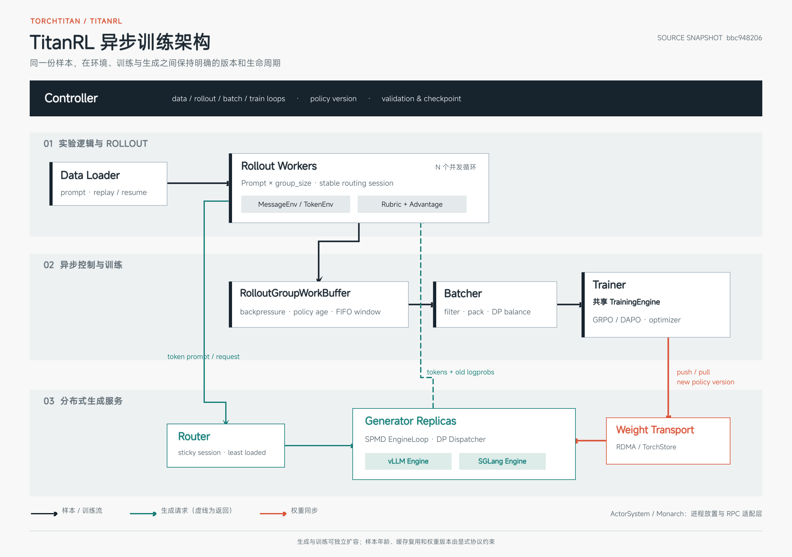

# TorchTitan RL（TitanRL）深度调研

> 调研对象：`pytorch/torchtitan` 的 `torchtitan/rl` 子系统及其 recipes、测试与历史提交。  
> 源码快照：`main` 分支 `bbc948206`，最新提交日期为 2026-11-20。  
> 方法：静态源码阅读、`git log --first-parent`、历史版本 README、GitHub PR 描述交叉核验。  
> 边界：本文没有重新运行 GPU 训练或完整测试；文中性能与训练效果若来自 PR，会明确标为“作者报告”，不视为本地复测结果。

## 一、先给结论

TitanRL 不是一个只附在 TorchTitan 后面的 GRPO 示例，而是一套围绕 **可验证的大模型强化学习** 建设的异步训练系统。它最有辨识度的地方，不是又实现了一遍 PPO/GRPO，而是把下面几件通常彼此割裂的事情放进了同一个工程：

1. **训练与生成共用 TorchTitan 模型定义。** 注意力模块会按角色适配，但模型主体、底层 kernel、并行与训练组件尽量复用，降低“训练模型”和“推理模型”各自演进后产生隐性偏差的风险。项目把这一点与 batch invariance、贯穿预训练到后训练的一条技术栈并列为三项主要优势。[README](https://github.com/pytorch/torchtitan/blob/bbc948206/torchtitan/rl/README.md#L3)
2. **把数值一致性当作系统功能，而非事后调试技巧。** 在支持的配置下，batch-invariant 模式追求不同 batch 组成、不同 DP 布局乃至 trainer/generator 之间的位级 logprob 一致性，用来隔离真正的算法或实现错误。
3. **异步不是简单地“多发几个请求”。** Controller 用有界 work buffer 显式控制样本的政策年龄；Windowed FIFO 在“不让 trainer 空等慢样本”和“不允许样本无限变旧”之间给出可调节的折中。
4. **训练与生成可以独立扩容。** Trainer、generator replicas、rollout workers 与 router 分离；权重发布和生成调度是核心协议，而不是某个 example 的临时胶水。
5. **2026 年 9 月的“毕业”关键不是目录改名。** 真正变化是抽取并复用核心 `TrainingEngine`，让 RL 不再维护一份会逐渐腐化的平行训练栈，同时把 Monarch 从领域对象中剥离成可替换的执行适配层。
6. **examples 是一张能力演进地图。** 它们依次覆盖：低成本多轮环境、真实数学 RL、检索工具闭环、外部 agent 环境生态、图像 RL、超大 MoE 的 LoRA RL。每个案例都在逼出一项基础能力，而不只是展示一个数据集。

一句话概括：**TitanRL 的核心命题是“让新模型、新 kernel 和新 RL 环境能在同一条可验证、可扩展的训练—生成链路上快速试验”。**

---

## 二、它要解决什么问题

### 2.1 RL 后训练把训练与推理耦合成了一个系统

普通 SFT 主要是“数据 → forward/backward → optimizer”。可验证 RL 则多了一个在线闭环：

```text
当前策略生成回答
  → 环境推进、工具调用或任务交互
  → 奖励计算与同 prompt 多采样比较
  → 构造 advantage 和训练样本
  → 更新策略
  → 把新权重送回生成器
  → 继续生成
```

因此，错误可能来自任何交界处：

- 训练与推理使用了不同的模型实现、RoPE、tokenizer 或 attention kernel；
- 同一个 token 在生成和训练重算时得到不同 logprob；
- 多轮环境把检索文本或工具输出误算进 policy loss；
- generator 已更新权重，但 KV cache 仍来自旧策略；
- 异步流水线让样本过旧，或者为等待慢 rollout 让昂贵 GPU 空转；
- trainer 与 generator 的并行切分不同，权重同步需要重新分片；
- 奖励进程、环境进程或外部 agent 框架泄漏进核心训练依赖。

TitanRL 的模块边界基本就是围绕这些失败模式建立的。

### 2.2 为什么落在 TorchTitan，而不是独立再做一套

TorchTitan 已提供模型定义、分布式并行、混合精度、checkpoint、profiler、CUDA graph、activation remat、MoE 等训练基础。如果 RL 复制一份 trainer，短期更自由，长期却要为每项核心能力维护第二份适配。

当前架构因此选择了另一条路：**RL 负责 rollout、奖励、advantage、异步调度、生成服务与权重发布；实际分布式训练由核心 `TrainingEngine` 承担。** 当前 README 也明确说核心与 RL 各有 workflow-specific `Trainer`，但两者共同组合 `TrainingEngine`。[README](https://github.com/pytorch/torchtitan/blob/bbc948206/torchtitan/rl/README.md#L64)

---

## 三、历史演进：从位级确定性实验到正式子系统

### 3.1 时间线

| 时间 | 事件 | 技术意义 |
|---|---|---|
| 2025-11-07 | 首个主线 RL 实验进入 `torchtitan/experiments/deterministic_vllm_rl`，commit `35bffe989`。[PR #1975](https://github.com/pytorch/torchtitan/pull/1975) | 一次加入 15 个文件、约 3,368 行，包含确定性前后向、vLLM 兼容 Qwen3、自定义 FlashAttention backward、batch-invariant 算子 backward、GRPO 风格循环和测试。最初仅单设备，训练与推理仍有权重格式转换。 |
| 2025-12-15 | 直接使用 TorchTitan 模型定义跑单卡 vLLM 推理，commit `e36d02752`。[PR #2119](https://github.com/pytorch/torchtitan/pull/2119) | 从“独立推理模型 + 转换”走向统一模型。 |
| 2025-12-22 | Monarch 多进程 trainer/generator actors，commit `4b3d25a0c`。[PR #2158](https://github.com/pytorch/torchtitan/pull/2158) | trainer 使用 DDP、generator 使用 TP，开始形成分离式 RL 系统。 |
| 2025-12-23 | `Qwen3TorchTitanForCausalLM` 同时服务训练与生成，commit `30ab580cd`。[PR #2174](https://github.com/pytorch/torchtitan/pull/2174) | 训练和推理分别替换 attention；TP=1 时可位级一致。统一模型路线基本确立。 |
| 2026-02～03 | Python dataclass 配置 registry；非共置 trainer/generator；TorchStore GPU 权重同步；删除旧 `vllm_compat` | 从单机原型转向可配置分布式系统，并清理被统一模型取代的兼容层。 |
| 2026-04～07 | 环境式 rollout/controller 重构；引入 `MessageEnv`、`Rollout`、`Rubric`、`Renderer`；continuous batching、多轮、异步 RL | 从“对一个 batch 做题”扩展为可表达工具调用与环境交互的通用 rollout 协议。 |
| 2026-07 后 | Windowed FIFO | 给异步调度增加最老样本年龄的硬上界选项，而不是只靠平均离策略程度。 |
| **2026-09-17** | `torchtitan/experiments/rl` 毕业为 `torchtitan/rl`，commit `ec953b360`。[PR #4773](https://github.com/pytorch/torchtitan/pull/4773) | 抽取共享 `TrainingEngine`；核心 trainer 与 RL trainer 去重；trainer/generator 成为不依赖 Monarch 的实体类，Monarch 仅保留薄 actor adapter。 |
| 2026-10 | 按角色重组 `controller/`、`trainer/`、`generator/`、`rollout/` 等目录；拆出独立 `GenerationEngine`；可配置 `ActorSystem` | 包结构开始直接表达依赖边界，engine 与 actor 框架均可替换。 |
| 2026-10～11 | SGLang engine；图像训练与 Geometry3K；Muse Spark 816B-A42B 的 SLAKE LoRA；RDMA microbatch、pipeline trainer、独立 validation | 从文本 dense 模型扩展到第二推理引擎、多模态和超大 MoE。 |
| 2026-11-20 | 调研快照 HEAD `bbc948206` | SGLang unified memory 等仍在快速演进，说明它还不是冻结 API 的成熟产品。 |

### 3.2 为什么 2026 年 9 月可以称为“毕业”

这次晋升至少有三层含义：

**工程复用层面。** RL trainer 不再复制核心训练初始化、forward/backward、optimizer 与 checkpoint 逻辑，而是组合 `TrainingEngine`。由此直接继承核心栈的 profiler、GC、CUDA graph、HSDP 等能力，也减少核心功能更新时 RL 被遗忘的概率。

**架构边界层面。** 领域类不再继承或 import Monarch。Monarch 是 actor system 的一种实现，而不是 Trainer、Generator、RolloutWorker 的概念基类。这使单元测试、替代执行后端和未来本地调试都更直接。

**组织信号层面。** 从 `experiments/` 移到顶级 `rl/`，表示它已成为受核心 CI、包组织与模型支持约束的一等子系统，而不是允许任意依赖和临时接口的试验角落。

PR 作者给出的迁移验证包括数值不变、H100 位级对照与测试结果；这些是 PR 自带证据，本文未在本地重跑。

### 3.3 历史主线并不是“功能越加越多”这么简单

可以看到三条反复出现的收敛过程：

- **模型统一：** 两套模型与格式转换 → 同一 TorchTitan 模型 → trainer/generator 共享更多模型路径。
- **框架解耦：** Monarch actor 承载业务 → 独立领域服务 + 薄 actor adapter → 可配置 `ActorSystem`。
- **异步可控化：** 连续生成 → 异步训练 → 有界活跃组 → Windowed FIFO → 权重 pull 与下一步计算重叠。

所以，TitanRL 的演进更像是在持续消除“原型系统中隐含的假设”，而非简单堆叠算法。

---

## 四、当前架构总图



这条链路的关键不是“异步”三个字，而是：**每个环节都可以独立运行，但样本年龄、权重版本和缓存一致性仍由显式协议约束。** 当前包按 `controller/`、`trainer/`、`generator/`、`rollout/`、`routing/`、`actors/`、`observability/` 与 `examples/` 分责，领域组件不依赖 Monarch，核心 TorchTitan 也不应获得 RL 专用可选依赖。[README](https://github.com/pytorch/torchtitan/blob/bbc948206/torchtitan/rl/README.md#L73)

---

## 五、逐模块剖析

## 5.1 `train.py`：极薄入口

入口只负责加载一个 `Controller.Config`，然后执行：

```text
build → setup_async() → run() → close()
```

这意味着实验定义不是另一套 CLI 参数树，而是可组合的 Python dataclass 配置；真正的生命周期属于 Controller。Monarch 是默认 actor system，但入口并不直接编排 Monarch 对象。

**设计价值：** 新实验主要替换 dataset、environment、rubric、rollouter 和 recipe，而不是 fork 主循环。

## 5.2 `controller/`：异步数据流与政策版本的中枢

### 主要循环

Controller 顶部描述的主链路为：

```text
_data_input_loop
  → _rollout_loop[N]
  → _batcher_loop
  → training_batch_queue
  → _trainer_loop
```

`RolloutGroupWorkBuffer` 在 rollout 与 batcher 之间提供背压。独立 loop 让生成、打包、训练可以并行推进；但活跃组数量和权重同步顺序仍由 Controller 统一管理。

### 活跃槽位与离策略程度

设：

- `P = num_prompts_per_train_step`；
- `S = target_offpolicy_steps`；
- 活跃 prompt group 数 `B = (S + 1) × P`。

`S=0` 对应同步执行；`S>0` 允许 trainer 在生成后续组时先训练已完成组。平均政策年龄大致由 buffer 深度决定，但默认 greedy consumption **没有最大年龄保证**：慢组可以无限落后，系统只记录并警告超过目标年龄的样本，不会擅自丢弃。

### Windowed FIFO

`windowed_fifo_batches=n` 时，窗口以 buffer 中最老组为锚点，只允许有限数量的年轻组绕过它。最大离策略上界为：

```text
S + n
```

`n=1` 近似按 batch 的 FIFO；`None` 则不设上限。这个设计避免三种极端：为慢组完全停等、直接丢弃慢组造成浪费与选择偏差、为了少量 straggler 把所有样本都放旧。[WINDOWED_FIFO](https://github.com/pytorch/torchtitan/blob/bbc948206/torchtitan/rl/controller/WINDOWED_FIFO.md#L21)

### Work buffer 的槽位释放为何重要

entry 生命周期是：

```text
WAITING → CLAIMED → FINALIZED
```

但取出 `FINALIZED` 组并不会立即释放活跃槽位；只有训练完成、对应 generator 权重 pull 完成，或该组被过滤后才释放。否则，新样本可能在 generator 尚未装入刚训练策略时被放行，造成“刚出生就已经过旧”。

### 权重同步时序

当前顺序可以概括为：

1. 等待上一轮 generator pull 完成；
2. 完成本轮 trainer push；
3. 后台启动 generator pull；
4. 让 pull 与下一步 forward/backward 重叠；
5. 下一次 push 前，必须确认上一轮 pull 已完成。

因此 trainer 只需一套 staging buffer，又不会让 generator 读取到被下一步覆盖的权重。

**Controller 的本质：** 它不是普通 job launcher，而是样本年龄、buffer 生命周期和权重版本协议的所有者。

## 5.3 `rollout/`：从消息环境到可训练 rollout

### `types.py`：核心数据契约

主要类型链路为：

```text
Prompt → Completion → RolloutTurn → Rollout → RolloutGroup
```

一个 `RolloutGroup` 是同一 prompt 的多个 sibling samples，用于组内基线。多轮交互不为每轮复制完整历史，而是保存“共享前缀 + 本轮 delta”；每 token 字段使用 NumPy，降低序列化与 Python GC 成本。

`GenerateFn` 是环境获取生成能力的抽象，使 MessageEnv 不必知道 actor、router、replica 或具体 engine。

### `message_env.py` 与 `token_env.py`：把用户接口和 token 细节分开

用户实现消息级的：

- `init()`：如何构造初始 prompt；
- `step(completion_message)`：如何根据模型响应推进环境、注入工具结果或终止。

`TokenEnv` 则负责 renderer、token 编解码、解析错误、超时、最大 token 数与最大轮数等横切逻辑。这样，AlphabetSort 与 Search-R1 可以共享 token 层规则，却有完全不同的环境行为。

### `rollouter.py`：同 prompt 多采样与会话亲和

`MessageEnvRolloutWorker` 为一个 prompt 创建多个 sibling env，并发执行 rollout，随后统一评分和计算 advantage。每条多轮 rollout 使用稳定 session key，让后续轮尽量回到同一 generator，以复用前缀 KV。

`Rollouter` 组合训练/验证数据、worker 与录制逻辑；只有真正改变协议时才需要子类化。例如 Verifiers 不使用原生 MessageEnv 流程，因此拥有自定义 rollouter/worker。

### `rubric.py`：奖励不是单个函数，而是可组合评分管线

多个 `RewardFn` 可并行执行，再按权重归一化求和；支持解析/执行错误的 `error_reward` 与截断惩罚。多奖励设计使“答案正确”“确实调用检索”“格式合规”等信号可以分别记录、加权与调试。

### `advantage.py`：默认更接近 Dr.GRPO

默认组内 advantage 为：

```text
A_i = r_i - mean(r_1 ... r_G)
```

只有开启 `should_std_normalize` 才再除以组内标准差，即更标准的 GRPO 形式。默认丢弃零奖励方差组，因为此时所有 advantage 都为零，不会贡献策略梯度，却消耗训练计算。

### `data.py`：数据 checkpoint 与训练事务对齐

loader 用全局 ID、pending/replay 集合跟踪样本。只有对应 optimizer step 已进入 checkpoint 事务边界后，才 commit prompt；崩溃恢复时，未完成训练的数据可以重放，而不是因为“已经生成过”被错误跳过。

### `recorder.py`

`RolloutSampleRecorder` 把选中的训练/验证 rollout 写入 JSONL，用于查看模型实际输出、工具交互、奖励分解和截断，而不只是看平均 reward。

## 5.4 `trainer/training_sample_builder.py`：多轮历史如何变成 loss

这一步远比“拼接消息”复杂：

- 连续历史尽量合成一个训练样本；
- 只对 assistant completion token 计算 loss，环境注入内容被 mask；
- 历史被压缩、thinking 被移除或重分词破坏前缀时，不能假设旧 logprob 与新训练前缀完全一致，于是切成多个训练分支；
- 过滤没有有效 loss token 的样本；
- 可丢弃零奖励方差组。

**它的重要性：** 多轮 agent RL 的正确性往往不在 loss 公式，而在这里——究竟哪些 token 是 policy 产生的、在什么前缀下产生、训练时能否重建同一前缀。

## 5.5 `trainer/batcher.py`：按 prompt group 组织训练，而非简单数样本

一个 optimizer step 由足够多可训练 prompt groups 触发，而不是任意凑够 N 条样本。输出是：

```text
[pipeline group][microbatch][DP rank]
```

内部使用 flat-token packing，并按估计的 attention 成本做 LPT/DP 均衡，避免按“样本条数”平均却造成 token 与注意力计算严重不均。大 tensor 可选 RDMA 留在 batcher 侧；trainer 通过预读隐藏下一批传输与预处理成本。

多模态后，batcher 还负责图像去重、图像 embedding 行索引和可选 M-RoPE 位置构造；详见 Geometry3K 案例。

## 5.6 `trainer/trainer.py`：RL 特有逻辑很薄，核心训练复用很重

RL `Trainer` 负责：

- RL 指标；
- rollout/controller 相关恢复状态；
- 训练后的模型权重发布；
- LoRA 时选择只发布 adapter 和必要 buffer。

实际模型初始化、分布式执行、forward/backward、optimizer、checkpoint、profiling 等由共享 `TrainingEngine` 完成。

LoRA 路径中，generator 自己从同一 HF checkpoint 装载冻结 base，trainer 只同步 adapter；这避免了每次策略更新都传输整个大模型。

## 5.7 `trainer/losses/`：GRPO 与 DAPO

### 策略比率与裁剪

基本比率为：

```text
ratio = exp(clamp(new_logprob - old_logprob, -10, 10))
```

裁剪前的 log-ratio 截断用于避免极端指数放大。DAPO 支持独立上下裁剪界，典型为 `0.2 / 0.28`，即 clip-higher 给正向优势更多向上探索空间。GRPO 在实现上可视为 DAPO 对称 clip 的特例。

### 当前实现还处理了几个现实问题

- 采样温度校正，使 old logprob 与实际采样分布一致；
- 过滤 generator 产生的非有限 logprob；
- 全局有效 token 归一化，避免不同 DP/microbatch 的 mask 数量改变梯度尺度；
- 输出 logprob parity、clip fraction、entropy 等诊断指标。

**值得注意：** “用了 GRPO”并不自动说明训练正确；old/new logprob 是否同分布、mask 是否准确、采样温度是否一致，往往比公式本身更影响结果。

## 5.8 `generator/`：不是 vLLM 的简单包装

### 服务层与 SPMD 循环

- `Generator` 管理服务endpoint、生成请求和权重预取；
- 专用线程中的 `EngineLoop` 让同一 generator 的所有 rank 按完全相同顺序执行 SPMD 操作；
- `RequestDispatcher` 管理 generator 内部 DP rank 的请求分发和结果汇聚；
- `GenerationEngine` 定义可替换接口，当前有 vLLM 与 SGLang 实现。

这种分层把“请求路由”“分布式步进”“推理引擎”拆开，避免把 vLLM 的对象模型扩散到整个 RL 系统。

### Token-in / token-out

默认边界传 token 而非文本，renderer/tokenizer 在 rollout 侧统一处理。这样训练样本知道准确 token 序列，也减少不同组件重复 detokenize/retokenize 带来的前缀漂移。

`SamplingConfig` 强制 `top_p=1`，因为 trainer 会在全词表上重算 logprob；若生成时使用会截断词表的 top-p，两侧概率语义不再一致。

### KV 与策略版本

默认用 policy version 给 cache salt，跨更新保留可安全复用的缓存，同时隔离不同策略版本。batch-invariant 模式则在模型更新时强制清 KV，避免缓存差异破坏位级对照。

## 5.9 `generator/vllm/`：把 TorchTitan 模型嵌入 vLLM

这一层包含：

- 模型和 worker wrapper；
- engine/config/registry；
- multimodal wrapper；
- session KV holder；
- batch-invariant patch；
- softmax、MLA、GDN、KDA 等 attention adapters；
- engine 指标输出。

vLLM 提供 KV 管理、调度、continuous batching 等推理系统能力；TorchTitan 提供模型主体与训练侧数值路径。它不是把 HF 模型交给 vLLM，而是让 TorchTitan 模型在 vLLM 内运行。

## 5.10 `generator/sglang/`：第二引擎验证了抽象是否真实

SGLang 同样运行 TorchTitan 模型，复用其模型与 attention kernel，而由 SGLang 提供 paged KV、radix prefix cache、continuous batching、chunked prefill、priority/overlap scheduling 和 CUDA graphs。[SGLang README](https://github.com/pytorch/torchtitan/blob/bbc948206/torchtitan/rl/generator/sglang/README.md#L9)

值得关注的实现细节：

- 每个 rank 在进程内建立自己的 Scheduler，依赖各 TP scheduler 做出一致调度决策；
- 支持多轮 session KV，让下一轮复用完整历史前缀；
- 同 prompt 的 GRPO samples 先让一条完成 prefill，再放行其余 sibling，从而共享 prompt KV；
- 支持 CPU KV offload 与跨 generator 的 Mooncake Store；
- GDN/KDA 的 recurrent state 与全注意力 KV 可共享 unified memory pool；
- batch-invariant 模式仍回到 trainer 的 varlen kernel 与 `compute_logprobs`。

**限制也很重要：** 文档只确认特定 SGLang commit，并依赖私有 API；其他版本可能损坏。部分 KDA + HiCache 组合存在尚未定位的 parity 问题，不能把所有功能组合都理解为无条件稳定。

## 5.11 `routing/`：两层 look-aside 路由

路由分两级：

1. 跨 generator replicas；
2. replica 内跨 DP ranks。

默认策略是 sticky session + least-loaded：多轮会话优先保持亲和，负载过高时按 `repin_load_ratio` 允许重新绑定。Router 只返回路由决策，调用方把实际生成 payload 直接发往目标 generator，router 不经过大 payload 数据路径。

**为什么有趣：** 它同时承认“缓存局部性”和“负载均衡”都重要，而不是把请求随机 Round Robin 后让 KV 失效。

## 5.12 `actors/`：执行框架与领域服务解耦

`ActorSystem` 抽象：

- provision / spawn / stop；
- `.call`、`.call_one`、`.choose`、`.stream`、`.broadcast` 等通信操作。

当前主要实现是 Monarch。Monarch actor wrapper 应只做 endpoint 适配，不放领域行为；各 endpoint 使用 `@concurrent_endpoint`，避免普通 endpoint 阻塞 actor 内其他消息。

**意义：** 进程放置和 RPC 是一种部署选择，不应决定 Trainer、Generator 或环境代码的类层次。

## 5.13 `ModelStateDictTransport`：按已知分片规划的一次性 RDMA 读

默认 transport 使用 `torch.distributed._transport` 上的 NIXL 或 Mooncake，让 generator 对 trainer 的 staging memory 做 one-sided RDMA reads。它与 TorchStore 的差别是：trainer/generator 分片在初始化时已知，因此可以一次性规划每次读取，省掉每步 key lookup 和元数据交换。

生命周期为：

```text
初始化：报告 shard layout、注册内存、规划 reads
push：trainer 按 generator rank 重分片并写入 pinned staging buffer
pull：每个 generator rank 从相关 trainer ranks 读取自己的片段
load：从 prefetch buffer 原地装载模型
```

如果 trainer FSDP 与 generator TP 切分维度不同，tensor 交集被拆成 piece 传输；HSDP 有重复片段时，可让 generator ranks 轮询不同来源。当前 `gpu_fetch` 仍需要 TorchStore 路径。[Transport](https://github.com/pytorch/torchtitan/blob/bbc948206/torchtitan/rl/MODEL_STATE_DICT_TRANSPORT.md#L80)

## 5.14 `observability/`：四种视角回答四种问题

1. **系统时间线：** 结构化 JSONL trace + Gantt，查空闲、重叠与瓶颈；
2. **训练曲线：** rollout、controller、trainer、loss 的 typed metrics 每步归约；
3. **推理健康：** engine 指标可写 JSONL 或 OTLP；
4. **rollout 原文：** JSONL 样本记录用于看模型到底生成了什么。

核心 profiler 的 Kineto trace 与 memory snapshot 也可复用。对异步 RL 来说，这些不是附属品：没有 policy age、queue time、cache hit、截断率和实际 rollout，仅凭 reward 曲线几乎无法定位系统问题。

---

## 六、一次策略更新的端到端时序

```text
1. Loader 取出一个 prompt，分配全局 group id。
2. Rollout worker 建立 G 个 sibling env，共享 prompt、分别采样。
3. 每轮由 renderer 生成 token prompt，经 router 选择 generator/session。
4. Engine 返回 sampled tokens 与 old logprobs；环境决定继续、工具调用或终止。
5. Rubric 并行计算奖励；组内奖励生成 advantage。
6. RolloutGroup 进入 work buffer；buffer 控制活跃组数量与消费窗口。
7. TrainingSampleBuilder 重建多轮前缀、loss mask 和图像引用。
8. Batcher 过滤无效组，packing 到 pipeline/microbatch/DP 网格。
9. Trainer 重算 new logprobs，计算 GRPO/DAPO loss，更新 optimizer。
10. Trainer 发布 policy version；generator pull 与下一轮训练计算重叠。
11. 等 pull 完成后，相关活跃槽位才释放，新组开始使用对应的新策略。
```

这个时序揭示了 TitanRL 的一项基本立场：**吞吐优化可以重叠，正确性边界不能模糊。**

---

## 七、特色一：统一模型与位级一致性究竟解决什么

### 7.1 为什么 logprob 会不一致

generator 可能在 8 条 completion 的 batch 中计算 old logprob，trainer 经过 DP 与 packing 后在另一种 batch 组成中重算 new logprob。GEMM、softmax、reduction、attention split-k 和 NCCL reduction 的顺序都可能变化，产生微小差异；MoE 中微小 logit 漂移甚至可能翻转 top-k routing。[Bitwise parity](https://github.com/pytorch/torchtitan/blob/bbc948206/torchtitan/rl/BITWISE_PARITY.md#L9)

### 7.2 对应措施

- `mm/addmm/log_softmax/mean` 换成固定迭代顺序的 batch-invariant kernels；
- FA3 强制 `num_splits=1`；
- NCCL all-reduce 固定单 channel tree；
- 关闭 TF32 与 reduced-precision reductions；
- generator 的 attention 回到 trainer 对应 kernel；
- logprob 使用 trainer 的 `compute_logprobs`，而非 vLLM fused sampler 的另一套实现；
- trainer 保留 fp32 master weights，但 FSDP 在 forward 前统一 cast 到 bf16，与 generator 计算精度对齐。

### 7.3 不是免费午餐

当前位级 parity 要求 trainer/generator 使用相同 TP，且不支持 sequence parallelism。项目文档给出的一组 Search-R1 H100 结果中，batch-invariant 模式让 generator 每 token 延迟和 trainer forward/backward 原始计算慢约 2.4～2.9 倍，但该 workload 被检索、编排与同步等待主导，端到端 step 时间几乎不变；计算密集型任务则可能直接暴露这部分成本。

因此它最适合两种用途：

- **正确性调试：** 把 logprob diff 和 KL 压到零，排除数值噪声；
- **受控 on-policy 研究：** 在严格一致的对照条件下研究算法，而不是把系统噪声误当算法现象。

---

## 八、Examples：为什么引入，以及各自有趣在哪里

当前主线 `torchtitan/rl/examples/` 有六组：`alphabet_sort`、`dapo_math`、`search_r1`、`geometry3k`、`slake`、`verifiers`。其中 Verifiers 下再分 `dapo_math` 与 `terminal_bench`。不应把仅出现在非主线历史材料中的案例混入当前清单。

## 8.1 AlphabetSort：最小成本暴露多轮、格式与稠密奖励问题

**引入背景。** 2026-06-10 合入的 PR #3582 引入它，并删除更早的 SumDigits。原因很直接：Qwen 在 SumDigits 训练前已能拿到 100% accuracy，无法提供学习信号；AlphabetSort 从 arXiv 作者名生成任务，模型看到的是 token 而非字符，排序并非天然简单，且奖励从低到高有连续变化。[PR #3582](https://github.com/pytorch/torchtitan/pull/3582)

**任务形式。** 给定若干 `FirstLast` 名字，按名或姓排序，并输出指定 XML 块。多轮版本下一轮新增名字，要求对全集重新排序，因此环境必须保存并推进状态。

**奖励设计。** 不是只有全对/全错，而是对 XML 块和目标序列做 `difflib` 相似度，再取四次方，并按预期轮数平均。四次方让接近正确答案有信号，同时明显压低“只完成一部分”的收益。

**为什么有趣。**

- 无需外部工具和大规模数据，便可 smoke test 整条 RL 链路；
- 同一任务可切换单轮/多轮，适合验证 history、loss mask、session 与 reward；
- 稠密部分奖励比纯 EM 更适合观察系统是否真的能学习；
- 它也是 SGLang、batch-invariant 等基础配置的常用验证 workload。

## 8.2 DAPO Math：从玩具任务走向可复现的参考 RL recipe

**引入背景。** 2026-07-21 的 PR #3951 加入单节点 Qwen3-4B-Base 数学训练，目标是把基础设施放到真实、可验证且有公开比较价值的数学 workload 上。[PR #3951](https://github.com/pytorch/torchtitan/pull/3951)

**实现。**

- 训练：filtered DAPO-Math-17k；
- 验证：AIME 2025 的 30 题；
- 奖励：Math-Verify 比较数学答案，而非字符串完全相等；
- 算法：DAPO 非对称 clip `[0.2, 0.28]`，默认 Dr.GRPO 均值基线；
- 参考拓扑：8 GPU，2 卡 trainer + 6 个单卡 generator。

Math-Verify 在独立进程池运行，默认每 worker 4 个评分进程，并为单答案设置 60 秒超时，避免复杂等价判断阻塞 rollout worker。

**为什么有趣。**

- 数学答案提供低人工成本的程序化 reward；
- 长响应会同时考验 packing、全局 token 归一化、截断、吞吐与梯度稳定；
- 它是其他集成的“对照组”：Verifiers DAPO Math 尽量保持 recipe 不变，只替换 rollout path。

**限制。** 当前 README 明确 32K response 配置未 benchmark，参考结果仍有 TODO；不能把配置存在理解为所有变体都已完成系统验证。

## 8.3 Search-R1：工具使用迫使系统真正支持多轮 agent

**引入背景。** 2026-06-16 合入的 PR #3602 指出，当时 controller 只支持单轮，而 Search-R1 天然需要“模型发搜索请求 → 环境返回检索内容 → 模型继续”的多轮闭环。因此这个案例同时推动了 multi-turn controller、环境 token loss mask、stop strings、固定验证集等基础设施。[PR #3602](https://github.com/pytorch/torchtitan/pull/3602)

**实现。**

- 数据：Natural Questions / HotpotQA；
- 工具：外部 E5 + wiki-18 检索服务；
- 模型原生发出 `search` 工具调用；没有工具调用时，响应被视为最终答案；
- 默认奖励为纯 EM；
- 可选 `no_search_penalty` 与 `retrieval_score`，抑制“闭卷碰巧答对、完全不检索”的 reward hacking。

**为什么有趣。**

- 检索内容不是 policy 生成的 token，必须从 loss 中排除；
- 多轮连续批处理要求每轮只推进未完成 rollout，而不是整组同步停等；
- sticky session 能复用上一轮 prompt/completion 的 KV，显著影响长历史成本；
- 奖励只看最终 EM 可能鼓励绕过工具，说明“结果正确”不等于“行为符合目标”。

**历史结果的正确读法。** 当前 README 保留过 Qwen3-1.7B EM 约 0.05→0.41、8B 约 0.26→0.45 的特定旧 recipe 快照；它们不是本次调研的当前复测。最初 PR 还使用 KL-to-reference 与 clip-higher 抑制坍塌，后续主干已演进，不应把初版 recipe 与现状逐项等同。

## 8.4 Geometry3K：图像 RL 的难点不在“多传一张图”

**引入背景。** 2026-11-11 合入的 PR #5825 是一组多模态 stack 的关键一环：此前 rollout 与 generator 已能携带图像，但 trainer 只有 placeholder tokens，没有图像，Controller 会拒绝 `vision_processor`。这个 PR 打通真正的图像训练，并以 Geometry3K 作为可验证任务。[PR #5825](https://github.com/pytorch/torchtitan/pull/5825)

**案例实现。**

- 数据：Geometry3K，2,101 train / 300 validation / 601 test；题面 `<image>` marker 与图像文件按顺序对应；
- 环境：单轮几何题，要求逐步思考并把答案放进 `\boxed{}`；
- 奖励：复用 DAPO Math 的 Math-Verify；
- 模型：Qwen3.5-0.8B，4 GPU，trainer FSDP=2 + 2 个 TP=1 generators；
- 图像 token 使用 M-RoPE，batcher 必须生成与 generator 一致的 3D 位置。[geometry3k](https://github.com/pytorch/torchtitan/blob/bbc948206/torchtitan_recipes/rl/geometry3k.py)

**底层设计亮点。**

1. **传输文件而非 pixel values。** PR 给出的量级是每图约 15 KB 文件对约 2.4 MB 预处理后像素；trainer 在本地 preprocess，RDMA 时还可在 read-ahead 线程隐藏。
2. **按图像去重。** 同组 samples 共享同一题图，不应为每条 sample 重跑一次 vision encoder。Packing 会优先把含相同图像的样本放进已有该图的 microbatch。
3. **显式 embedding 行映射。** 不能靠扫描 placeholder token 推断图像，因为 policy 也可能在 completion 中采样出 placeholder id。
4. **M-RoPE 一致性成为配置约束。** 若 generator 用 3D 位置而 trainer 用 1D，即使图像和 token 都正确，训练仍然错位。
5. **多轮图像也服从 delta 协议。** 历史图像与 token 一样重建；图像被原地替换时必须切分训练分支。

**作者报告与限制。** PR 报告 4×A100 上 30 步验证 reward 0.285→0.358，并附 CP、vision gradient 与 CPU/GPU 测试；本文未复跑。当前负载均衡主要估计 attention work，不精确计入 vision encoder work，而且图像只在单个 microbatch 内去重。

## 8.5 SLAKE：把多模态 RL 推到 816B MoE，并证明 LoRA 同步的系统价值

**引入背景。** 2026-11-13 合入的 PR #6025 将图像 RL 从 Qwen3.5 扩展到 Muse Spark。它不仅是新增数据集，还暴露了三项模型差异：Muse Spark renderer 原本拒绝图像；其图像 token 使用 1D 位置而非 M-RoPE；decoder 的 residual/final norm dtype 路径不能被 generator wrapper 复制错。[PR #6025](https://github.com/pytorch/torchtitan/pull/6025)

**案例实现。**

- 数据：英文 SLAKE 医疗 VQA，含 CT/MRI/X-ray；保留 closed/open 问题，剔除答案不依赖图像的 knowledge-graph 问题；
- 环境：图像在前，问题在后，附加“单词或短语作答”指令；
- 奖励：归一化后精确匹配，并处理医学同义词、标点、冠词和 yes/no 首词；
- 模型：Muse Spark Open 816B-A42B；
- 训练：LoRA rank 8、alpha 16，仅作用于 attention projections 与 output gate；routed experts、router 和 vision tower 冻结；
- 拓扑：32×GB300，8 卡 trainer + 3 个 8 卡 generators，trainer FSDP=8、EP=8，generator DP=2、TP=4、EP=8。[slake](https://github.com/pytorch/torchtitan/blob/bbc948206/torchtitan_recipes/rl/slake.py)

**为什么有趣。**

1. **只同步约 51 MB adapters。** Generators 自己加载同一冻结 base，避免每次策略更新搬运 816B 全模型；这是 LoRA 在在线 RL 中的系统级收益，而不仅是少占训练显存。
2. **冻结参数存储精度也影响可行性。** bf16 base 才能放进 8 卡 trainer；LoRA adapter 保留 fp32 master weights 和 AdamW state，计算使用 bf16。
3. **过滤零方差组改变调度最优解。** 大量 closed questions 同组全对而被丢弃，rollout supply 受活跃组上限约束，单纯增加 generator 不一定提速。
4. **离策略程度成为显式吞吐旋钮。** PR 报告 `target_offpolicy_steps=3` 时约 36 秒/step、trainer 经常等待；设为 7 时约 24 秒/step、trainer 几乎不等待，但平均政策年龄从约 1.4 增至 4。
5. **真实引擎边界问题。** GRPO siblings 的图像 prefix-cache 命中与请求 preemption 组合曾触发 vLLM encoder cache miss；该案例推动了对应 generator 修复。

**限制。** 这些是高度硬件相关的作者测量；长期训练中更旧样本是否损害学习，PR 明确说尚未测量。默认 7 是吞吐选择，不是普适算法最优值。

## 8.6 Verifiers bridge：复用外部环境生态，而不是把环境生态搬进核心

**引入背景。** 2026-09-09 的 PR #4356 加入可选 Verifiers 集成，目标是让 TitanRL 继续控制样本分组、调度、路由、policy version、advantage 和训练，而由 Verifiers 负责 env/agent/runtime/reward。所有 Verifiers 适配代码留在 example 内，核心 RL 不获得该依赖。[PR #4356](https://github.com/pytorch/torchtitan/pull/4356)

**桥接方式。**

```text
TitanRL VerifiersRolloutWorker
  ├─ GenerationServer：把 agent chat 请求转为 token IDs，送入 TitanRL generator
  └─ Env server：经 ZMQ/msgpack 与 Verifiers 环境/agent runtime 通信
```

Verifiers 不直接接管模型采样服务，也不绕过 TitanRL 的 rollout group 和训练样本协议。

### 子案例 A：Verifiers DAPO Math

保持原生 DAPO Math 数据与训练 recipe，只替换 rollout path，使用 null harness + local subprocess，不暴露工具。它相当于桥接层的最小 A/B 对照：如果 reward、响应长度、loss、step time 与原生路径相近，说明差异主要来自环境执行而非训练语义变化。

PR 作者用 4×H100 做过 100 步对照，整体训练指标接近；这属于作者报告。**local subprocess 只适用于受信任任务，不是不可信代码的安全沙箱。**

### 子案例 B：Terminal-Bench

2026-10-09 合入的 PR #4942 把桥接层推进到真正的长程终端 agent：TMax 训练、89 个 Terminal-Bench 2.1 任务验证；Harbor Terminus-2 在 Docker 内操作 tmux，任务自己的 `tests/test.sh` 负责评分。[PR #4942](https://github.com/pytorch/torchtitan/pull/4942)

**为什么有趣。**

- rollout 不再是“一次回答”，而是最多数十轮的观察—命令—反馈循环；
- 环境有真实状态，奖励来自任务测试，不是文本相似度；
- 它检验外部 agent harness、容器生命周期、工具协议和长 history 是否能与 TitanRL 的异步训练协作；
- PR 报告 Qwen3.5-9B 100 步后在另一组 held-out 任务上的 reward 从 0.334 到 0.417，主要收益来自更多任务能在 30 轮上限内完成，而非已完成任务的准确率显著变化。

**限制。** 9B/35B-A3B 配置都需 16 GPU；35B-A3B 明确没有端到端运行。Docker 是该实验的隔离机制，但不能把本地 Docker 配置描述成通用安全边界。结果还受任务/镜像版本、agent 所在位置、评估采样方式等影响。

---

## 九、把 examples 连起来看：它们是一张能力矩阵

| 案例 | 主要逼出的能力 | 最关键的正确性问题 | 规模/系统亮点 |
|---|---|---|---|
| AlphabetSort | 多轮、格式、稠密 reward、基础 smoke test | 状态推进与输出解析 | 低成本、可重复、适合 engine/parity 回归 |
| Search-R1 | 检索工具、多轮连续批处理、sticky KV | 工具 token 不进 loss；避免不检索的 reward hacking | 外部检索服务与长历史缓存 |
| DAPO Math | 真实可验证数学、长输出、DAPO | 数学等价评分、温度/logprob/token 归一化 | 独立扩容的多 generator 参考 recipe |
| Verifiers DAPO Math | 外部 env 框架桥接 | 换 rollout path 不改变训练语义 | 最小 A/B 对照、核心无可选依赖泄漏 |
| Terminal-Bench | 长程 agent、容器环境、真实测试 reward | agent/tool 协议、环境状态、任务完成判定 | Docker + Harbor + Terminus-2 |
| Geometry3K | 图像 prompt、vision training、M-RoPE | 图像—placeholder—位置编码一一对应 | 文件传输、图像去重、read-ahead preprocess |
| SLAKE | 另一多模态架构、超大 MoE、LoRA RL | 1D/M-RoPE 差异、冻结 base 与 adapter 一致性 | 816B-A42B、32×GB300、约 51 MB 权重同步 |

这条顺序很能说明项目的开发方式：**先找一个能暴露缺失能力的最小任务，再把任务需要的一般机制沉淀进框架。**

---

## 十、总体评价：最重要的设计主线

### 10.1 正确性不是单个测试，而是一组架构约束

统一模型、token-in/token-out、明确 loss mask、policy-version cache salt、权重 pull 生命周期、batch-invariant kernels、trainer/generator logprob diff 指标共同构成正确性体系。任何一项单独存在都不够。

### 10.2 把“离策略”从隐患变成可观测、可调度的资源

异步 RL 不可能只问“快不快”，还要问“样本来自多旧的策略”。TitanRL 同时提供平均目标、可选最大上界、年龄指标和权重版本，使吞吐与 staleness 的交换可以被实验，而不是藏在实现细节里。

### 10.3 抽象边界由第二个真实消费者验证

- 第二个 engine（SGLang）验证 `GenerationEngine`；
- 外部环境框架（Verifiers）验证 rollout 协议；
- 第二种多模态模型（Muse Spark）验证 image prompt、位置编码和 decoder wrapper；
- LoRA + 816B MoE 验证权重发布是否真的能按角色和参数类型扩展。

这比只有接口没有第二个实现的设计更有说服力。

### 10.4 “hackable”来自复用核心，而非暴露所有内部细节

用户可以只写 dataset、MessageEnv、Rubric 和 recipe；需要新协议时才继承 rollouter/worker；需要新模型时主要维护 TorchTitan 模型和角色适配。实验代码不必复制完整分布式 trainer，这正是毕业重构带来的长期收益。

---

## 十一、当前限制与使用时应避免的误读

1. **仍在活跃开发。** README 明确 API 和配置可能变化；历史 PR 的类名、目录和 recipe 不应直接当作当前接口。
2. **位级一致不是全配置通用。** 当前要求匹配 TP，不支持 SP；原始计算可能显著变慢。
3. **默认异步没有最大年龄。** 若需要硬上界，必须配置 Windowed FIFO；只设 `target_offpolicy_steps` 不等于限制最坏 straggler。
4. **统一模型不保证永远比原生推理快。** 项目自己说明，纯推理 workload 可能落后原生 vLLM，某些端到端 RL 配置才可能因复用与系统组合获益。
5. **SGLang 版本敏感。** 当前实现依赖私有 API并锁定已验证 commit；部分高级 cache/linear-attention 组合仍有明确限制。
6. **README 的模型支持表是项目测试声明。** 它说明代表性 debug model 完成两步端到端验证，不等于所有模型尺寸、并行组合、长训练都已覆盖。
7. **案例结果不可跨 PR 直接比较。** 数据版本、recipe、硬件、验证集、采样方式和 agent harness 都在演进。
8. **若干配置明确未完整验证。** DAPO Math 32K 未 benchmark；Terminal-Bench 35B-A3B 未端到端运行；SLAKE 更高 staleness 的长期学习影响未测量。
9. **多模态负载均衡仍不完美。** 图像只在 microbatch 内去重，rank balancing 主要按 attention 成本估计，vision encoder 成本可能造成新的偏斜。
10. **本地进程或普通 Docker 不是通用不可信代码沙箱。** 对真实不可信 agent 任务仍需专门隔离、权限与网络策略。

---

## 十二、推荐阅读顺序

如果要继续读源码，建议不要按字母顺序，而按一条数据的生命周期：

1. `torchtitan/rl/README.md`：建立模块地图；
2. `torchtitan/rl/rollout/types.py`：理解 Prompt、Turn、RolloutGroup；
3. `rollout/message_env.py`、`token_env.py`、`rollouter.py`：看交互如何产生；
4. `controller/controller.py`、`work_buffer.py`、`WINDOWED_FIFO.md`：看异步与政策年龄；
5. `trainer/training_sample_builder.py`、`batcher.py`：看 rollout 如何变成训练输入；
6. `trainer/losses/dapo.py`、`grpo.py`：看优势、ratio、mask 与归一化；
7. `trainer/trainer.py` 与核心 `training_engine.py`：看共享训练边界；
8. `generator/engine.py`、`engine_loop.py`、`dispatcher.py`：看独立生成服务；
9. `generator/vllm/` 或 `generator/sglang/`：选一个 engine 深入，不必先读全部 kernel；
10. `MODEL_STATE_DICT_TRANSPORT.md`、`BITWISE_PARITY.md`：最后理解权重传输和严格数值一致性；
11. 再按 AlphabetSort → Search-R1 → Verifiers/Terminal-Bench → Geometry3K → SLAKE 阅读 examples。

这条顺序能始终围绕一个问题：**某个 token 是在哪个政策版本、哪个环境前缀和哪套数值路径下产生的，它最后又如何影响了参数更新。**
